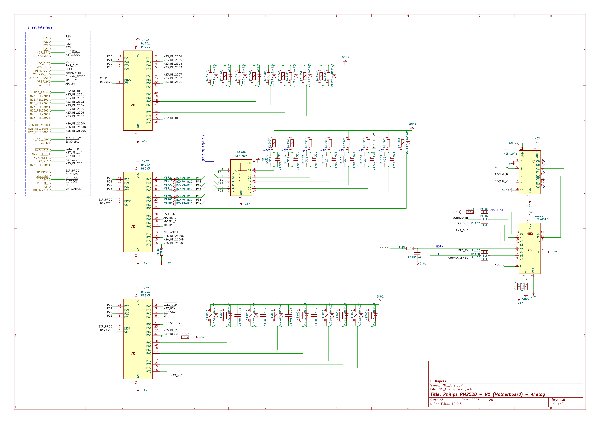
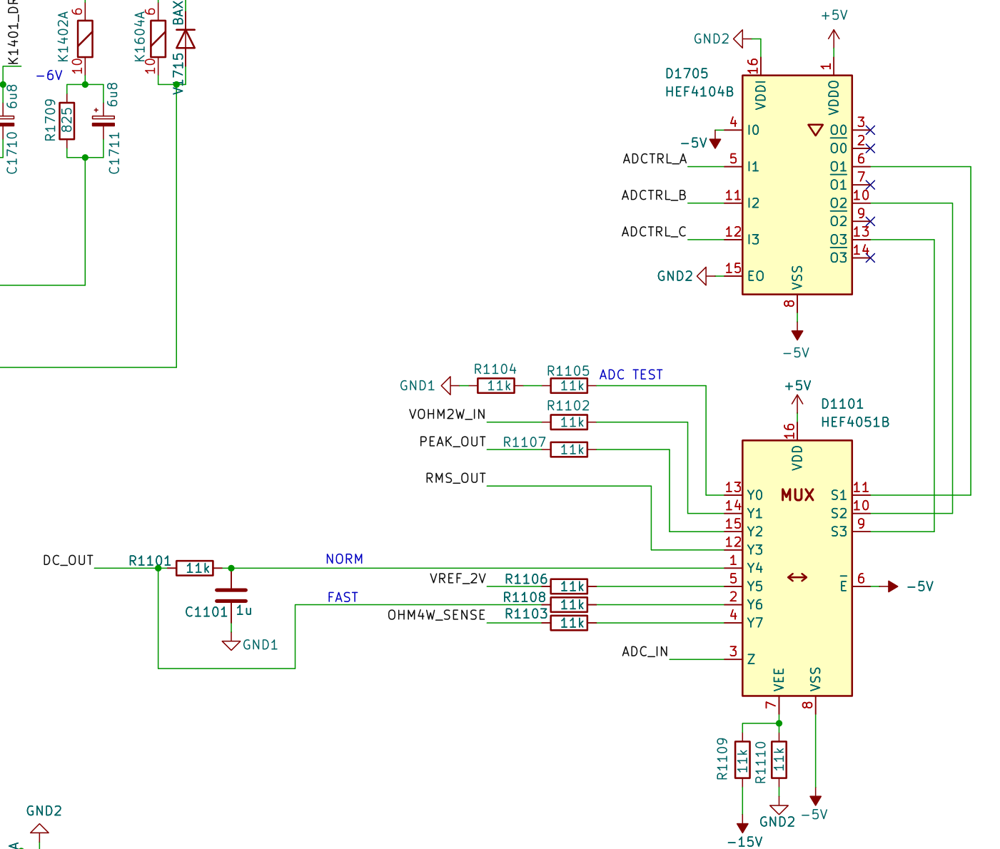

# Motherboard (N1) · Analog sheet
N1 › [Overview](README.md) · [Main sheet](MainSheet.md) · [Digital](Digital.md) · **Analog** · [Power](Power.md) · [Switching](Switching.md)

## Relay drivers
The CPU drives the relays through three 8243 I/O expanders. Each has four 4-bit ports (P4-P7):
- **D1701** drives its relays directly; a relay is on when its port bit is 0. It controls the current source N23, the current shunts and the input routing.
- **D1702** drives its relays through the ULN2003 D1704; a relay is on when its bit is 1. The zener diodes (BZX79-B10) shift the logic level for the ULN2003. Each relay coil has a series resistor with a capacitor across it: the capacitor gives the full voltage at switch-on, the resistor lowers the holding current. P6 and P7 also drive the ADC multiplexer, the external supply, `~DH_SAMPLE` and the relays on N26.
- **D1703** drives the AC feedback relays and the DC divider relays, and reads four status lines: `~DATAHOLD`, the N27 `/BSY` and `/STADC`, and the CFI latch. It also drives the N27 SEL and /RESET lines.

The full list of which bit drives which relay is on the [Firmware](/Deepdive/Firmware/Ports.md#expander-ports-8243) page. Which relay is on in which function and range is on the [Switching](Switching.md) page.

## ADC input multiplexer

D1101 (HEF4051) selects the signal that goes to the ADC (N21, `ADC_IN`). D1705 (HEF4104) shifts the select lines from the logic levels (-5 V/0 V) to the ±5 V of the multiplexer.

| Input | Signal | Used for |
| - | - | - |
| Y0 | ADC TEST (R1104/R1105) | ADC test loop (switch S1801B) |
| Y1 | Ω 2-wire, from the 0 socket via R1102 | Ω 2W |
| Y2 | N27 output (PEAK_OUT) via R1107 | Vpeak |
| Y3 | N25 output (RMS_OUT) | VAC, VDC+AC, ADC+AC, Vhf |
| Y4 NORM | N22 output (DC_OUT), filtered by R1101/C1101 | VDC; ADC in fast mode |
| Y5 | +2 V reference (VREF_2V) via R1106 | not used |
| Y6 FAST | N22 output (DC_OUT) via R1108, unfiltered | VDC in fast mode; ADC |
| Y7 | 4-wire sense (OHM4W_SENSE) via R1103 | Ω 4W, °C |

_Note: the DC current function (ADC) uses the filtered and unfiltered inputs the other way round from VDC. That might be deliberate or a firmware bug; I still need to check it on the instrument._
