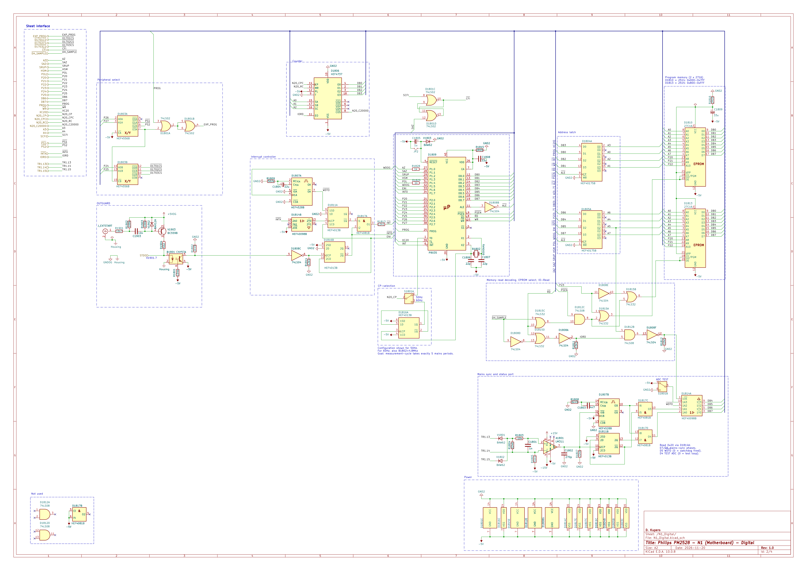
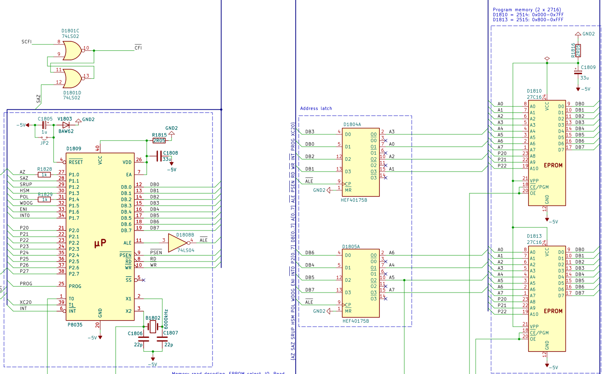
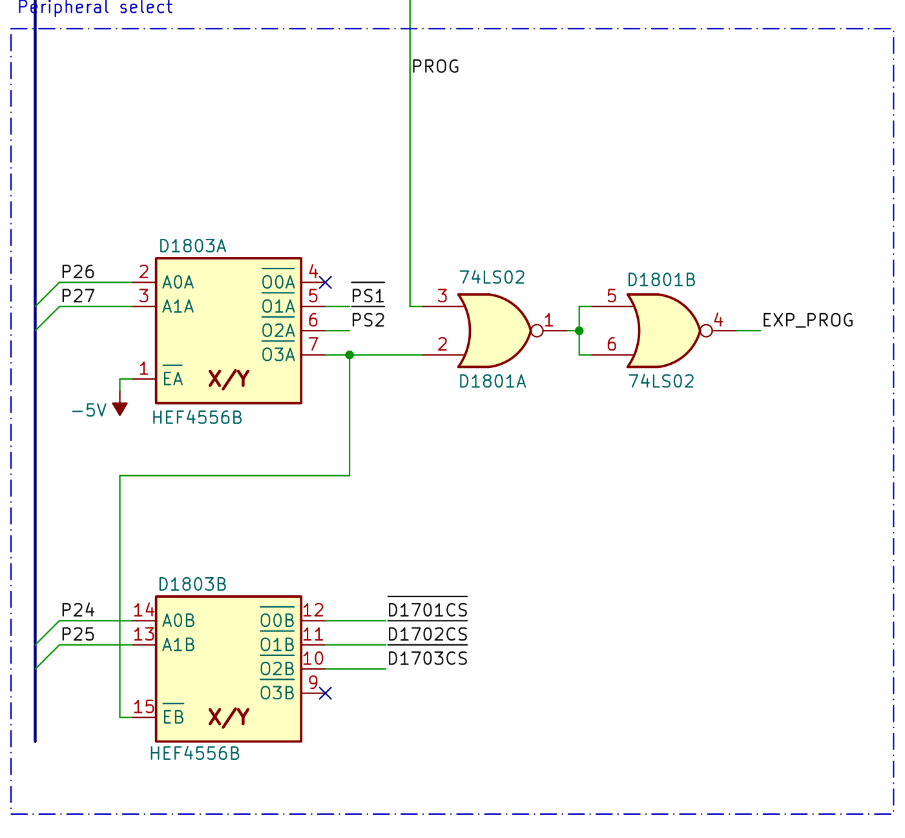
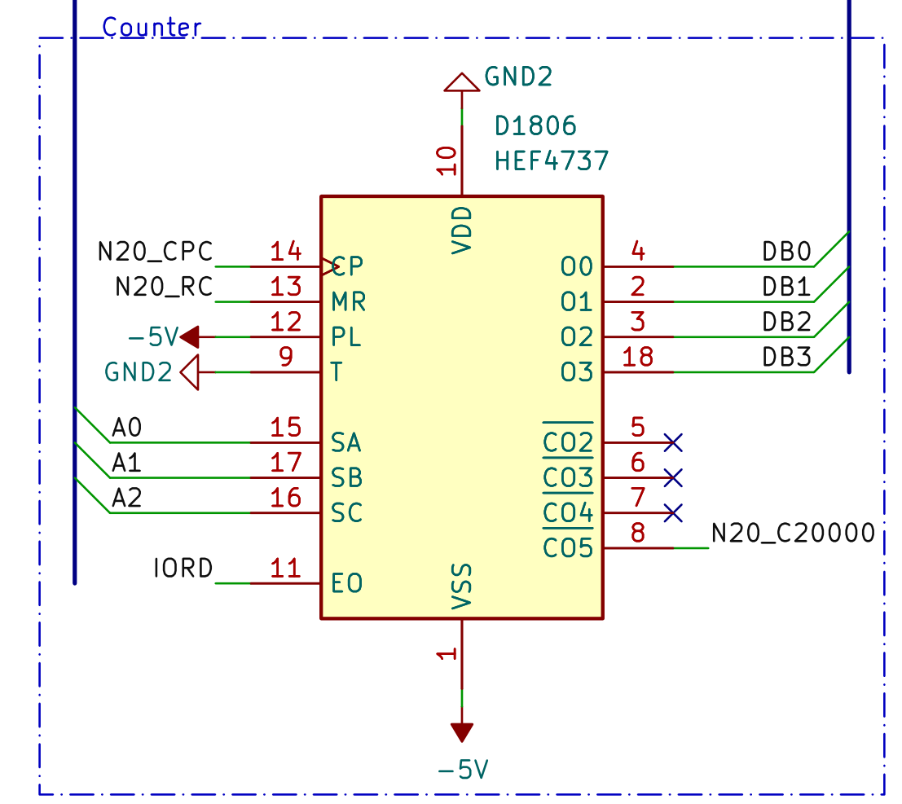
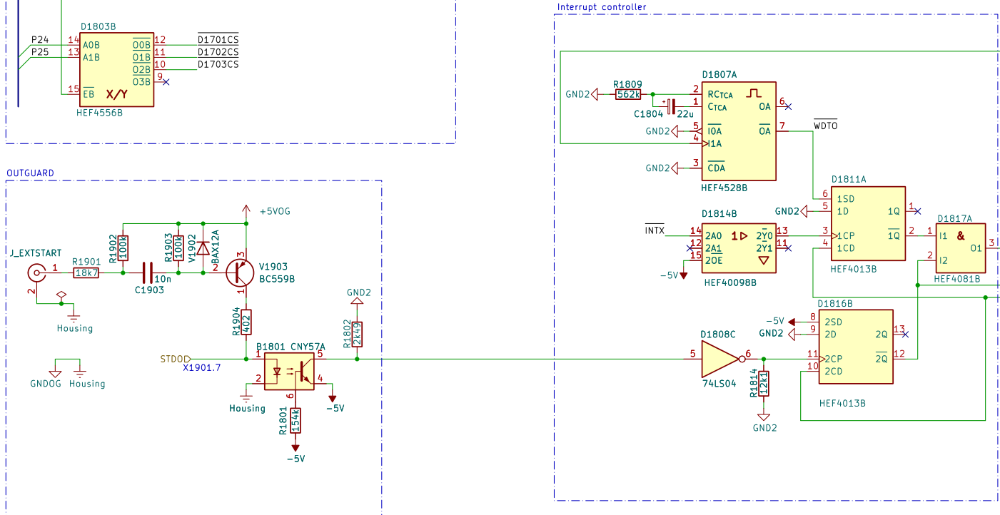
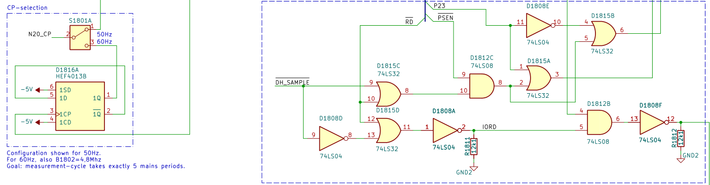
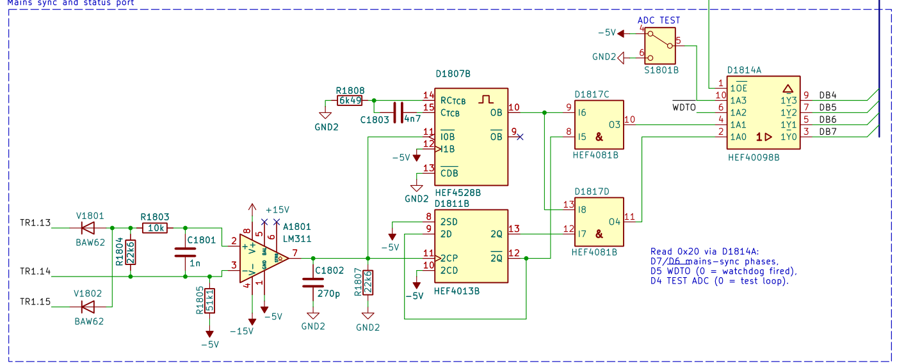

# Motherboard (N1) · Digital sheet
N1 › [Overview](README.md) · [Main sheet](MainSheet.md) · **Digital** · [Analog](Analog.md) · [Power](Power.md) · [Switching](Switching.md)

## Full schematic

## CPU and program memory

- **D1809 (P8035):** an 8048 without on-chip ROM, running at 6 MHz (2.5 µs per instruction cycle). It has 64 bytes of internal RAM and no external RAM.
- **D1810 / D1813 (2716):** the firmware, 2 × 2 KB. D1810 holds 2514.5 (0x000-0x7FF), D1813 holds 2515.6 (0x800-0xFFF). P23 acts as address line A11 and selects one of the two.
- **D1804 / D1805 (HEF40175):** the address latch. On ALE they hold the low address byte from the data bus.
- **Port 1** carries the ADC control lines (AZ, SAZ, SRUP, HSM, POL), the watchdog trigger (WDOG) and the interrupt lines (ENI, /INT0).
- **T0** outputs the 2 MHz clock (6 MHz / 3) for the ADC, **T1** counts the overflow pulses (XC20) of the ADC counter.

## Peripheral select

The upper four bits of port 2 select which I/O expander the CPU talks to. D1803A (HEF4556) decodes P26/P27 into `PS1` and `PS2` for the display unit N2, and enables the PROG strobe (`EXP_PROG`) for the motherboard. D1803B decodes P24/P25 into the chip selects of D1701, D1702 and D1703.

## Counter

D1806 (HEF4737) is a 4½-decade counter. It counts the clock pulses (CPC) that N20 lets through during the ramp-down phase, so its contents are the result of a conversion. Its overflow (C20000) goes to N20, the overflow pulses (XC20) go to T1 of the CPU. The CPU reads the digits as external memory 0x00-0x04.

## Interrupt controller and watchdog

The CPU has a single interrupt input. Three sources share it:
- **Keys:** pressing a key on N2 pulls `INTX` low.
- **External start and IEC bus:** the rear EXT START BNC (through V1903 and R1904) and the `STDO` line of the IEC board N32 or the BCD board N34 (X1901 pin 8, straight to the LED) share optocoupler B1801, so they're isolated from the measuring circuit. B1801 sets D1816B, which pulls `/INT0` (P1.7) low. The CPU checks P1.7 to see which kind of interrupt it got, and clears D1816B with a pulse on ENI (P1.6).
- **Watchdog:** D1807A (HEF4528) is a retriggerable one-shot. The firmware pulses WDOG (P1.5) every 10 ms. If the pulses stop, `~WDTO` goes low, which also causes an interrupt; the firmware sees `~WDTO` at address 0x20 and restarts itself.

D1817A (AND) combines the sources into `INT` for the CPU.

## Memory read decoding and clock selection

- **IORD** is the I/O read strobe: `RD` low and `~DH_SAMPLE` high. The counter, the status port and N30 use it.
- With `~DH_SAMPLE` low, a `MOVX` read goes to the EPROMs instead, so the CPU could read its own program as data (probably meant for a checksum). The firmware never uses this.
- **S1801A (50/60 Hz):** selects the clock for the ADC (CP). At 50 Hz it's T0 (2 MHz); at 60 Hz it's the crystal divided by two by D1816A, with a 4.8 MHz crystal. Either way the ramp-up phase takes exactly 5 mains periods, so mains hum averages out.

## Mains sync and status port

- A1801 (LM311) compares two transformer windings (TR1.13/TR1.15) and makes a square wave at mains frequency.
- D1807B (one-shot) and D1811B (flip-flop) make two phase signals, which D1817C/D turn into D7 and D6.
- The firmware waits for one of them before each conversion, so every conversion starts at the same point of the mains period. It alternates between the two phases on successive conversions.
- **D1814A (HEF40098)** puts these on the data bus when the CPU reads address 0x20, together with `~WDTO` (D5) and the ADC TEST switch S1801B (D4).

---
N1 › [Overview](README.md) · [Main sheet](MainSheet.md) · **Digital** · [Analog](Analog.md) · [Power](Power.md) · [Switching](Switching.md)
