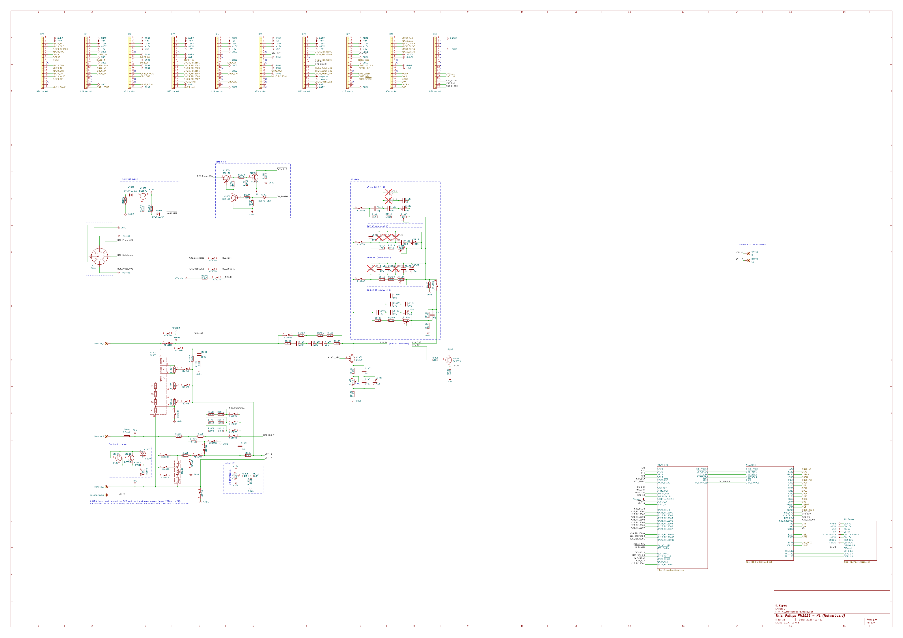
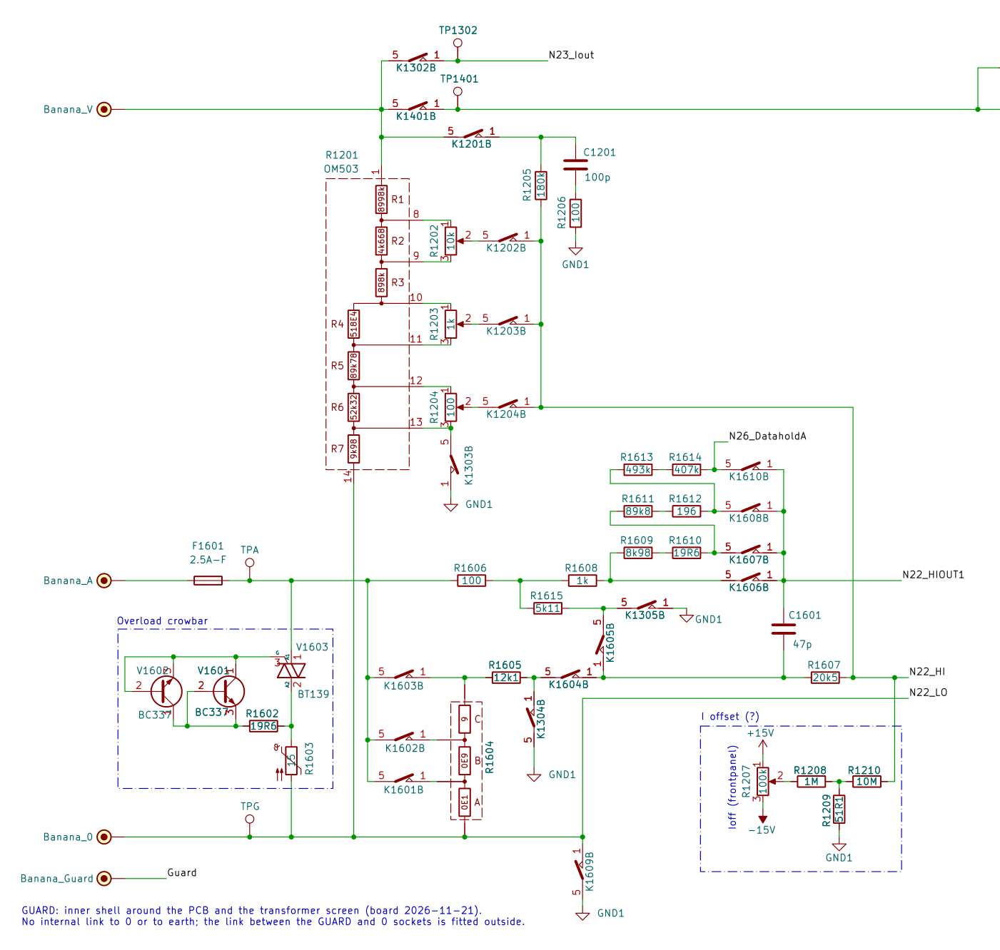
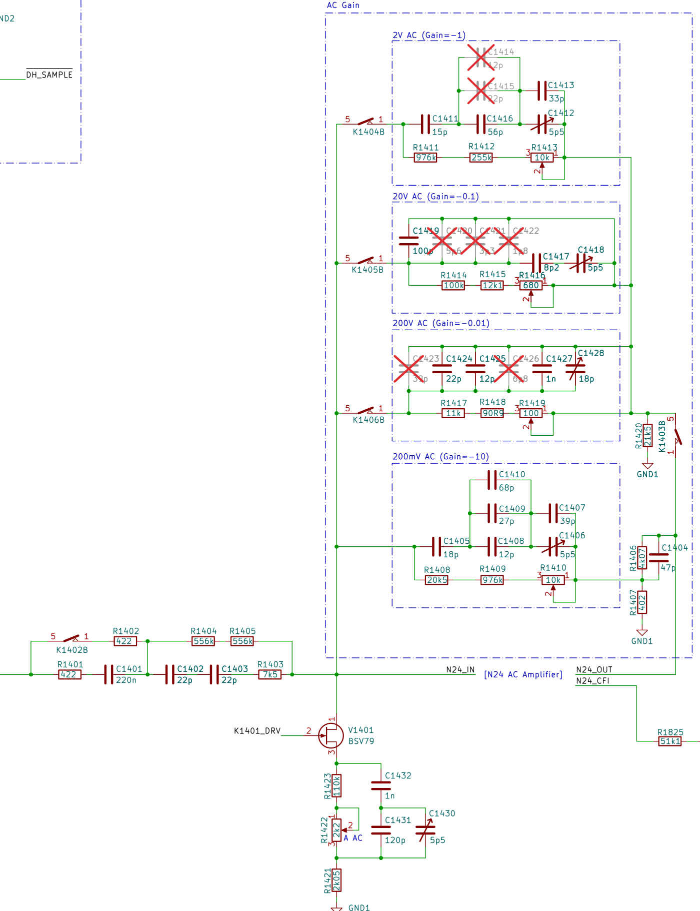
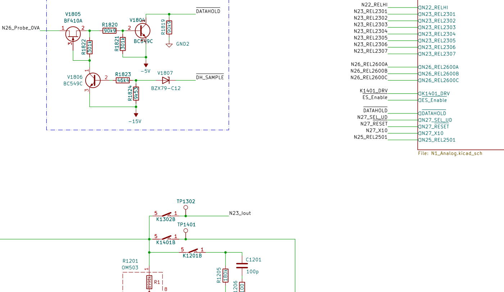

# Motherboard (N1) · Main sheet
N1 › [Overview](README.md) · **Main sheet** · [Digital](Digital.md) · [Analog](Analog.md) · [Power](Power.md) · [Switching](Switching.md)

_Note: unlike the expansion boards, I haven't drawn the N1 PCB. The schematics below are based on the Philips drawings (Fig 7.4-7.6, which are a bit hard to read), checked against the firmware, a few logic-analyser captures and beeping out the board._

## Schematics
I copied and redrew the schematics in KiCad, using the low‑res Philips docs as a reference. There might be a few small differences since I tweaked them to match my PM2528. You’ll find the KiCad files in other parts of this repo.

The motherboard is drawn on four sheets:

| Sheet | Contents |
| - | - |
| Main sheet | Card sockets, input terminals, input relays, AC amplifier networks, probe socket and data hold |
| Digital | CPU, EPROMs, decoding, counter, interrupt controller, mains sync |
| Analog | Relay drivers (the three 8243 expanders), ADC input multiplexer |
| Power | Transformer, rectifiers and regulators |

### Card sockets
Each expansion board plugs into its own 19-pin socket (X20-X27, X30, X31). The pinout of each card is described on the card's own page. Analog cards get 0 V, -5 V, -15 V, +15 V and +5 V on pins 1-5. N31 is an outguard board and gets the isolated outguard supply instead.

### Section: Input terminals

- **V/Ω input:** the high-voltage input. Relay K1401 sends it to the AC amplifier, K1201 to the DC divider.
- **Divider R1201 (OM503):** a thick-film divider network. K1202-K1204 pick the tap for the DC ranges; R1202-R1204 are the trimmers.
- **A input:** fused by F1601 (2.5 A). K1601-K1604 select the shunt taps (R1604 and the R1605-R1615 networks), so each current range gives a usable voltage.
- **Overload crowbar:** if the voltage across the shunt gets too high, V1601/V1602 fire the triac V1603. The triac shorts the A input to 0, so the fuse blows instead of the shunts burning.
- **N22_HI / N22_LO:** the signal goes from here to the DC amplifier N22.
- **GUARD:** connected to the inner shell around the PCB and the transformer screen. There's no internal link to 0 or earth; the link between the GUARD and 0 sockets is fitted on the outside.

### Section: AC amplifier networks

The AC amplifier itself sits on N24, but its input resistor and its feedback networks are on the motherboard. N24 is an inverting amplifier with an input resistance of R1404 + R1405 = 1.112 MΩ. The feedback networks set the gain, so every range gives 2 V full scale at N24's output:

| Range | Relays on | Gain |
| - | - | - |
| 200 mV | none | ×10 |
| 2 V | K1403, K1404 | ×1 |
| 20 V | K1403, K1405 | ×0.1 |
| 200 V | K1403, K1406 | ×0.01 |
| 2000 V | K1403, K1406, plus K2501 on N25 | ×0.01 |

- K1402 bridges the input capacitor C1401 (with R1402) for the VDC+AC and Vpeak high/low functions; the others are AC coupled.
- The small trimmer capacitors flatten the frequency response. On my board, a few of them have one leg lifted (noted on the schematic).
- V1401 (BSV79) connects the HF unit N26 to the amplifier input in the Vhf function. It conducts only when K1401 is off.

### Section: Probe socket, data hold and external supply

- **X2 (DIN):** the socket for the probes: the HF probe (N26), the PT100 probe and the probe with a data-hold button.
- **External supply:** V1007 supplies +Vprobe to the probe, switched by `/ES` from expander D1702.
- **Data hold:** the probe pulls line J (`N26_Probe_0VA`). When the CPU drives `~DH_SAMPLE` low, V1806/V1805 switch on and V1804 puts the data-hold state on `~DATAHOLD`, which the CPU reads through expander D1703.
- **SCFI:** V1808 turns the crest-factor flag of N24 (CFI) into a logic signal for the CFI latch on the digital sheet.
