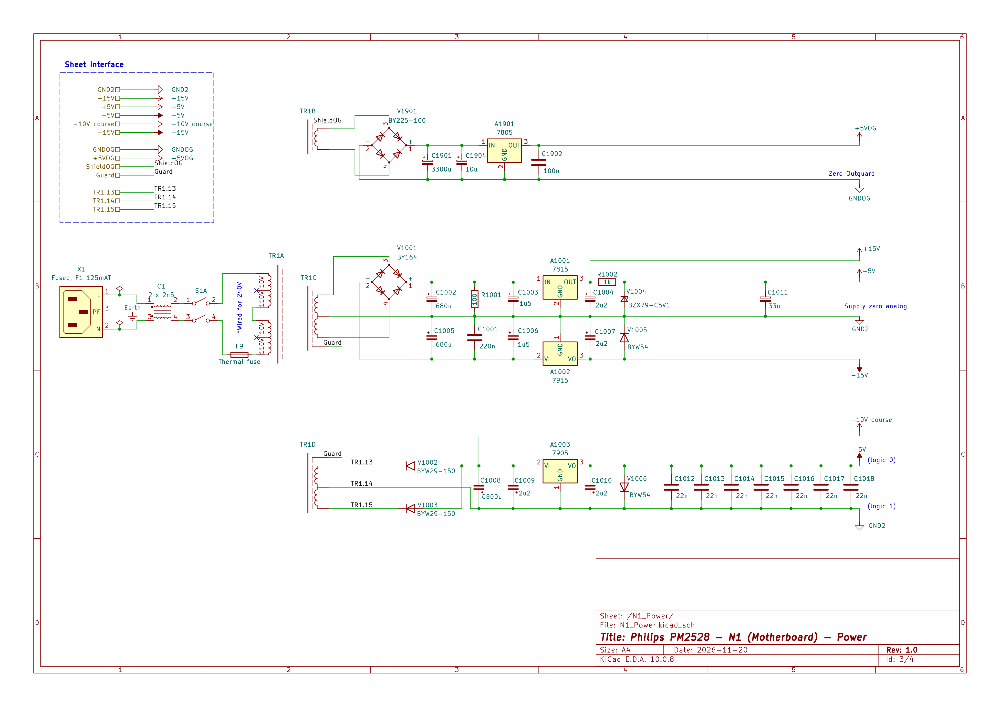

# Motherboard (N1) · Power sheet
N1 › [Overview](README.md) · [Main sheet](MainSheet.md) · [Digital](Digital.md) · [Analog](Analog.md) · **Power** · [Switching](Switching.md)

The transformer has four windings:

| Winding | Rectifier | Regulator | Rail | Use |
| - | - | - | - | - |
| TR1A | - | - | - | Primary; my unit is wired for 240 V |
| TR1B | V1901 | A1901 7805 | +5VOG / GNDOG | Outguard supply, isolated from the rest (N30, N31, IEC board) |
| TR1C | V1001 | A1001 7815, A1002 7915 | +15 V, -15 V | Analog supply |
| TR1C | V1001 | From +15 V via R1002 and zener V1004 | +5 V | Analog supply |
| TR1D | V1002, V1003 | A1003 7905 | -5 V | Logic supply (logic 0 = -5 V, logic 1 = 0 V) |
| TR1D | V1002, V1003 | - | -10 V coarse | Unregulated; N2 makes its own -5 V from it |

TR1.13-TR1.15 also feed the mains sync circuit on the digital sheet.

_Note: all logic runs between -5 V and 0 V. So on the scope, with the probe ground on 0 V, a logic "1" is 0 V and a logic "0" is -5 V._
