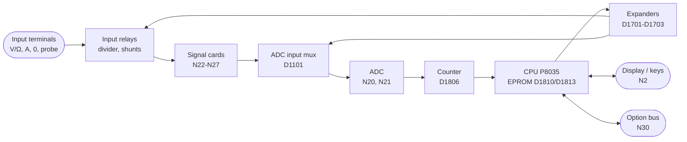

# Motherboard (N1)
N1 › **Overview** · [Main sheet](MainSheet.md) · [Digital](Digital.md) · [Analog](Analog.md) · [Power](Power.md) · [Switching](Switching.md)

The motherboard holds everything that isn't on an expansion board or the display: the power supply, the CPU, the relays that route the input signals, and the sockets for all expansion boards.

## Functions
- Power supply: all supply rails, plus a separate isolated supply for the outguard boards
- Input terminals, input divider, current shunts and overload protection
- The input and feedback networks of the AC amplifier (N24)
- The CPU (P8035), the firmware EPROMs and the decoding logic
- The ADC counter, read by the CPU after each conversion
- Three I/O expanders (8243) that drive about 50 relays and read some status lines
- The ADC input multiplexer, which selects the signal for the ADC
- Interrupts (keys, IEC bus, external start), watchdog and mains synchronisation
- Sockets X20-X31 for the expansion boards, and X1901 for the flat cable of the IEC or BCD option

## Signal flow

The firmware side of all this (port bits, addresses, internal memory) is described on the [Firmware](/Deepdive/Firmware/README.md) page.

## More about this board
- [Main sheet](MainSheet.md): card sockets, input terminals, AC amplifier networks, probe socket
- [Digital](Digital.md): CPU, EPROMs, decoding, counter, interrupts, mains sync
- [Analog](Analog.md): relay drivers and the ADC input multiplexer
- [Power](Power.md): transformer, rectifiers and regulators
- [Switching](Switching.md): which relay is on in which function and range, and the ADC multiplexer

---
N1 › **Overview** · [Main sheet](MainSheet.md) · [Digital](Digital.md) · [Analog](Analog.md) · [Power](Power.md) · [Switching](Switching.md)
