# Motherboard (N1)
The motherboard holds everything that isn't on an expansion board or the display: the power supply, the CPU, the relays that route the input signals, and the sockets for all expansion boards.

Its functions include:
- Power supply: all supply rails, plus a separate isolated supply for the outguard boards
- Input terminals, input divider, current shunts and overload protection
- The input and feedback networks of the AC amplifier (N24)
- The CPU (P8035), the firmware EPROMs and the decoding logic
- The ADC counter, read by the CPU after each conversion
- Three I/O expanders (8243) that drive about 50 relays and read some status lines
- The ADC input multiplexer, which selects the signal for the ADC
- Interrupts (keys, IEC bus, external start), watchdog and mains synchronisation
- Sockets X20-X31 for the expansion boards

The firmware side of all this (port bits, addresses, internal memory) is described on the [Firmware](/Deepdive/Firmware/README.md) page.

_Note: unlike the expansion boards, I haven't drawn the N1 PCB. The schematics below are based on the Philips drawings (Fig 7.4-7.6, which are a bit hard to read), checked against the firmware, a few logic-analyser captures and beeping out the board._

## Schematics
I copied and redrew the schematics in KiCad, using the low‑res Philips docs as a reference. There might be a few small differences since I tweaked them to match my PM2528. You’ll find the KiCad files in other parts of this repo.

The motherboard is drawn on four sheets:

| Sheet | Contents |
| - | - |
| Main sheet | Card sockets, input terminals, input relays, AC amplifier networks, probe socket and data hold |
| Digital | CPU, EPROMs, decoding, counter, interrupt controller, mains sync |
| Analog | Relay drivers (the three 8243 expanders), ADC input multiplexer |
| Power | Transformer, rectifiers and regulators |

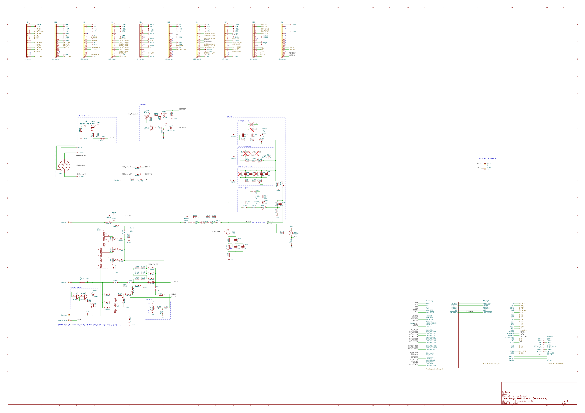

### Card sockets
Each expansion board plugs into its own 19-pin socket (X20-X27, X30, X31). The pinout of each card is described on the card's own page. Analog cards get 0 V, -5 V, -15 V, +15 V and +5 V on pins 1-5. N31 is an outguard board and gets the isolated outguard supply instead.

### Section: Input terminals
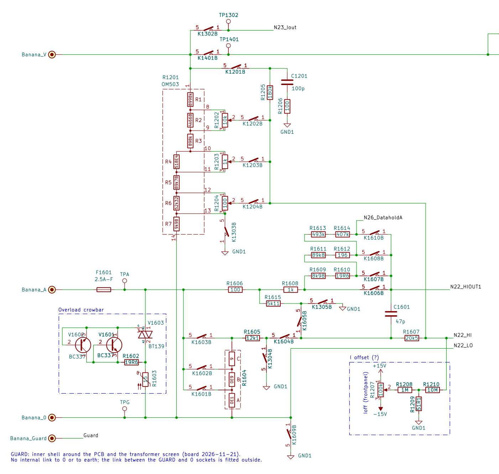
- **V/Ω input:** the high-voltage input. Relay K1401 sends it to the AC amplifier, K1201 to the DC divider.
- **Divider R1201 (OM503):** a thick-film divider network. K1202-K1204 pick the tap for the DC ranges; R1202-R1204 are the trimmers.
- **A input:** fused by F1601 (2.5 A). K1601-K1604 select the shunt taps (R1604 and the R1605-R1615 networks), so each current range gives a usable voltage.
- **Overload crowbar:** if the voltage across the shunt gets too high, V1601/V1602 fire the triac V1603. The triac shorts the A input to 0, so the fuse blows instead of the shunts burning.
- **N22_HI / N22_LO:** the signal goes from here to the DC amplifier N22.
- **GUARD:** connected to the inner shell around the PCB and the transformer screen. There's no internal link to 0 or earth; the link between the GUARD and 0 sockets is fitted on the outside.

### Section: AC amplifier networks
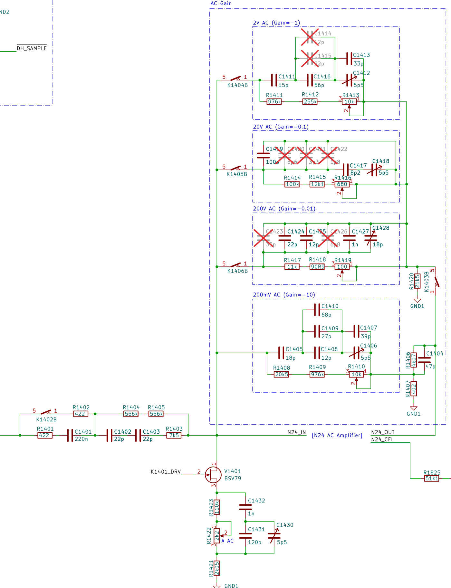
The AC amplifier itself sits on N24, but its input resistor and its feedback networks are on the motherboard. N24 is an inverting amplifier with an input resistance of R1404 + R1405 = 1.112 MΩ. The feedback networks set the gain, so every range gives 2 V full scale at N24's output:

| Range | Relays on | Gain |
| - | - | - |
| 200 mV | none | ×10 |
| 2 V | K1403, K1404 | ×1 |
| 20 V | K1403, K1405 | ×0.1 |
| 200 V | K1403, K1406 | ×0.01 |
| 2000 V | K1403, K1406, plus K2501 on N25 | ×0.01 |

- K1402 bridges the input capacitor C1401 (with R1402) for the VDC+AC and Vpeak high/low functions; the others are AC coupled.
- The small trimmer capacitors flatten the frequency response. On my board, a few of them have one leg lifted (noted on the schematic).
- V1401 (BSV79) connects the HF unit N26 to the amplifier input in the Vhf function. It conducts only when K1401 is off.

### Section: Probe socket, data hold and external supply
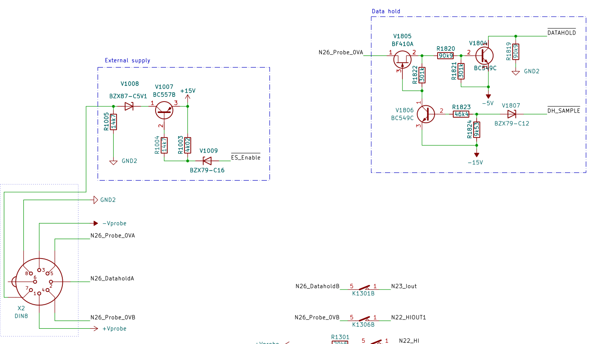
- **X2 (DIN):** the socket for the probes: the HF probe (N26), the PT100 probe and the probe with a data-hold button.
- **External supply:** V1007 supplies +Vprobe to the probe, switched by `/ES` from expander D1702.
- **Data hold:** the probe pulls line J (`N26_Probe_0VA`). When the CPU drives `~DH_SAMPLE` low, V1806/V1805 switch on and V1804 puts the data-hold state on `~DATAHOLD`, which the CPU reads through expander D1703.
- **SCFI:** V1808 turns the crest-factor flag of N24 (CFI) into a logic signal for the CFI latch on the digital sheet.

### Sheet: Digital
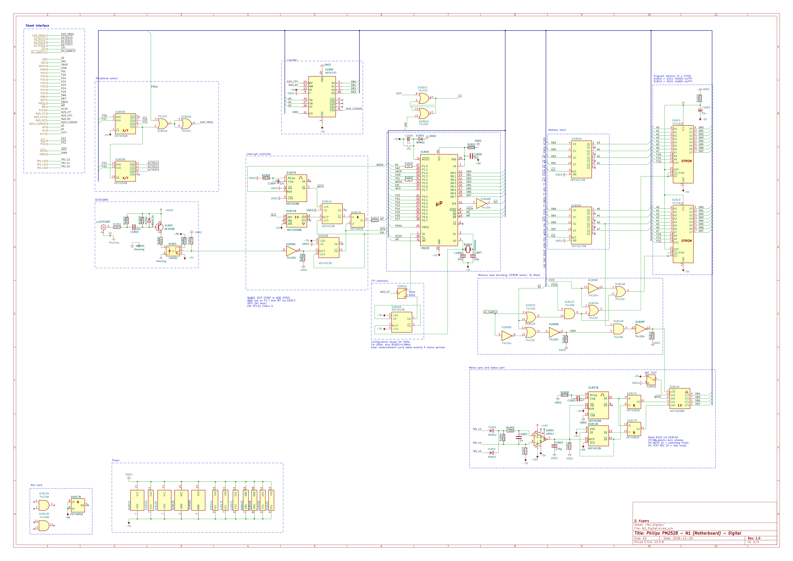

#### CPU and program memory
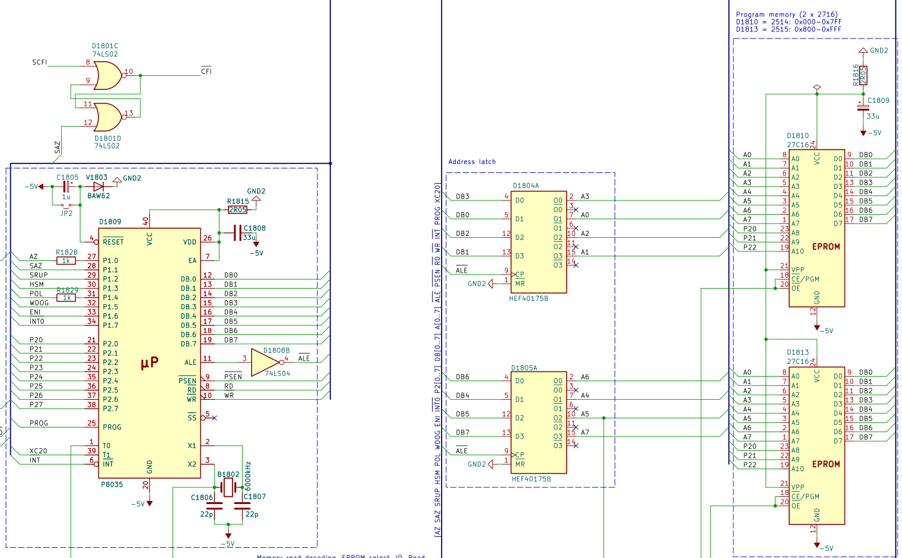
- **D1809 (P8035):** an 8048 without on-chip ROM, running at 6 MHz (2.5 µs per instruction cycle). It has 64 bytes of internal RAM and no external RAM.
- **D1810 / D1813 (2716):** the firmware, 2 × 2 KB. D1810 holds 2514.5 (0x000-0x7FF), D1813 holds 2515.6 (0x800-0xFFF). P23 acts as address line A11 and selects one of the two.
- **D1804 / D1805 (HEF40175):** the address latch. On ALE they hold the low address byte from the data bus.
- **Port 1** carries the ADC control lines (AZ, SAZ, SRUP, HSM, POL), the watchdog trigger (WDOG) and the interrupt lines (ENI, /INT0).
- **T0** outputs the 2 MHz clock (6 MHz / 3) for the ADC, **T1** counts the overflow pulses (XC20) of the ADC counter.

#### Peripheral select
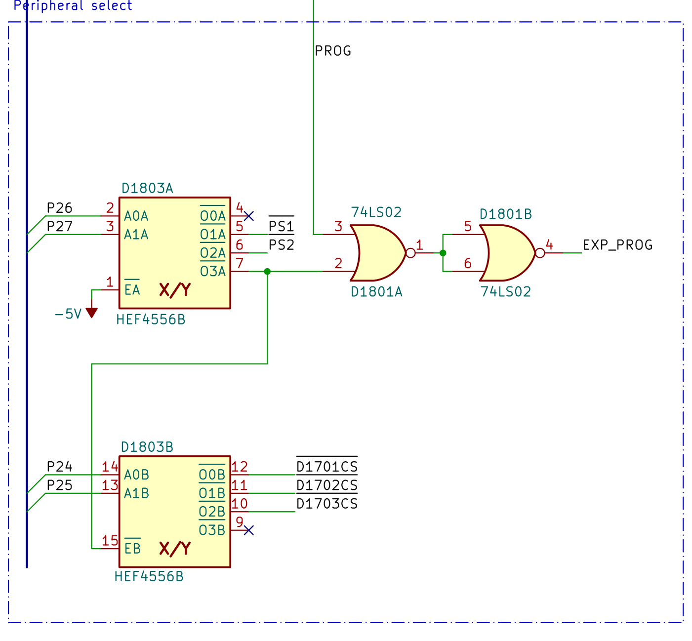
The upper four bits of port 2 select which I/O expander the CPU talks to. D1803A (HEF4556) decodes P26/P27 into `PS1` and `PS2` for the display unit N2, and enables the PROG strobe (`EXP_PROG`) for the motherboard. D1803B decodes P24/P25 into the chip selects of D1701, D1702 and D1703.

#### Counter
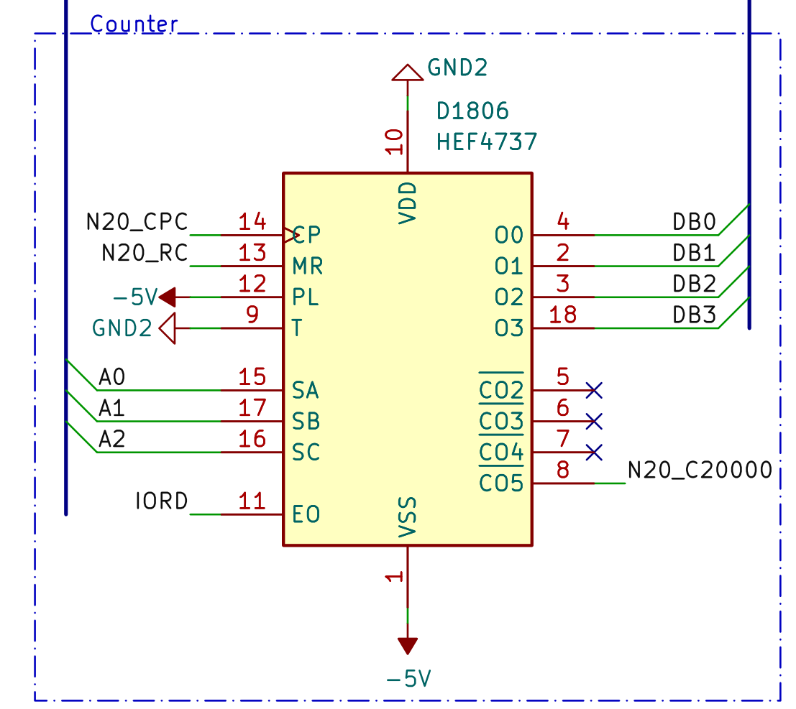
D1806 (HEF4737) is a 4½-decade counter. It counts the clock pulses (CPC) that N20 lets through during the ramp-down phase, so its contents are the result of a conversion. Its overflow (C20000) goes to N20, the overflow pulses (XC20) go to T1 of the CPU. The CPU reads the digits as external memory 0x00-0x04.

#### Interrupt controller and watchdog
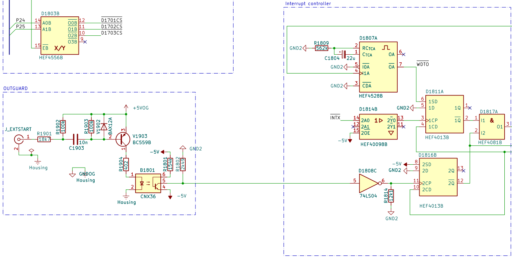
The CPU has a single interrupt input. Three sources share it:
- **Keys:** pressing a key on N2 pulls `INTX` low.
- **External start and IEC bus:** the rear EXT START BNC and the `STDO` line of the IEC board share optocoupler B1801, so they're isolated from the measuring circuit. B1801 sets D1816B, which pulls `/INT0` (P1.7) low. The CPU checks P1.7 to see which kind of interrupt it got, and clears D1816B with a pulse on ENI (P1.6).
- **Watchdog:** D1807A (HEF4528) is a retriggerable one-shot. The firmware pulses WDOG (P1.5) every 10 ms. If the pulses stop, `~WDTO` goes low, which also causes an interrupt; the firmware sees `~WDTO` at address 0x20 and restarts itself.

D1817A (AND) combines the sources into `INT` for the CPU.

#### Memory read decoding and clock selection
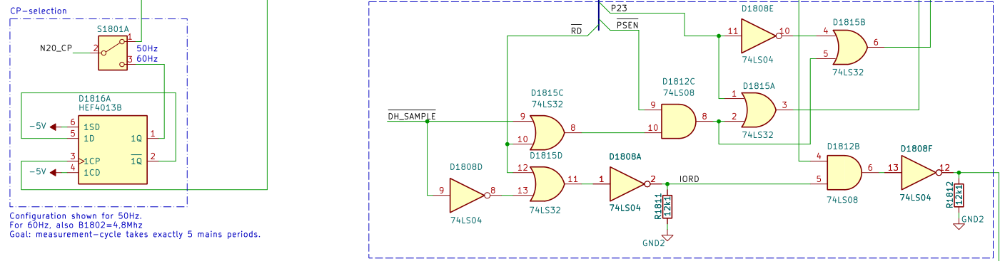
- **IORD** is the I/O read strobe: `RD` low and `~DH_SAMPLE` high. The counter, the status port and N30 use it.
- With `~DH_SAMPLE` low, a `MOVX` read goes to the EPROMs instead, so the CPU could read its own program as data (probably meant for a checksum). The firmware never uses this.
- **S1801A (50/60 Hz):** selects the clock for the ADC (CP). At 50 Hz it's T0 (2 MHz); at 60 Hz it's the crystal divided by two by D1816A, with a 4.8 MHz crystal. Either way the ramp-up phase takes exactly 5 mains periods, so mains hum averages out.

#### Mains sync and status port
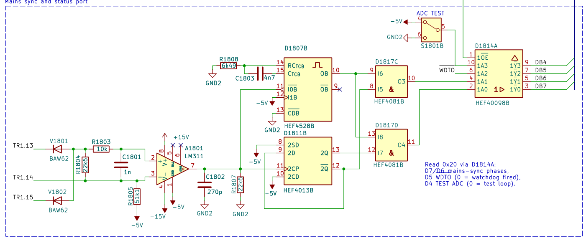
- A1801 (LM311) compares two transformer windings (TR1.13/TR1.15) and makes a square wave at mains frequency.
- D1807B (one-shot) and D1811B (flip-flop) make two phase signals, which D1817C/D turn into D7 and D6.
- The firmware waits for one of them before each conversion, so every conversion starts at the same point of the mains period. It alternates between the two phases on successive conversions.
- **D1814A (HEF40098)** puts these on the data bus when the CPU reads address 0x20, together with `~WDTO` (D5) and the ADC TEST switch S1801B (D4).

### Sheet: Analog
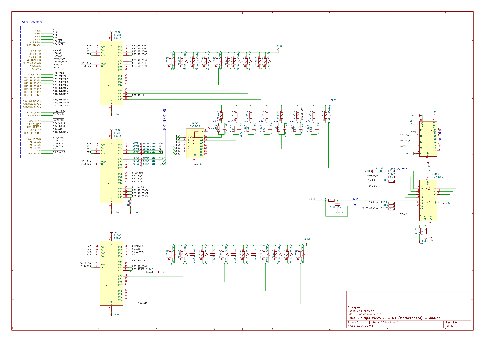

#### Relay drivers
The CPU drives the relays through three 8243 I/O expanders. Each has four 4-bit ports (P4-P7):
- **D1701** drives its relays directly; a relay is on when its port bit is 0. It controls the current source N23, the current shunts and the input routing.
- **D1702** drives its relays through the ULN2003 D1704; a relay is on when its bit is 1. The zener diodes (BZX79-B10) shift the logic level for the ULN2003. Each relay coil has a series resistor with a capacitor across it: the capacitor gives the full voltage at switch-on, the resistor lowers the holding current. P6 and P7 also drive the ADC multiplexer, the external supply, `~DH_SAMPLE` and the relays on N26.
- **D1703** drives the AC feedback relays and the DC divider relays, and reads four status lines: `~DATAHOLD`, the N27 `/BSY` and `/STADC`, and the CFI latch. It also drives the N27 SEL and /RESET lines.

The full list of which bit drives which relay is on the [Firmware](/Deepdive/Firmware/README.md) page.

#### ADC input multiplexer
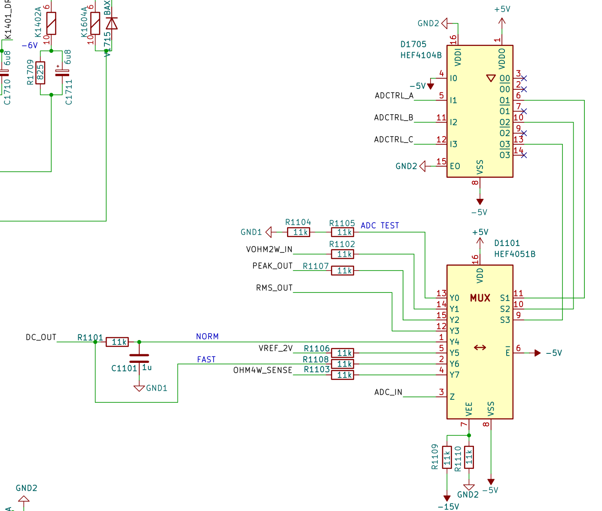
D1101 (HEF4051) selects the signal that goes to the ADC (N21, `ADC_IN`). D1705 (HEF4104) shifts the select lines from the logic levels (-5 V/0 V) to the ±5 V of the multiplexer.

| Input | Signal | Used for |
| - | - | - |
| Y0 | ADC TEST (R1104/R1105) | ADC test loop (switch S1801B) |
| Y1 | Ω 2-wire, from the 0 socket via R1102 | Ω 2W |
| Y2 | N27 output (PEAK_OUT) via R1107 | Vpeak |
| Y3 | N25 output (RMS_OUT) | VAC, VDC+AC, ADC+AC, Vhf |
| Y4 NORM | N22 output (DC_OUT), filtered by R1101/C1101 | VDC; ADC in fast mode |
| Y5 | +2 V reference (VREF_2V) via R1106 | not used |
| Y6 FAST | N22 output (DC_OUT) via R1108, unfiltered | VDC in fast mode; ADC |
| Y7 | 4-wire sense (OHM4W_SENSE) via R1103 | Ω 4W, °C |

_Note: the DC current function (ADC) uses the filtered and unfiltered inputs the other way round from VDC. That might be deliberate or a firmware bug; I still need to check it on the instrument._

### Sheet: Power
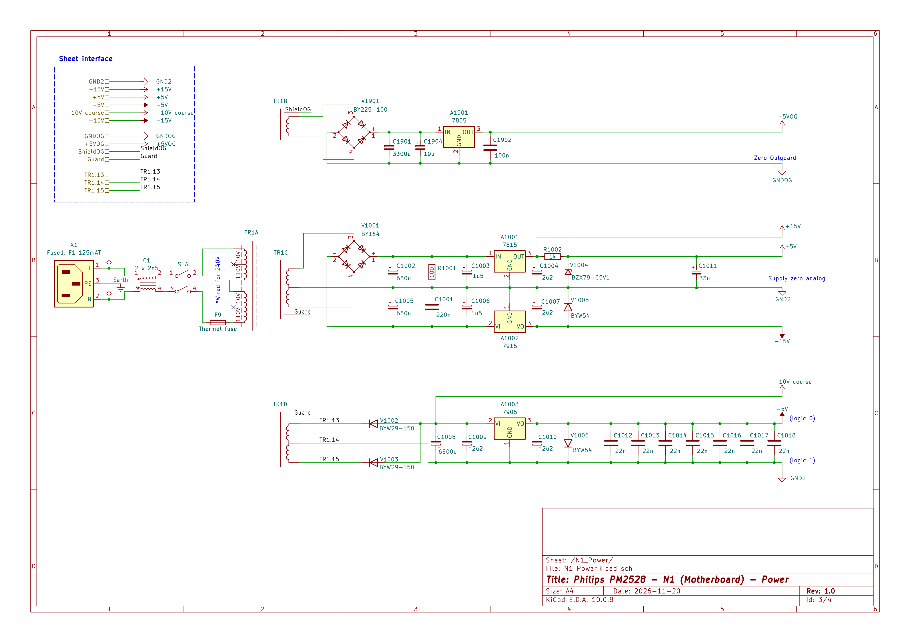
The transformer has four windings:

| Winding | Rectifier | Regulator | Rail | Use |
| - | - | - | - | - |
| TR1A | - | - | - | Primary; my unit is wired for 240 V |
| TR1B | V1901 | A1901 7805 | +5VOG / GNDOG | Outguard supply, isolated from the rest (N30, N31, IEC board) |
| TR1C | V1001 | A1001 7815, A1002 7915 | +15 V, -15 V | Analog supply |
| TR1C | V1001 | From +15 V via R1002 and zener V1004 | +5 V | Analog supply |
| TR1D | V1002, V1003 | A1003 7905 | -5 V | Logic supply (logic 0 = -5 V, logic 1 = 0 V) |
| TR1D | V1002, V1003 | - | -10 V coarse | Unregulated; N2 makes its own -5 V from it |

TR1.13-TR1.15 also feed the mains sync circuit on the digital sheet.

_Note: all logic runs between -5 V and 0 V. So on the scope, with the probe ground on 0 V, a logic "1" is 0 V and a logic "0" is -5 V._
