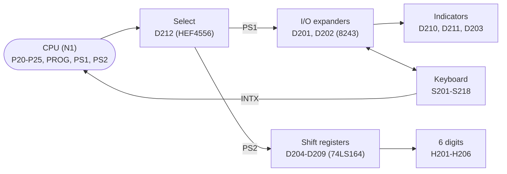

# Display Unit (N2) · Operation
N2 › [Overview](README.md) · **Operation** · [Schematics](Schematics.md) · [PCB](PCB.md)

> [!NOTE]
> I haven't made scope captures of this board. The description below is based on the schematics, the Philips documentation, the firmware and one logic-analyser capture of a key press.

## Block diagram

## How it works
The CPU uses the same 8243 expander protocol for everything on this board: it puts a command and port number on P20-P23, pulses PROG, then puts the 4-bit data on P20-P23 and pulses PROG again. Port 2 bits P24-P27 select the device:

| P27-P24 | Selects |
| - | - |
| 0100 | D201 (keyboard, trigger and mode LEDs) |
| 0101 | D202 (function, unit, sign, decimal point) |
| 1000 | Digits H201 + H202 |
| 1001 | Digits H203 + H204 |
| 1010 | Digit H205 |
| 1011 | Digit H206 |

P26/P27 are decoded on the motherboard into `/PS1` and `/PS2`; D212 decodes P24/P25.

### The digits
The digits don't have an expander. Instead, each one has a 74LS164 shift register:
- With `/PS2` active, D212B and D213 (OR gates) pass PROG to the clock of the selected shift register.
- At each PROG pulse, the shift register takes the bit on P20. So the CPU shifts a digit in bit by bit (1 = segment off).
- D204/D205 and D206/D207 are chained in pairs, so H201+H202 and H203+H204 are each loaded with 16 pulses.
- The digits are common-anode HP5082-7750 displays; R214-R255 (300 Ω) limit the segment current.

### The indicators
| Driven by | Through | Shows |
| - | - | - |
| D202 P4 | D211 (74LS145, BCD decoder) | Unit: Ω, kΩ, MΩ, °C, µA, mA, mV, V |
| D202 P5 | D210 (74LS145, BCD decoder) | Function: V DC, V AC, V DC/AC, Ω2W, Ω4W, A DC, A DC/AC, °C, Vhf, Vpeak |
| D202 P6 | D203 (ULN2003) | Sign lamps + and -, Vpeak high and low marks (▲, ▼) |
| D202 P7 | R210-R213 | Decimal points of H202-H205 |
| D201 P6 | directly, and D203 for REM | OFFSET, HR, REMOTE |
| D201 P7 | directly | INT, EXT, MAN, AUTO |

The decoders light one lamp per 4-bit code. Code 4 and 5 both light µA, because outputs Q4 and Q5 of D211 are joined.

> [!NOTE]
> The parts list says H207/H208 (sign) are LEDs, but on my board they are small lamps.

### The keyboard
The 18 keys form a matrix of five columns and four rows:
- **Columns:** D201 P40-P43 and P60, each through a diode (V201-V205).
- **Rows:** D201 P50-P53, pulled up by R202-R205.
- A key press connects its row to its column and also to `INTX`. That pulls `INTX` low and interrupts the CPU.
- About 10 ms later (debounce), the CPU walks a 0 across the columns and reads the rows, to find out which key it was.

| Column | Row P50 | Row P51 | Row P52 | Row P53 |
| - | - | - | - | - |
| P40 | V DC | V AC | V DC/AC | Ω2W |
| P41 | Ω4W | A DC | A DC/AC | °C |
| P42 | Vhf | Vpeak | - | - |
| P43 | MAN | EXT | INT | HR |
| P60 | OFFSET | UP | DOWN | AUTO |

---
N2 › [Overview](README.md) · **Operation** · [Schematics](Schematics.md) · [PCB](PCB.md)
