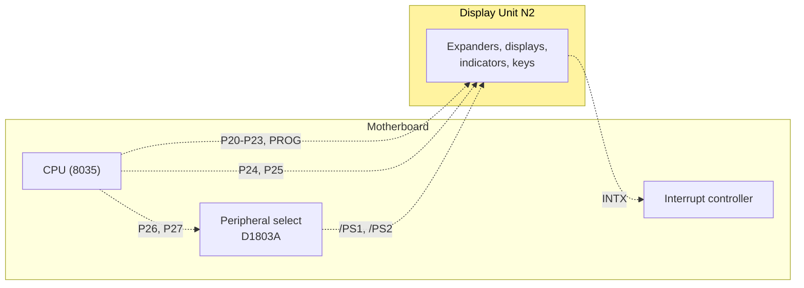

# Display Unit (N2)
N2 › **Overview** · [Operation](Operation.md) · [Schematics](Schematics.md) · [PCB](PCB.md)

The display unit is the front panel: six 7-segment digits, the indicator lamps and LEDs, and the 18 keys. It has no intelligence of its own; the CPU on the motherboard writes every segment and scans the keys.

## Functions
- Driving six 7-segment LED digits through shift registers
- Showing the function, the unit, the sign and the trigger mode with LEDs and small lamps
- Reading the keyboard, and interrupting the CPU when a key is pressed
- Making its own -5 V supply

## Signal flow
The display unit hangs on the CPU's expander bus. The peripheral select on the mainboard tells it whether the CPU talks to its I/O expanders or to the digit shift registers.

## Edge connector

🟦 signal · 🟧 supply / zero · ⬛ not connected

| Pin | Name | I/O | Description | Connected to |
| -: | - | :-: | - | - |
| 1 | 🟦 **/PS2** | I | Select the digit shift registers | Mainboard (D1803A) |
| 2 | 🟦 **/PS1** | I | Select the I/O expanders | Mainboard (D1803A) |
| 3 | 🟦 **PROG** | I | Expander strobe, also the shift clock | CPU |
| 4 | 🟦 **P22** | I/O | Expander bus bit 2 | CPU |
| 5 | 🟦 **P20** | I/O | Expander bus bit 0, also the serial segment data | CPU |
| 6 | 🟦 **INTX** | O | Key pressed (interrupt) | Mainboard (interrupt controller) |
| 7 | ⬛ - |  | Not connected |  |
| 8 | 🟧 **-10V coarse** |  | Unregulated supply | Mainboard |
| 9 | 🟧 **0V** |  | Supply zero | Mainboard |
| 10 | ⬛ - |  | Not connected |  |
| 11 | 🟦 **P21** | I/O | Expander bus bit 1 | CPU |
| 12 | 🟦 **P23** | I/O | Expander bus bit 3 | CPU |
| 13 | 🟦 **P24** | I | Device select bit 0 | CPU |
| 14 | 🟦 **P25** | I | Device select bit 1 | CPU |

## More about this board
- [Operation](Operation.md): how the digits, indicators and keyboard work
- [Schematics](Schematics.md): the full schematic, internal signals and the sections
- [PCB](PCB.md): the board layout and 3D view

_N2 has no relays or analog switches._

---
N2 › **Overview** · [Operation](Operation.md) · [Schematics](Schematics.md) · [PCB](PCB.md)
