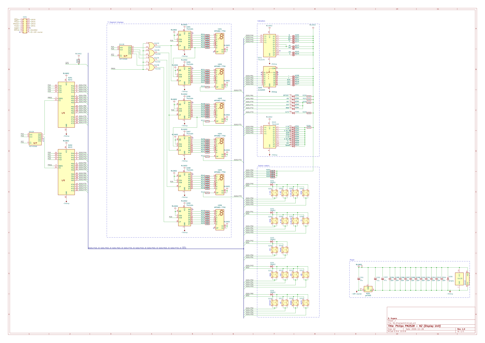
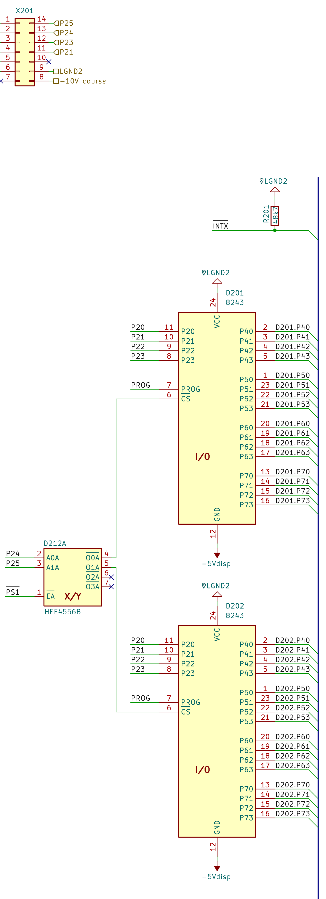
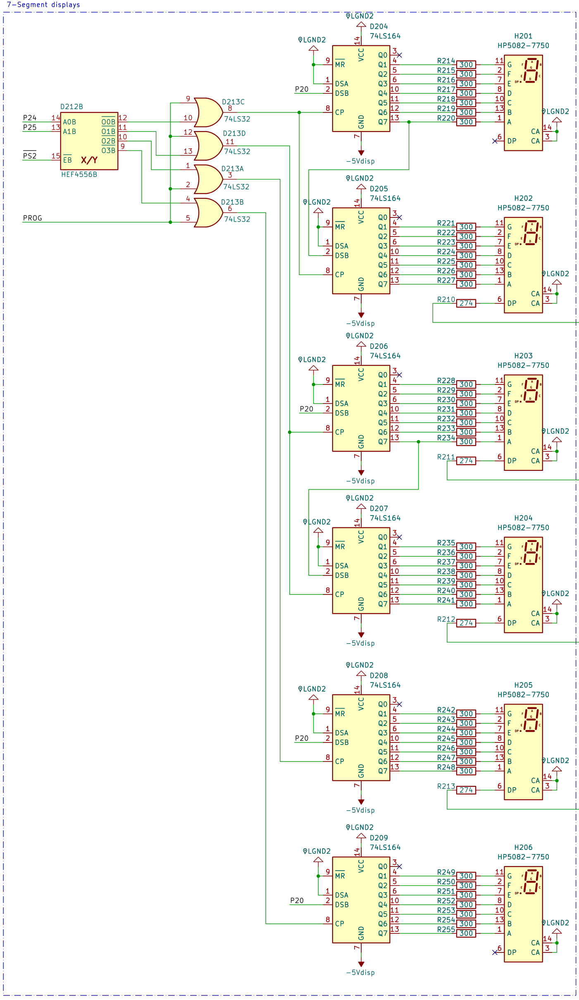
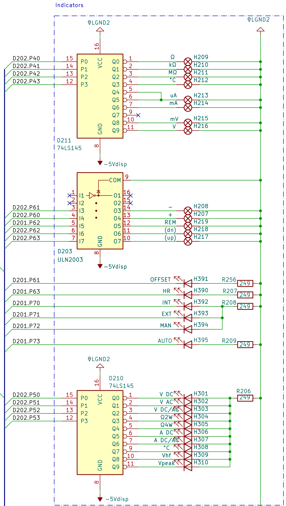
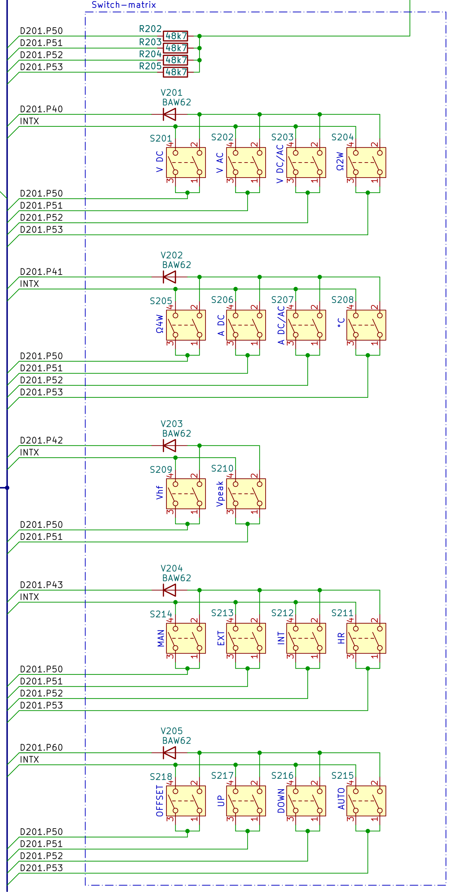

# Display Unit (N2) · Schematics
N2 › [Overview](README.md) · [Operation](Operation.md) · **Schematics** · [PCB](PCB.md)

## Schematics
I copied and redrew the schematics and PCB in KiCad, using the low‑res Philips docs as a reference. There might be a few small differences since I tweaked them to match my PM2528. You’ll find the KiCad files in other parts of this repo.

### Section: Expanders

X201 is the connector to the motherboard. D212A (HEF4556) selects D201 or D202 when `/PS1` is active.

### Section: 7-segment displays

D212B selects one of the four shift-register groups when `/PS2` is active; D213 combines it with PROG into the shift clock.

### Section: Indicators

D211 and D210 decode the unit and the function, D203 drives the sign lamps and the REM lamp.

### Section: Keyboard

The diodes stop a pressed key from shorting two column lines.

The function and mode LEDs (H301-H310, H390-H395) sit inside the keys and shine through a small window in the key cap. Only UP and DOWN have no LED.

### Section: Power
A201 (µA7905) makes the display supply (-5Vdisp) from the unregulated -10 V of the motherboard, so the display current doesn't load the logic supply.
