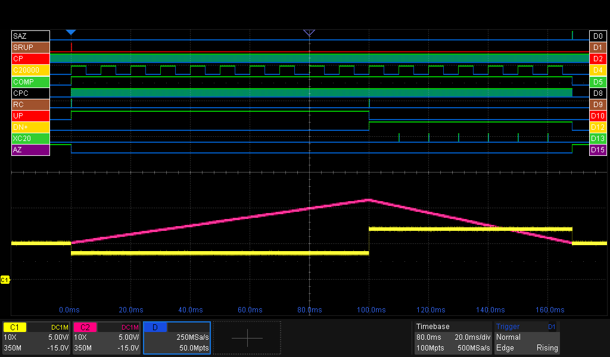
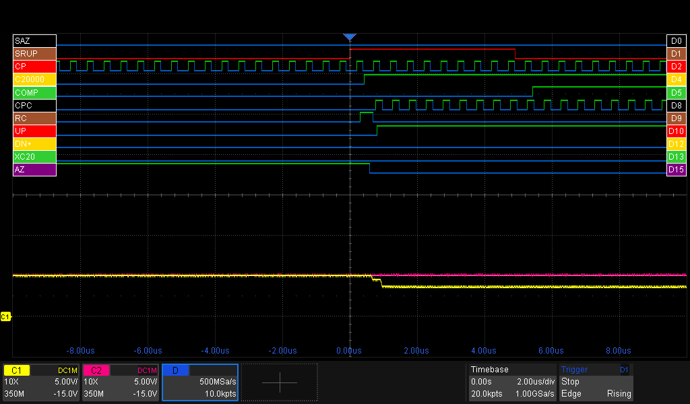
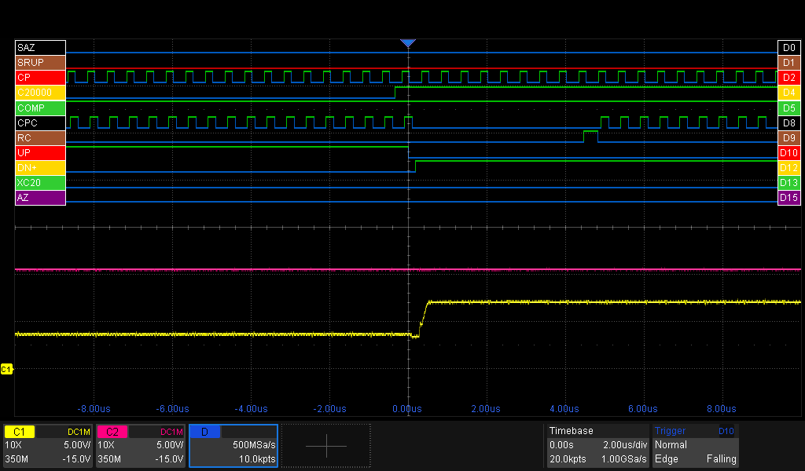
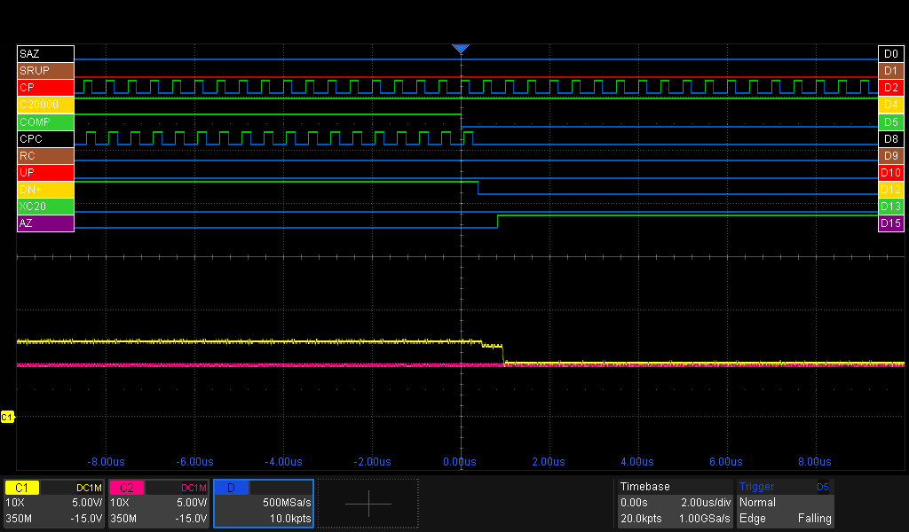

# ADC Control (Expansionboard N20) · Operation
N20 › [Overview](README.md) · **Operation** · [Schematics](Schematics.md) · [PCB](PCB.md)

## A Measurement Cycle from the ADC Control's perspective

This section describes in detail how the N20 takes it role as the conductor of a measurement. The next image shows an overview, including the most important signals.

#### @0ms: start of the cycle

- The measurement starts with a **SRUP**-pulse from the CPU
- The ADC Control resets the counter via **RC**. The counter resets and sets the **C20000** signal high (it's active low)
- The ADC Control opens the gate for the **CP** signals to passthrough to the Counter via the **CPC** signal.
- The ADC Control raises the **UP** signal, which instructs the ADC Analog to select the input-signal (reverse polarity).
- The **AZ** signal is set low by the ADC-control, indicating there's no auto-zeroing going on.
- **COMP** goes high because the integrator on N21 rises (positive input)

#### @0-100ms: Ramp-up phase
See the first image in this section for reference.
- The Counter is busy counting, clocked by the **CPC** pulses.
- The Counter sends the **C20000** pulses to indicate it overflows. As the Ramp-Up phase is a fixed time phase, the ADC Control swallows them.
- Watch the clockpulses (**CP**) pulsing
- The ADC (**purple trace**) is integrating

#### @100ms: The fixed-time Ramp-Up phase is finished, starting the Ramp-Down phase
(please add 100ms to the time in the image)

- The ADC Control detected that the Ramp-Up phase has finished, as it has counted 200000 **CP** pulses.
- The ADC Control resets **UP** to signal the ADC Analog Ramp-Up is finished.
- The ADC Control sets **DN+** to indicate the ADC Analog we're now starting the Ramp-Down phase. The ADC Analog selects the positive reference-signal for de-integrating. For negative measure-signals, the ADC Analog would set **DN-** (not pictured).
- The ADC Control resets the counter via **RC**. The counter resets and sets/keeps the **C20000** signal high (it's active low).

Note: **CPC** pauses for about 4.5 µs around the RC pulse while **DN+** is already active, so about 9 clock pulses are not counted.

#### @100-170ms: Ramp-down phase
See the first image in this section for reference.
- The ADC (**purple trace**) keeps draining
- For every counter-overflow (rising edge of **C20000**), the ADC Control sends a pulse to the CPU (**XC20**).

#### @170ms: Measurement ready

- The ADC Analog detected that de-integrating is ready by resetting the **COMP** signal.
- The ADC Control then resets the **DN+** signal
- The ADC Control closes the gate for the **CPC** signal, stopping the Counter.
- The ADC Control asserts the **AZ** signal, signalling the CPU its job has been done and signaling the ADC Analog to select 0V (**yellow trace**) as input to the ADC logic.

The CPU has enough info to calculate the voltage of the input-signal:
- the current value of the Counter
- Multiply the number of **XC20** pulses by 20.000
- Ramp-up phase = 200.000 counts (=fixed)
- Ramp-down phase = 135.100 counts (=6 x 20.000 from **XC20** + 15.100 from the Counter), which should be the same as the number of pulses **CPC**
- Reference-voltage = 2000mV
>Vin = (Tdown / Tup) × Vref = (135.100 / 200.000) * 2000mV = 1351mV
