# ADC Control (Expansionboard N20)
This expansion board forms the digital control interface between the microcontroller, the ADC Analog and the Counter.

Its functions include:
- Coordinating of the Ramp-Up and Ramp-Down phases
- Send the correct signals on time to the ADC Analog
- Trigger and reset the Counter
- Return measurement-ready signal to the CPU

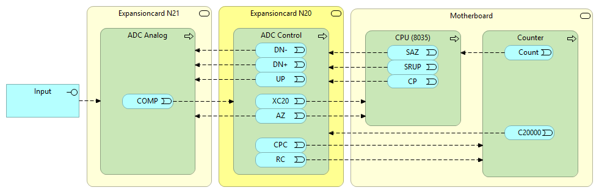

### The signals
#### External signals (to/from this board)
| Name | Description | I/O | Pin | Source | Target | Testpoint |
| - | - | :-: | -: | - | - |- |
| **CP** | Clock Pulses (2Mhz) | I | 16 | CPU.T0 | |TP2001
| **SRUP** | Start Ramp-Up | I | 8 | CPU
| **SAZ** | Set Auto Zero | I | 9 | CPU
| **DN-** | RampDown phase, for -pol input signals | O | 11 || ADC Analog | TP2010
| **DN+** | RampDown phase, for +pol input signals | O |13|| ADC Analog |TP2008
| **UP** | RampUp phase | O |14| | ADC Analog| TP2007
| **XC20** | Counter overflow (20.000 counts) @ RampDown| O |15|| CPU.T1
| **AZ** | AutoZero active | O |12| |ADC Analog, CPU | TP2009
| **COMP** | COMParator output (sign of the integrator on N21) | I | 19 | ADC Analog || TP2006
| **C20000** | Counter overflow (20.000 counts) | I |5 | | Counter 
| **CPC** | ClockPulses for Counter | O |4 | | Counter |TP2011 
| **RC** | Reset Counter | O |3| | Counter | TP2003 
| **POL** | Polarity of the input | O |6| | CPU 
| **HSM** | High Speed Mode (40.000 counts instead of 200.000) @ RampUp | I |7| CPU

In the scope-screendumps, you'll also see these signals:
| Trace | Description | Measuring point |
| - | - | - |
| **yellow** | Input into ADC Integrator | N21.TP2105 |
| **purple** | ADC Integrator voltage | N21.TP2106 |

_Note: the scope ground was on the -5 V rail (logic 0), so logic swings 0–5 V on screen and analog 0 V appears at +5 V_

## A Measurement Cycle from the ADC Control's perspective

This section describes in detail how the N20 takes it role as the conductor of a measurement. The next image shows an overview, including the most important signals.

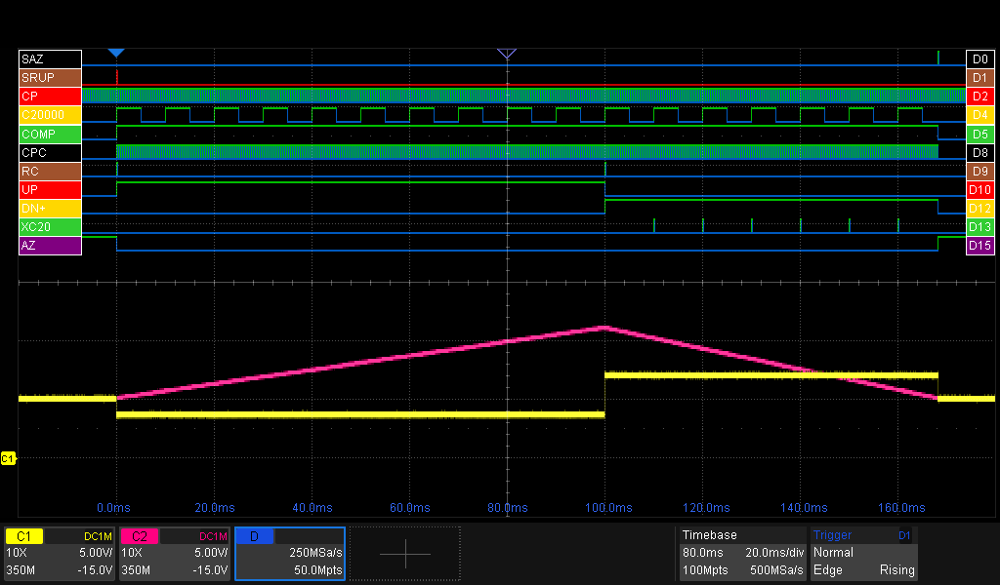

#### @0ms: start of the cycle
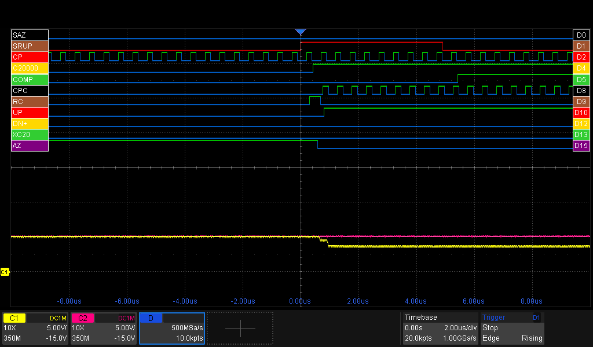
- The measurement starts with a **SRUP**-pulse from the CPU
- The ADC Control resets the counter via **RC**. The counter resets and sets the **C20000** signal high (it's active low)
- The ADC Control opens the gate for the **CP** signals to passthrough to the Counter via the **CPC** signal.
- The ADC Control raises the **UP** signal, which instructs the ADC Analog to select the input-signal (reverse polarity).
- The **AZ** signal is set low by the ADC-control, indicating there's no auto-zeroing going on.
- **COMP** goes high because the integrator on N21 rises (positive input)

#### @0-100ms: Ramp-up phase
See the first image in this section for reference.
- The Counter is busy counting, clocked by the **CPC** pulses.
- The Counter sends the **C20000** pulses to indicate it overflows. As the Ramp-Up phase is a fixed time phase, the ADC Control swallows them.
- Watch the clockpulses (**CP**) pulsing
- The ADC (**purple trace**) is integrating

#### @100ms: The fixed-time Ramp-Up phase is finished, starting the Ramp-Down phase
(please add 100ms to the time in the image)
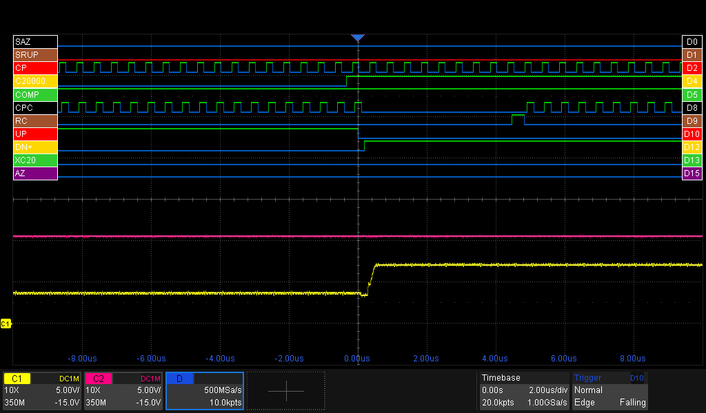
- The ADC Control detected that the Ramp-Up phase has finished, as it has counted 200000 **CP** pulses.
- The ADC Control resets **UP** to signal the ADC Analog Ramp-Up is finished.
- The ADC Control sets **DN+** to indicate the ADC Analog we're now starting the Ramp-Down phase. The ADC Analog selects the positive reference-signal for de-integrating. For negative measure-signals, the ADC Analog would set **DN-** (not pictured).
- The ADC Control resets the counter via **RC**. The counter resets and sets/keeps the **C20000** signal high (it's active low).

Note: **CPC** pauses for about 4.5 µs around the RC pulse while **DN+** is already active, so about 9 clock pulses are not counted.

#### @100-170ms: Ramp-down phase
See the first image in this section for reference.
- The ADC (**purple trace**) keeps draining
- For every counter-overflow (rising edge of **C20000**), the ADC Control sends a pulse to the CPU (**XC20**).

#### @170ms: Measurement ready
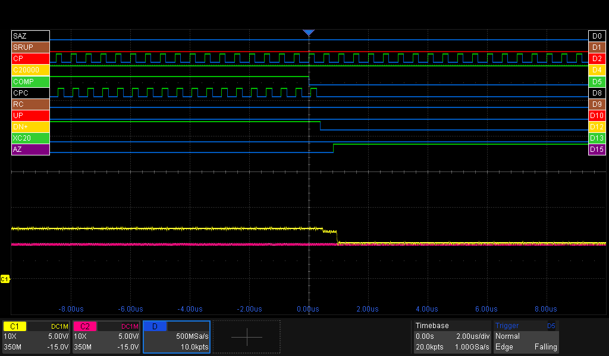
- The ADC Analog detected that de-integrating is ready by resetting the **COMP** signal.
- The ADC Control then resets the **DN+** signal
- The ADC Control closes the gate for the **CPC** signal, stopping the Counter.
- The ADC Control asserts the **AZ** signal, signalling the CPU its job has been done and signaling the ADC Analog to select 0V (**yellow trace**) as input to the ADC logic.

The CPU has enough info to calculate the voltage of the input-signal:
- the current value of the Counter
- Multiply the number of **XC20** pulses by 20.000
- Ramp-up phase = 200.000 counts (=fixed)
- Ramp-down phase = 135.100 counts (=6 x 20.000 from **XC20** + 15.100 from the Counter), which should be the same as the number of pulses **CPC**
- Reference-voltage = 2000mV
>Vin = (Tdown / Tup) × Vref = (135.100 / 200.000) * 2000mV = 1351mV

## Schematics
I copied and rearranged the schematics and PCB in KiCad, using the low‑res Philips docs as a reference. There might be a few small differences since I tweaked them to match my PM2528. You’ll find the KiCad files in other parts of this repo.
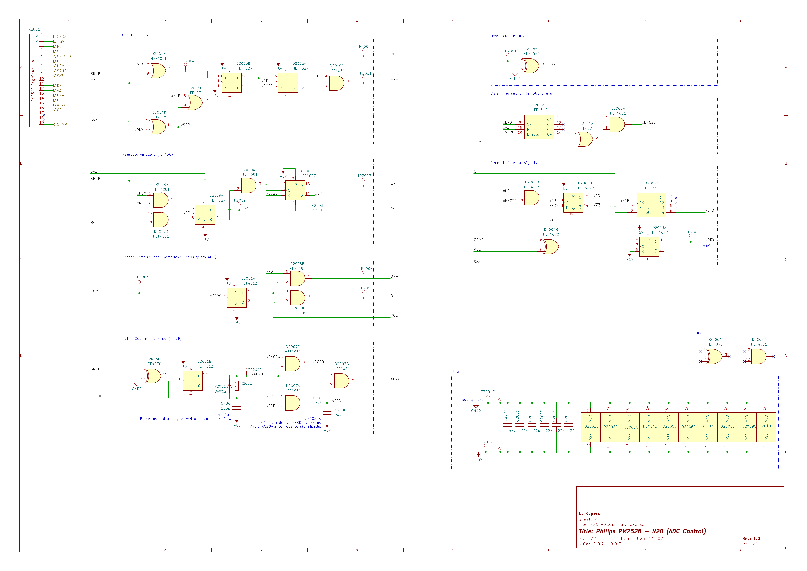

The input- and output signals of this board are listed at the top of the page. The 'local' signals are listed in the next table.

#### Internal signals
| Name | Description | Testpoint |
| - | - | - |
| **xSTD** | STart Down-count. Goes high 8 **CP** pulses after RampDown starts (Q3 of counter D2002A) and triggers the **RC** pulse that restarts the counter.|
| **xERD** |Enable RampDown overflow. It is **x/UP** AND **xECP**, delayed about 70 µs by R2002/C2008. It opens the **XC20** gate and freezes counter D2002B.|
|**xENC20**|ENable end-of-RampUp C20000. High while D2002B is at 9, or at 1 in HSM, so the next overflow ends RampUp.|
|**xEC20**|**xXC20** AND **xENC20**: the overflow pulse that ends RampUp (about 1.4 µs).|
| **xXC20** | One pulse of about 1.4 µs for every counter overflow (rising edge of **C20000**), blocked during **SRUP** | TP2005 |
|**xRDY**|Set when **COMP** flips during RampDown. It stays high until the CPU's **SAZ** pulse, so the ~60 µs width is set by the firmware, not by this board. | TP2002
|**xSCP**|**SAZ** OR **xRDY**. It closes the counter gate at once.|
| **xAZ** | Same as **AZ** (but decoupled from outside glitches) | TP2009
| **x/UP** | Ramp**UP** active (active low)
| **xRD** | **R**amp**D**own active | |
| **x/RD** | **R**amp**D**own active (active-low) | |
| **x/CP** | **C**lock**P**ulses (inverted)  | |
| **xECP** | **E**nable **C**lock**P**ulses (gate for pulses to counter)| |

### Section: Counter-control (to Counter)
This section generates the **CPC** (ClockPulses for Counter) and **RC** (Reset Counter) signals.

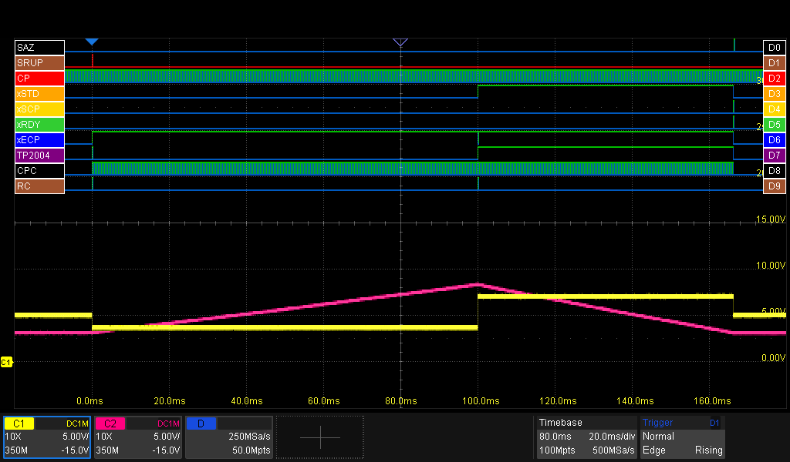

### Section: RampUp, AutoZero (to ADC)
This section generates the **UP** (RampUp active) and **AZ** (AutoZero) signals.

The **UP** (RampUp) signal is active during the RampUp phase.
The **AZ** (AutoZero) signal is active when the measurement is not active, i.e. when not in the RampUp or RampDown phase.

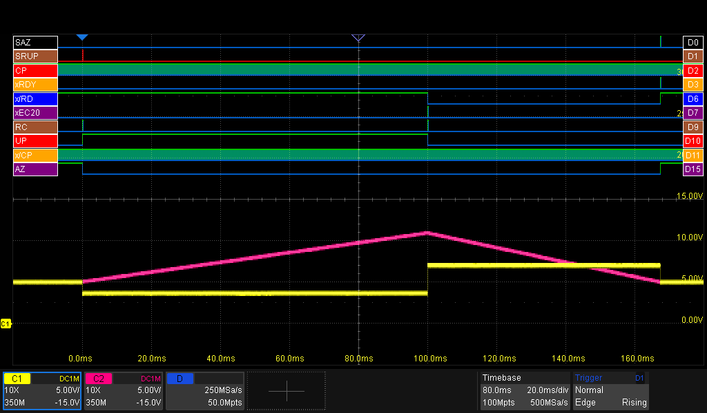

### Section: Polarity and RampDown (to ADC)
This section generates the **POL** (Polarity), **DN+** and **DN-** (DownRamp) signals.

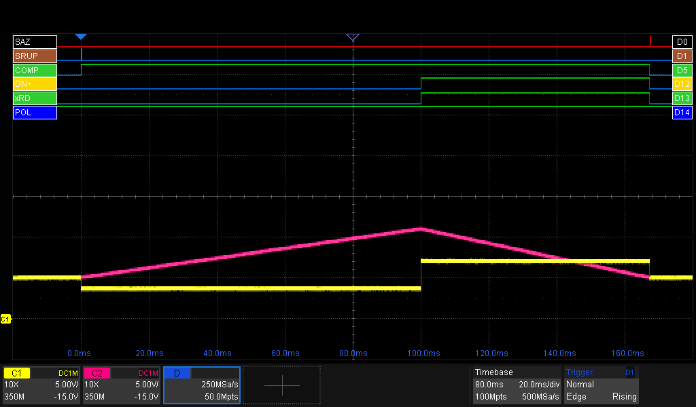

### Section: Gated Counter-overflow (to uP)
This section creates the **XC20** signal for the CPU. This is in fact a gated Counter-Overflow signal. The gate is closed in the RampUp phase, and opened in the RampDown phase.

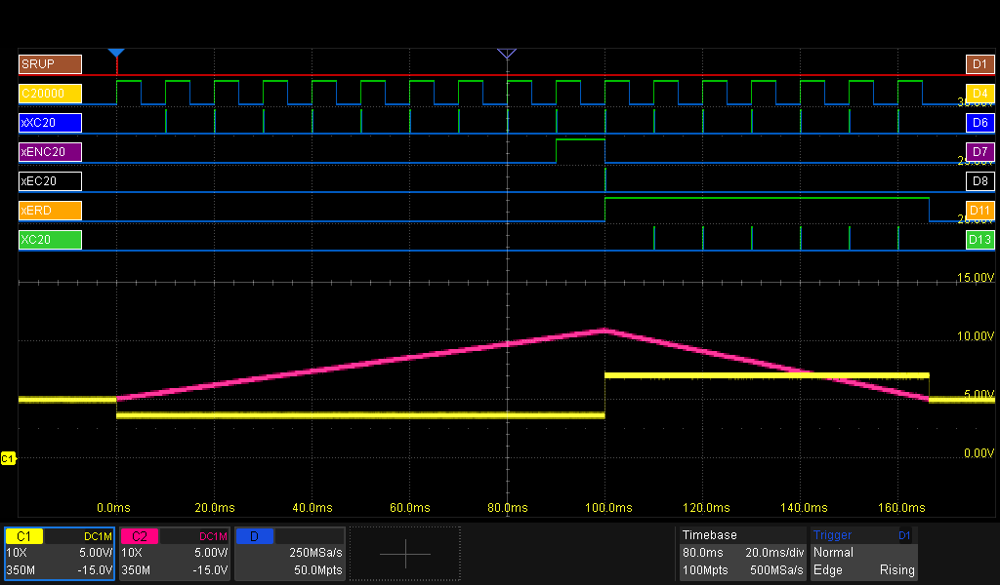

### Section: Determine end of RampUp phase
This section generates the internal **xENC20** signal. In HSM-mode it sets **xENC20** after the 1st Counter-overflow, so the RampUp-phase ends at the 2nd overflow (40.000 counts, 20 ms). Otherwise it sets **xENC20** after the 9th overflow, and the RampUp-phase ends at the 10th (200.000 counts, 100 ms). The RampUp-phase ends with the **xEC20** pulse.

### Section: Timing-table
| **CP**-Edge | What's happening | Components |
|-|-|-|
| rising, **SRUP**=high|**RC** set|D2005 (**RC**) |
| next falling|**AZ** cleared, counter gate **xECP** opens, **RC** cleared|D2009 (**xAZ**), D2005 (**xECP**) |
| next rising| **UP** set, count 1 | D2009 (**UP**), D2010 (**CPC**) |
| 200.000th rising  | Counter overflow: **C20000** --> **xXC20** --> **xEC20**, **POL** latched | Counter, D2001 |
| next rising | **UP** cleared (integrator input off| D2009 (**UP**) |
| next falling | **DN+** or **DN-** high, counter gate **xECP** closed | D2003 (**xRD**), D2005 (**xECP**) |
| next 8 falling edges | Counts to 8 --> **xSTD** high | D2002A |
| next rising | **RC** set: Counter cleared | D2005 (**RC**) |
| next falling | **RC** cleared, Counter gate opens | D2005 (**xECP**)|
| next rising | First counter **CP** @RampDown| D2010 (**CPC**) |
| (70us after gate open) | **XC20** gate opens | R2002/C2008 --> **xERD** |
| (**COMP** flips) | **xRDY** set --> **xSCP** --> counter gate closes | D2006 --> D2003 (**xRDY**) |
| next falling | **xRD** cleared, **DN+** or **DN-** off | D2003 (**xRD**) |
| next falling | **AZ** set --> CPU sees this, pulses **SAZ** after 67us | D2009 (**xAZ**) |

## PCB
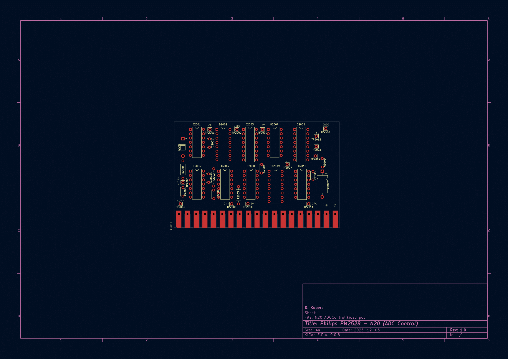
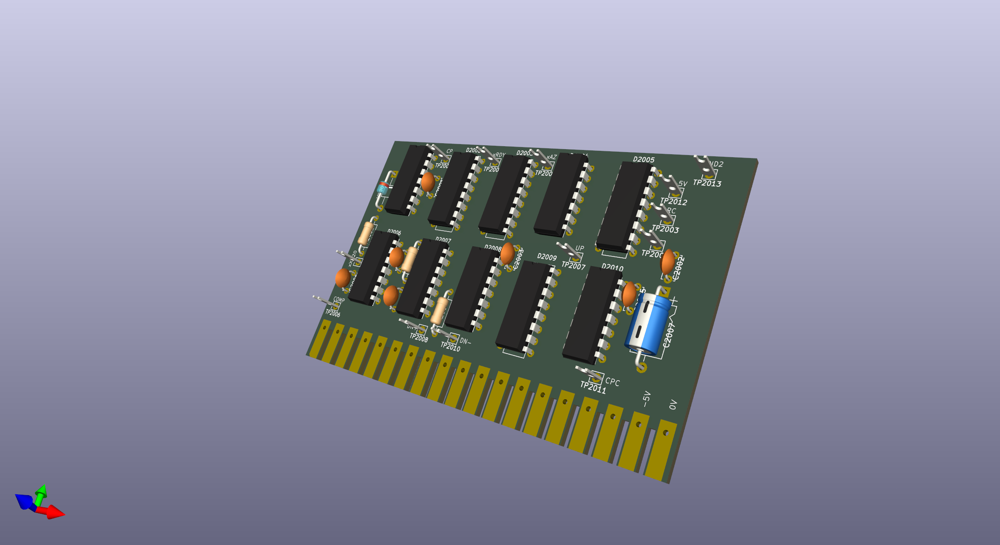