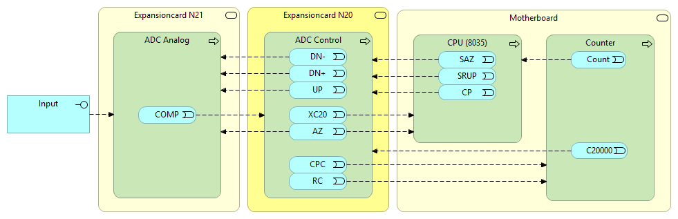

# ADC Control (Expansionboard N20)
N20 › **Overview** · [Operation](Operation.md) · [Schematics](Schematics.md) · [PCB](PCB.md)

This expansion board forms the digital control interface between the microcontroller, the ADC Analog and the Counter.

Its functions include:
- Coordinating of the Ramp-Up and Ramp-Down phases
- Send the correct signals on time to the ADC Analog
- Trigger and reset the Counter
- Return measurement-ready signal to the CPU

### The signals
#### External signals (to/from this board)
🟦 signal · 🟧 supply / zero · ⬛ not connected

| Pin | Name | I/O | Description | Connected to | Testpoint |
| -: | - | :-: | - | - | - |
| 1 | 🟧 **0V** |  | Supply zero | Mainboard |  |
| 2 | 🟧 **-5V** |  | Supply | Mainboard |  |
| 3 | 🟦 **RC** | O | Reset Counter | Counter | TP2003 |
| 4 | 🟦 **CPC** | O | ClockPulses for Counter | Counter | TP2011 |
| 5 | 🟦 **C20000** | I | Counter overflow (20.000 counts) | Counter |  |
| 6 | 🟦 **POL** | O | Polarity of the input | CPU |  |
| 7 | 🟦 **HSM** | I | High Speed Mode (40.000 counts instead of 200.000) @ RampUp | CPU |  |
| 8 | 🟦 **SRUP** | I | Start Ramp-Up | CPU |  |
| 9 | 🟦 **SAZ** | I | Set Auto Zero | CPU |  |
| 10 | ⬛ - |  | Not connected |  |  |
| 11 | 🟦 **DN-** | O | RampDown phase, for -pol input signals | ADC Analog | TP2010 |
| 12 | 🟦 **AZ** | O | AutoZero active | ADC Analog, CPU | TP2009 |
| 13 | 🟦 **DN+** | O | RampDown phase, for +pol input signals | ADC Analog | TP2008 |
| 14 | 🟦 **UP** | O | RampUp phase | ADC Analog | TP2007 |
| 15 | 🟦 **XC20** | O | Counter overflow (20.000 counts) @ RampDown | CPU.T1 |  |
| 16 | 🟦 **CP** | I | Clock Pulses (2Mhz) | CPU.T0 | TP2001 |
| 17 | ⬛ - |  | Not connected |  |  |
| 18 | ⬛ - |  | Not connected |  |  |
| 19 | 🟦 **COMP** | I | COMParator output (sign of the integrator on N21) | ADC Analog | TP2006 |

In the scope-screendumps, you'll also see these signals:
| Trace | Description | Measuring point |
| - | - | - |
| **yellow** | Input into ADC Integrator | N21.TP2105 |
| **purple** | ADC Integrator voltage | N21.TP2106 |

_Note: the scope ground was on the -5 V rail (logic 0), so logic swings 0–5 V on screen and analog 0 V appears at +5 V_

## More about this board
- [Operation](Operation.md): a measurement cycle, step by step
- [Schematics](Schematics.md): the full schematic, internal signals and the sections
- [PCB](PCB.md): the board layout and 3D view

_N20 is pure CMOS logic: it has no relays or analog switches._
