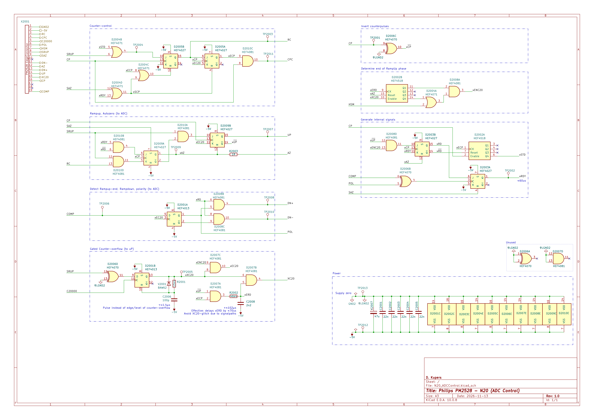
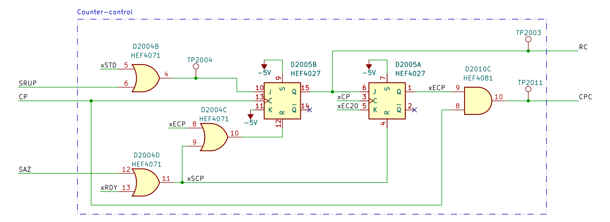
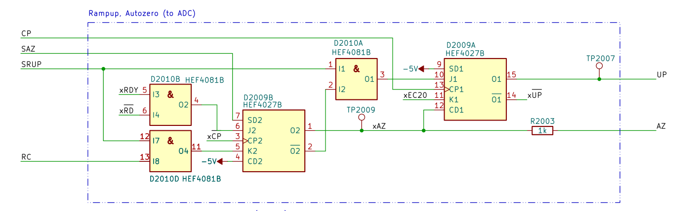
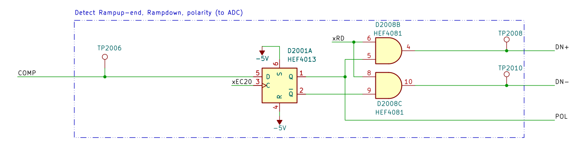
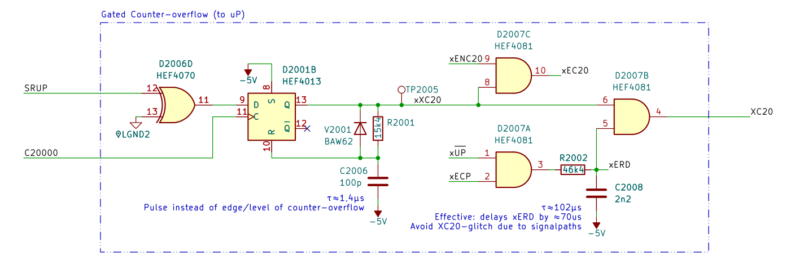
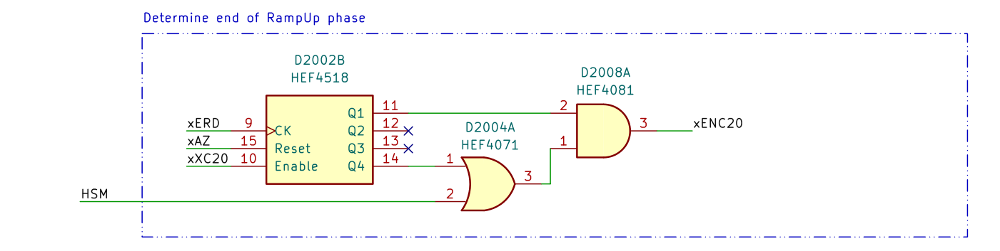

# ADC Control (Expansionboard N20) · Schematics
N20 › [Overview](README.md) · [Operation](Operation.md) · **Schematics** · [PCB](PCB.md)

## Schematics
I copied and rearranged the schematics and PCB in KiCad, using the low‑res Philips docs as a reference. There might be a few small differences since I tweaked them to match my PM2528. You’ll find the KiCad files in other parts of this repo.

The input- and output signals of this board are listed on the [overview page](README.md#the-signals). The 'local' signals are listed in the next table.

#### Internal signals
| Name | Description | Testpoint |
| - | - | - |
| **xSTD** | STart Down-count. Goes high 8 **CP** pulses after RampDown starts (Q3 of counter D2002A) and triggers the **RC** pulse that restarts the counter.|
| **xERD** |Enable RampDown overflow. It is **x/UP** AND **xECP**, delayed about 70 µs by R2002/C2008. It opens the **XC20** gate and freezes counter D2002B.|
|**xENC20**|ENable end-of-RampUp C20000. High while D2002B is at 9, or at 1 in HSM, so the next overflow ends RampUp.|
|**xEC20**|**xXC20** AND **xENC20**: the overflow pulse that ends RampUp (about 1.4 µs).|
| **xXC20** | One pulse of about 1.4 µs for every counter overflow (rising edge of **C20000**), blocked during **SRUP** | TP2005 |
|**xRDY**|Set when **COMP** flips during RampDown. It stays high until the CPU's **SAZ** pulse, so the ~60 µs width is set by the firmware, not by this board. | TP2002
|**xSCP**|**SAZ** OR **xRDY**. It closes the counter gate at once.|
| **xAZ** | Same as **AZ** (but decoupled from outside glitches) | TP2009
| **x/UP** | Ramp**UP** active (active low)
| **xRD** | **R**amp**D**own active | |
| **x/RD** | **R**amp**D**own active (active-low) | |
| **x/CP** | **C**lock**P**ulses (inverted)  | |
| **xECP** | **E**nable **C**lock**P**ulses (gate for pulses to counter)| |

### Section: Counter-control (to Counter)
This section generates the **CPC** (ClockPulses for Counter) and **RC** (Reset Counter) signals.

### Section: RampUp, AutoZero (to ADC)
This section generates the **UP** (RampUp active) and **AZ** (AutoZero) signals.

The **UP** (RampUp) signal is active during the RampUp phase.
The **AZ** (AutoZero) signal is active when the measurement is not active, i.e. when not in the RampUp or RampDown phase.

### Section: Polarity and RampDown (to ADC)
This section generates the **POL** (Polarity), **DN+** and **DN-** (DownRamp) signals.

### Section: Gated Counter-overflow (to uP)
This section creates the **XC20** signal for the CPU. This is in fact a gated Counter-Overflow signal. The gate is closed in the RampUp phase, and opened in the RampDown phase.

### Section: Determine end of RampUp phase
This section generates the internal **xENC20** signal. In HSM-mode it sets **xENC20** after the 1st Counter-overflow, so the RampUp-phase ends at the 2nd overflow (40.000 counts, 20 ms). Otherwise it sets **xENC20** after the 9th overflow, and the RampUp-phase ends at the 10th (200.000 counts, 100 ms). The RampUp-phase ends with the **xEC20** pulse.

### Section: Timing-table
| **CP**-Edge | What's happening | Components |
|-|-|-|
| rising, **SRUP**=high|**RC** set|D2005 (**RC**) |
| next falling|**AZ** cleared, counter gate **xECP** opens, **RC** cleared|D2009 (**xAZ**), D2005 (**xECP**) |
| next rising| **UP** set, count 1 | D2009 (**UP**), D2010 (**CPC**) |
| 200.000th rising  | Counter overflow: **C20000** --> **xXC20** --> **xEC20**, **POL** latched | Counter, D2001 |
| next rising | **UP** cleared (integrator input off| D2009 (**UP**) |
| next falling | **DN+** or **DN-** high, counter gate **xECP** closed | D2003 (**xRD**), D2005 (**xECP**) |
| next 8 falling edges | Counts to 8 --> **xSTD** high | D2002A |
| next rising | **RC** set: Counter cleared | D2005 (**RC**) |
| next falling | **RC** cleared, Counter gate opens | D2005 (**xECP**)|
| next rising | First counter **CP** @RampDown| D2010 (**CPC**) |
| (70us after gate open) | **XC20** gate opens | R2002/C2008 --> **xERD** |
| (**COMP** flips) | **xRDY** set --> **xSCP** --> counter gate closes | D2006 --> D2003 (**xRDY**) |
| next falling | **xRD** cleared, **DN+** or **DN-** off | D2003 (**xRD**) |
| next falling | **AZ** set --> CPU sees this, pulses **SAZ** after 67us | D2009 (**xAZ**) |
