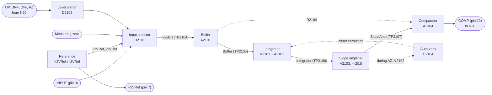
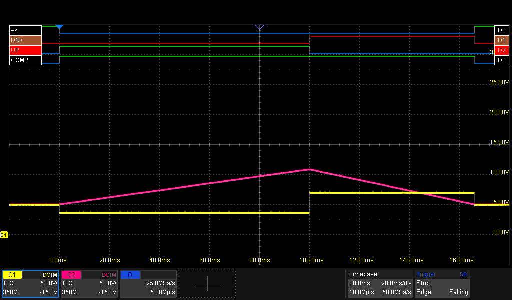
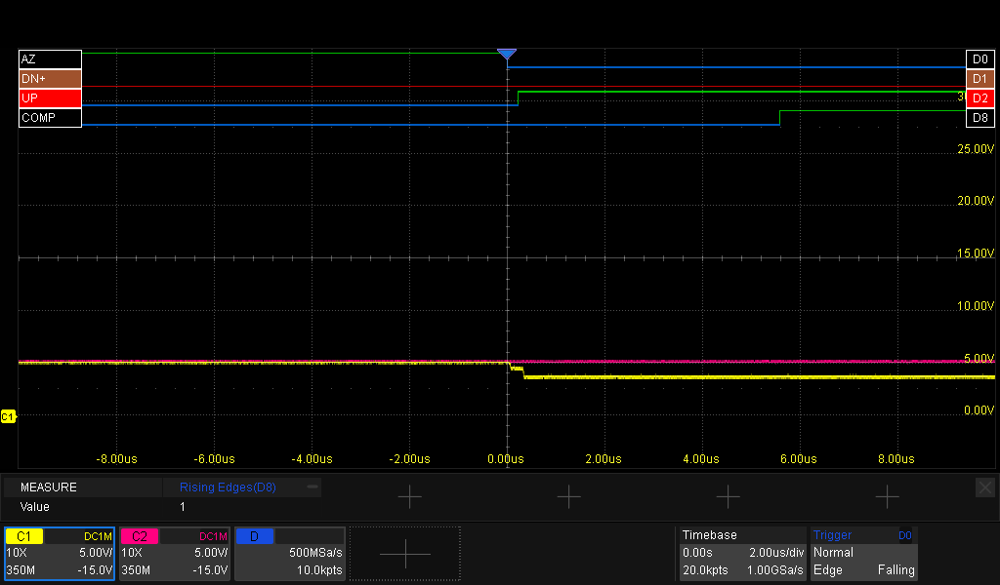

# ADC Analog (Expansionboard N21) · Operation
N21 › [Overview](README.md) · **Operation** · [Schematics](Schematics.md) · [PCB](PCB.md) · [Switching](Switching.md)

This page describes in detail how the N21 takes it role in a measurement.

## Block diagram

## Scope traces
In the scope-screendumps, you'll also see these signals:

| Trace | Description | Measuring point |
| - | - | - |
| **yellow** | Input into ADC Integrator | TP2105 |
| **purple** | ADC Integrator voltage | TP2106 |

> [!NOTE]
> The scope ground was on the -5 V rail (logic 0), so logic swings 0–5 V on screen and analog 0 V appears at +5 V.

## A Measurement Cycle from the ADC Analog's perspective
The next image shows an overview, including the most important signals.

### @0ms: start of the cycle

- The measurement starts with the **AZ**-signal from the ADC Control. This 'releases' the zero-clamping and offset-correcting circuits.
- After this, the ADC Control signals the ADC Analog to start the RampUp-phase by setting the **UP** signal.
- The integrator starts integrating (**purple trace**)

### @0-100ms: Ramp-up phase
See the first image in this section for reference.
- The ADC selects the input-signal to be fed into the integrator (**yellow trace**)
- The integrator keeps integrating (**purple trace**)
- **COMP** follows the sign of the integrator, in this example positive.

### @100ms: The fixed-time Ramp-Up phase is finished
(please add 100ms to the time in the image)

- The ADC Control releases the **UP** signal as the fixed time has passed.
- The ADC Control sets the **DN+** signal to tell the ADC Analog it can start the Ramp-Down phase.
- As a response, the ADC Analog now selects the correct Reference Signal (**yellow trace**), in this case +2V.
- The integrator now start to drain the capacitor (**purple trace**).

### @100-170ms: Ramp-down phase
See the first image in this section for reference.
- The integration-capacitor (**purple trace**) keeps draining

### @170ms: Measurement ready

- The ADC Analog detects de-integrating is ready (the capacitor-voltage crosses zero) and resets the **COMP** signal.
- The ADC Control release the **DN+** signal, telling the ADC Analog to stop the Ramp-down phase.
- The ADC Analog deselects the reference-signal from the integrator-input
- The ADC Control sets the **AZ** signal, the ADC Analog initiates the Auto-zero circuitery.

---
N21 › [Overview](README.md) · **Operation** · [Schematics](Schematics.md) · [PCB](PCB.md) · [Switching](Switching.md)
