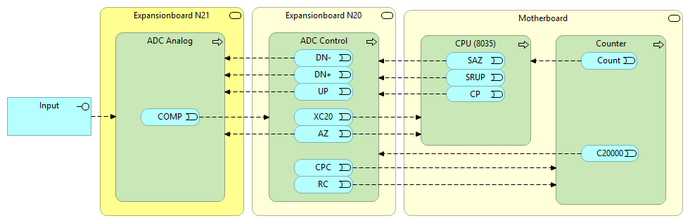

# ADC Analog (Expansionboard N21)
N21 › **Overview** · [Operation](Operation.md) · [Schematics](Schematics.md) · [PCB](PCB.md) · [Switching](Switching.md)

This expansion board realizes the actual Dual Slope Integrator.

Its functions include:
- Providing a reference voltage
- Realizing the actual Dual Slope Integrator
- Selecting the right signal to be fed into the integrator

### The signals
#### External signals (to/from this board)

🟦 signal · 🟧 supply / zero · ⬛ not connected

| Pin | Name | I/O | Description | Connected to | Testpoint |
| -: | - | :-: | - | - | - |
| 1 | 🟧 **0V** |  | Supply zero | Mainboard |  |
| 2 | 🟧 **-5V** |  | Supply | Mainboard |  |
| 3 | 🟧 **-15V** |  | Supply | Mainboard |  |
| 4 | 🟧 **+15V** |  | Supply | Mainboard |  |
| 5 | 🟧 **+5V** |  | Supply | Mainboard |  |
| 6 | 🟧 **Measuring zero** |  | Measuring zero | Mainboard |  |
| 7 | 🟦 **+2VRef** | O | 2V Reference | Mainboard | TP2101 |
| 8 | 🟧 **Measuring zero** |  | Measuring zero | Mainboard |  |
| 9 | 🟦 **INPUT** | I | Conditioned input-signal (inverted) | Mainboard | TP2108 |
| 10 | 🟧 **Measuring zero** |  | Measuring zero | Mainboard |  |
| 11 | 🟦 **DN-** | I | RampDown phase, for -pol input signals | ADC Control |  |
| 12 | 🟦 **AZ** | I | AutoZero active | ADC Control |  |
| 13 | 🟦 **DN+** | I | RampDown phase, for +pol input signals | ADC Control |  |
| 14 | 🟦 **UP** | I | RampUp phase, select input | ADC Control |  |
| 15 | ⬛ - |  | Not connected |  |  |
| 16 | ⬛ - |  | Not connected |  |  |
| 17 | ⬛ - |  | Not connected |  |  |
| 18 | 🟧 **0V** |  | Supply zero | Mainboard |  |
| 19 | 🟦 **COMP** | O | COMParator output (zero-crossing detector) | ADC Control | TP2109 |

In the scope-screendumps, you'll also see these signals:
| Trace | Description | Measuring point |
| - | - | - |
| **yellow** | Input into ADC Integrator | TP2105 |
| **purple** | ADC Integrator voltage | TP2106 |

_Note: the scope ground was on the -5 V rail (logic 0), so logic swings 0–5 V on screen and analog 0 V appears at +5 V_

## More about this board
- [Operation](Operation.md): a measurement cycle, step by step
- [Schematics](Schematics.md): the full schematic, internal signals and the sections
- [PCB](PCB.md): the board layout and 3D view
- [Switching](Switching.md): the analog switches per ADC phase
