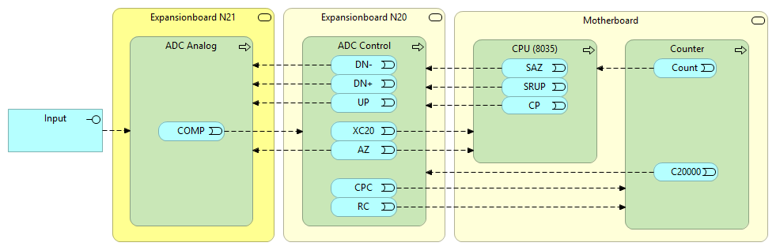
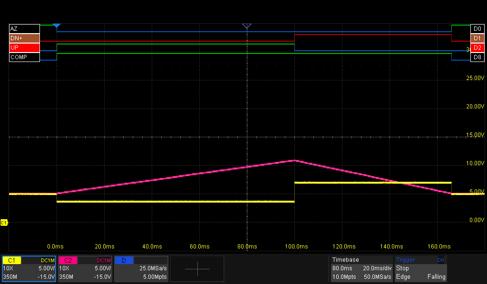
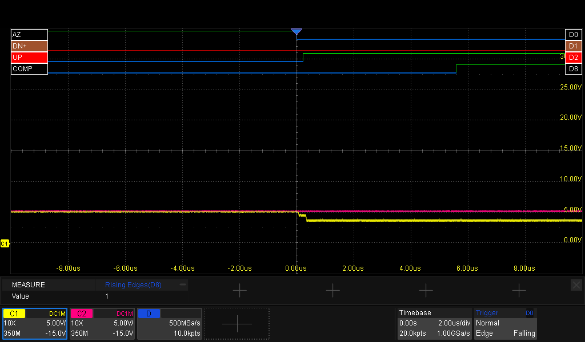
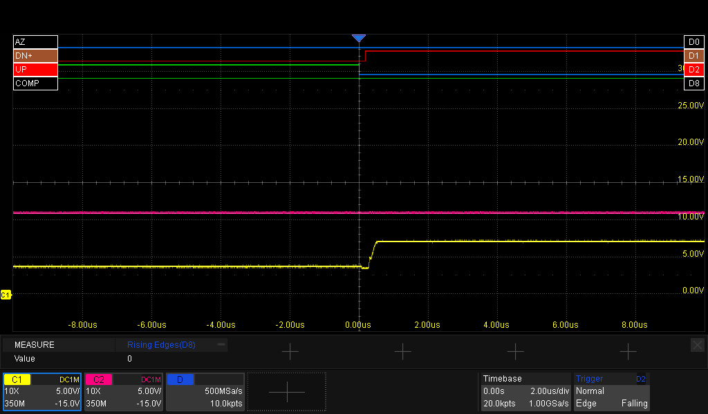
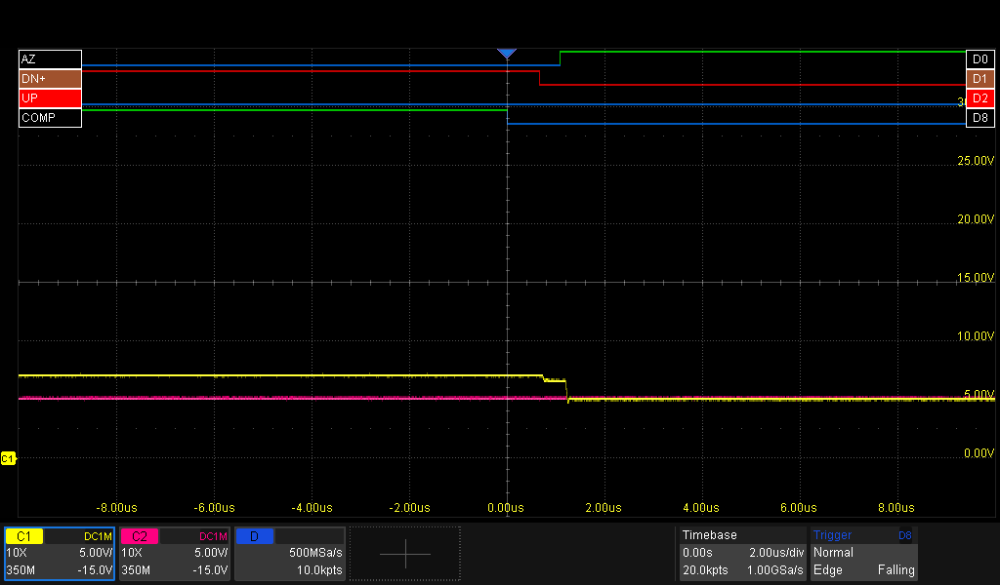
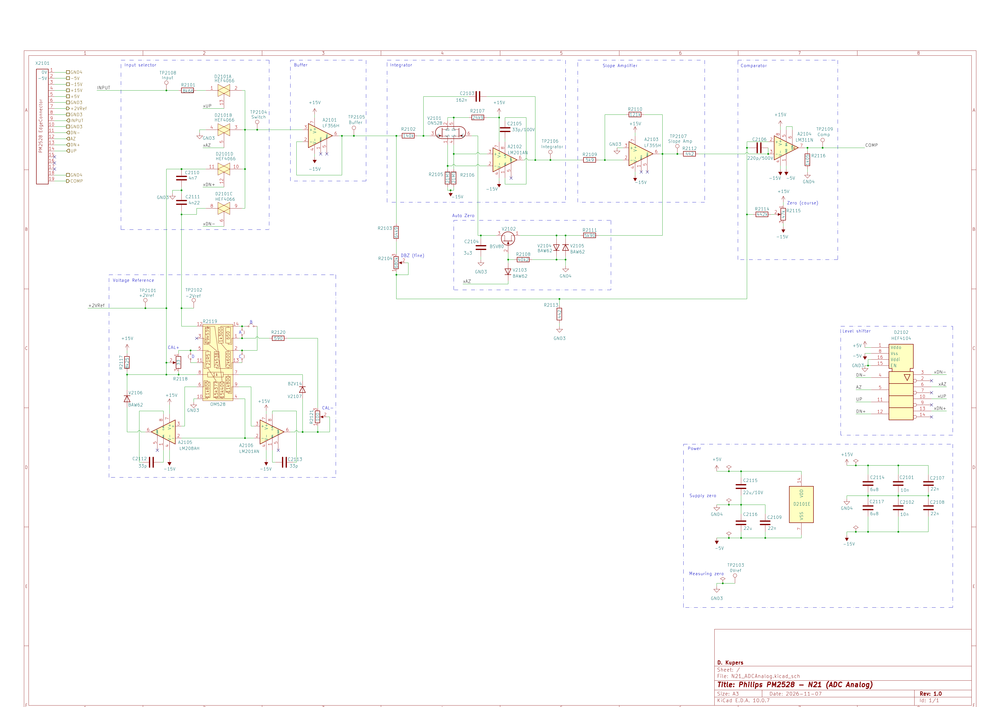
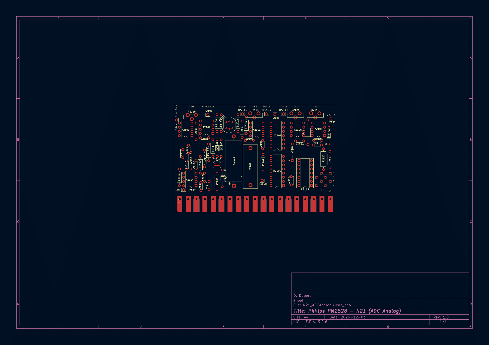
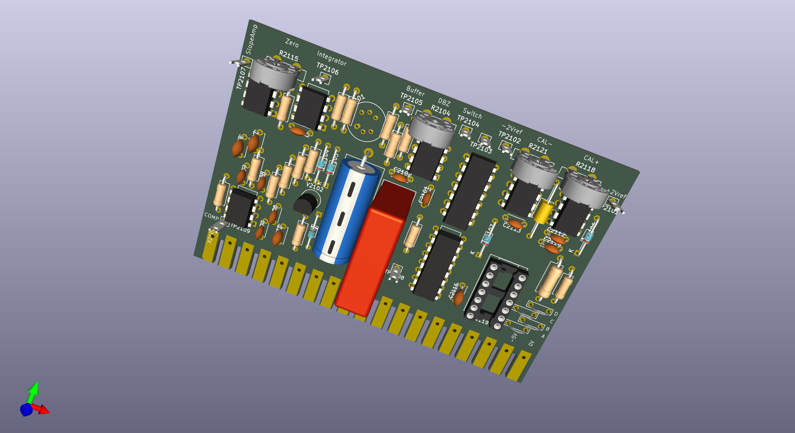

# ADC Analog (Expansionboard N21)
This expansion board realizes the actual Dual Slope Integrator.

Its functions include:
- Providing a reference voltage
- Realizing the actual Dual Slope Integrator
- Selecting the right signal to be fed into the integrator

### The signals
#### External signals (to/from this board)

| Name | Description | I/O | Pin | Source | Target | Testpoint |
| - | - | :-: | -: | - | - |- |
| **INPUT** | Conditioned input-signal (inverted) | I | 9 | Mainboard ||TP2108
| **AZ** | AutoZero active | I |12|ADC Control | |
| **DN-** | RampDown phase, for -pol input signals | I | 11 | ADC Control | |
| **DN+** | RampDown phase, for +pol input signals | I | 13| ADC Control |  |
| **UP** | RampUp phase, select input | I | 14| ADC Control | |
| **COMP** | COMParator output (zero-crossing detector) | O |19 | | ADC Control |TP2109
| **+2VRef** | 2V Reference | O | 7 | | Mainboard | TP2101

In the scope-screendumps, you'll also see these signals:
| Trace | Description | Measuring point |
| - | - | - |
| **yellow** | Input into ADC Integrator | TP2105 |
| **purple** | ADC Integrator voltage | TP2106 |

_Note: the scope ground was on the -5 V rail (logic 0), so logic swings 0–5 V on screen and analog 0 V appears at +5 V_

## A Measurement Cycle from the ADC Analog's perspective

This section describes in detail how the N21 takes it role in a measurement. The next image shows an overview, including the most important signals.

#### @0ms: start of the cycle

- The measurement starts with the **AZ**-signal from the ADC Control. This 'releases' the zero-clamping and offset-correcting circuits.
- After this, the ADC Control signals the ADC Analog to start the RampUp-phase by setting the **UP** signal.
- The integrator starts integrating (**purple trace**)

#### @0-100ms: Ramp-up phase
See the first image in this section for reference.
- The ADC selects the input-signal to be fed into the integrator (**yellow trace**)
- The integrator keeps integrating (**purple trace**)
- **COMP** follows the sign of the integrator, in this example positive.

#### @100ms: The fixed-time Ramp-Up phase is finished
(please add 100ms to the time in the image)

- The ADC Control releases the **UP** signal as the fixed time has passed.
- The ADC Control sets the **DN+** signal to tell the ADC Analog it can start the Ramp-Down phase.
- As a response, the ADC Analog now selects the correct Reference Signal (**yellow trace**), in this case +2V.
- The integrator now start to drain the capacitor (**purple trace**).

#### @100-170ms: Ramp-down phase
See the first image in this section for reference.
- The integration-capacitor (**purple trace**) keeps draining

#### @170ms: Measurement ready

- The ADC Analog detects de-integrating is ready (the capacitor-voltage crosses zero) and resets the **COMP** signal.
- The ADC Control release the **DN+** signal, telling the ADC Analog to stop the Ramp-down phase.
- The ADC Analog deselects the reference-signal from the integrator-input
- The ADC Control sets the **AZ** signal, the ADC Analog initiates the Auto-zero circuitery.

## Schematics
I copied and redrew the schematics and PCB in KiCad, using the low‑res Philips docs as a reference. There might be a few small differences since I tweaked them to match my PM2528. You’ll find the KiCad files in other parts of this repo.

#### Internal signals
| Name | Description | Testpoint |
| - | - | -|
| **Switch** | The signal-to-measure (input, ref, zero) | TP2104
| **Buffer** | The buffered signal-to-measure | TP2105
| **Integrator** | The integrated signal-to-measure | TP2106
| **SlopeAmp** | Integrator voltage x -20.5, saturates at about +/- 13V | TP2107
| **-2Vref** | Negative reference | TP2102

### Section: Input selector
This sections decides which signal to feed to the integrator: INPUT, +2VRef, -2VRef or 0V.

### Section: Buffer
Unity-gain buffer, so the integrator sees a lower-impedance source.

### Section: Integrator
THe integrator integrates via two JFETS configured as source followers.

### Section: Slope amplifier
This amplifies the integrator voltage by -20.5, making the zero-crossing steep

### Section: Comparator
This detects a zero-crossing.
R2115: This is a zero-offset trimmer, it shifts the comparator-offset (+/- 15mV)
R2104: Adds a little bit of the buffer to the threshold, making the comparator trip slightly late in both polarities.

### Section: Auto-zero
During autozero, the input-signal is 0V. C2104 stores the offset voltage of the buffer and integrator combined. This is compensated in the integrator during the next conversion.

## PCB

