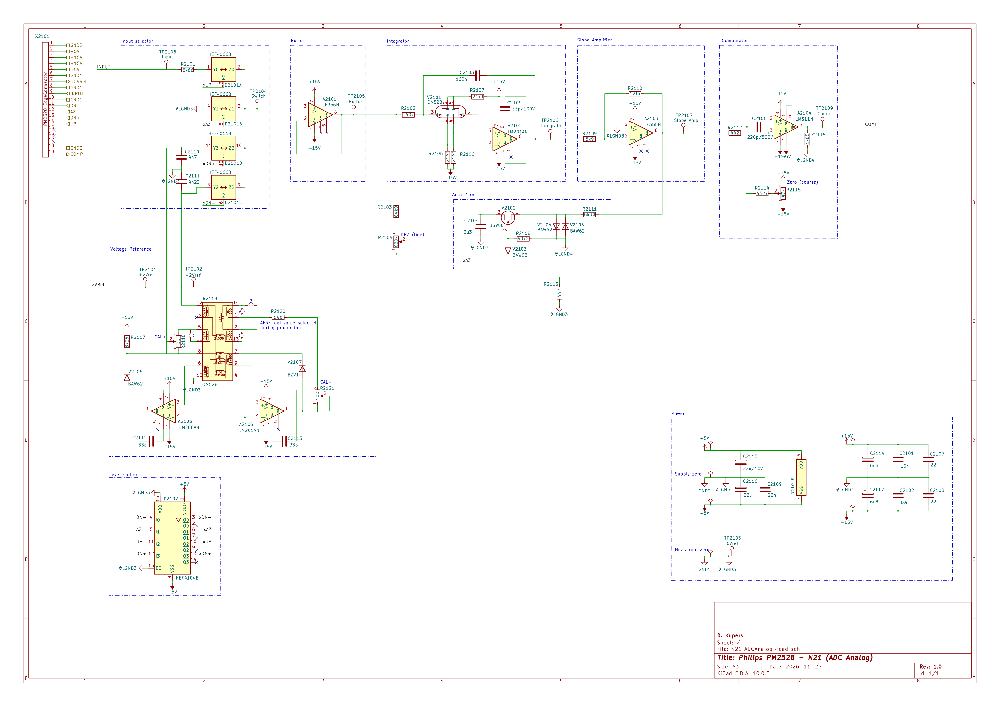
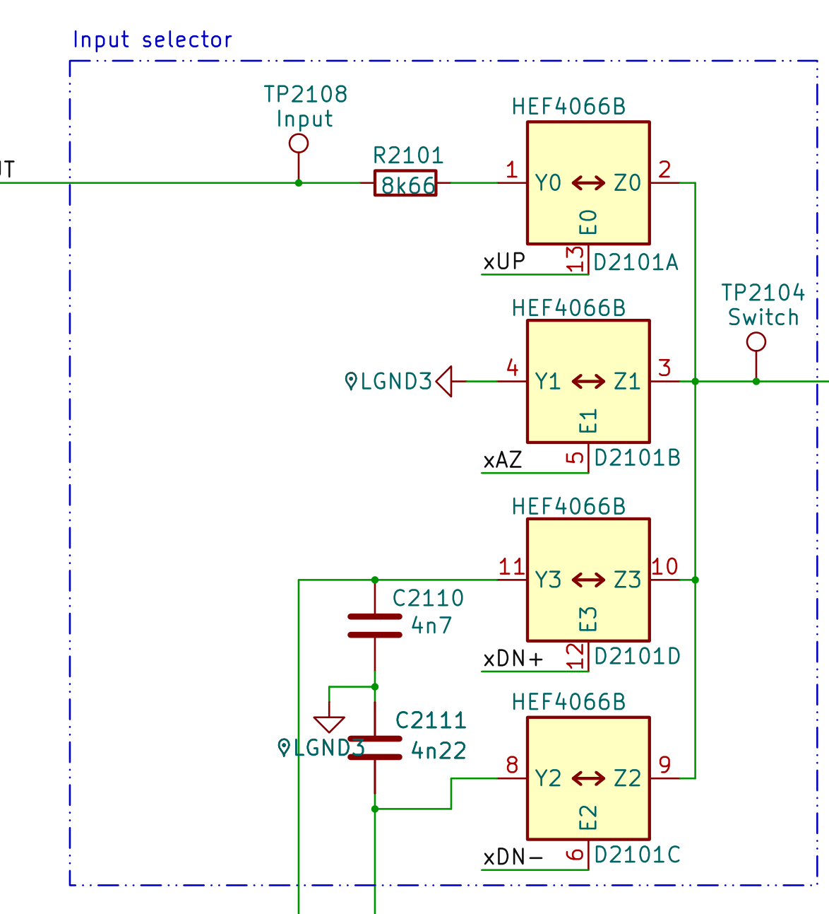
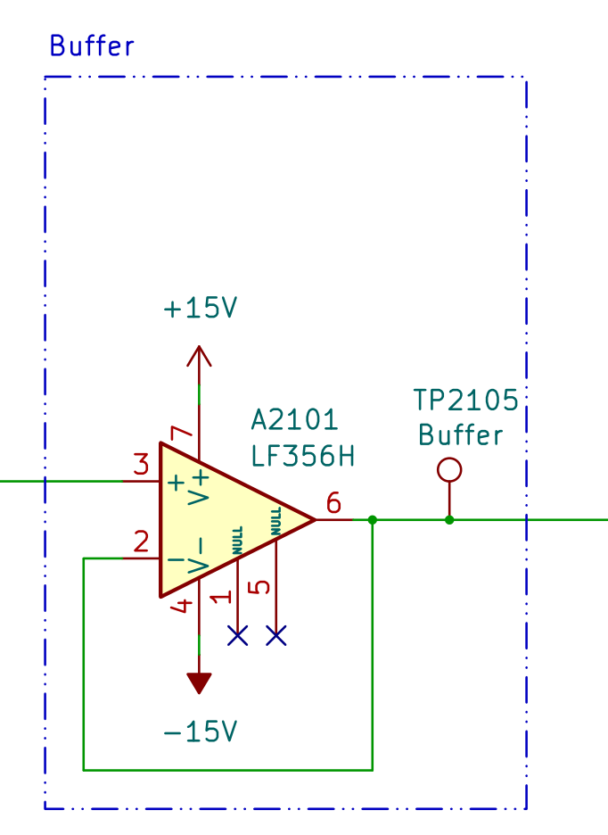
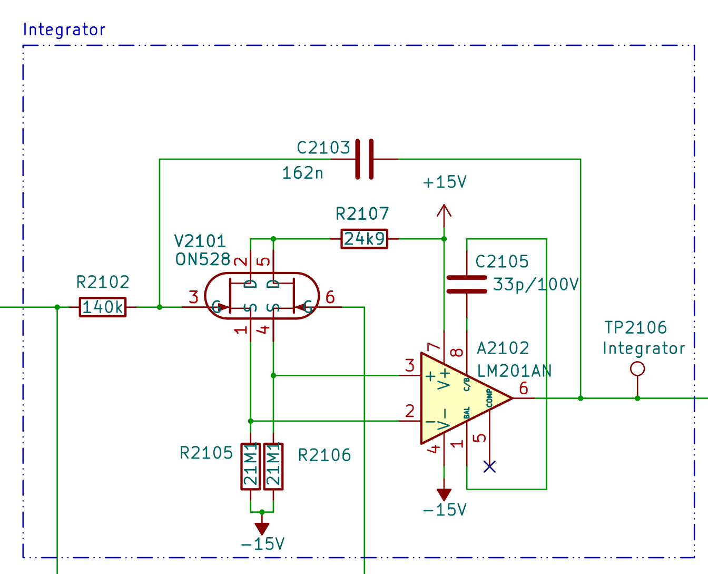
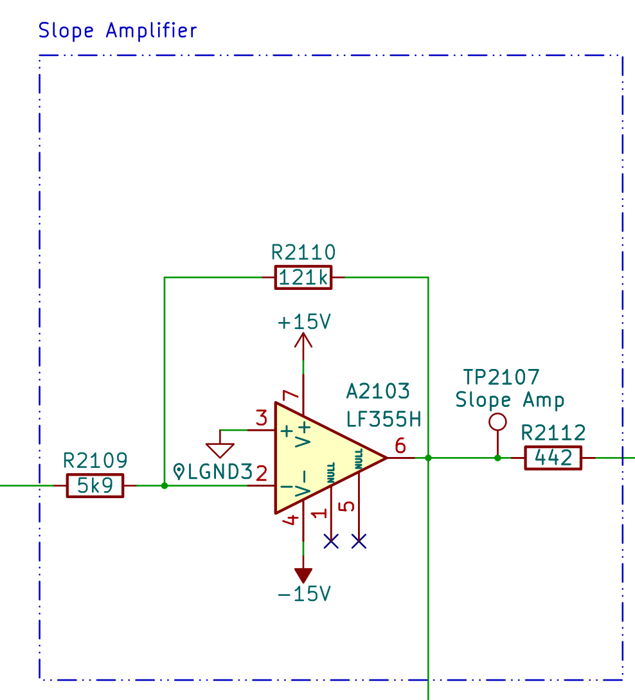
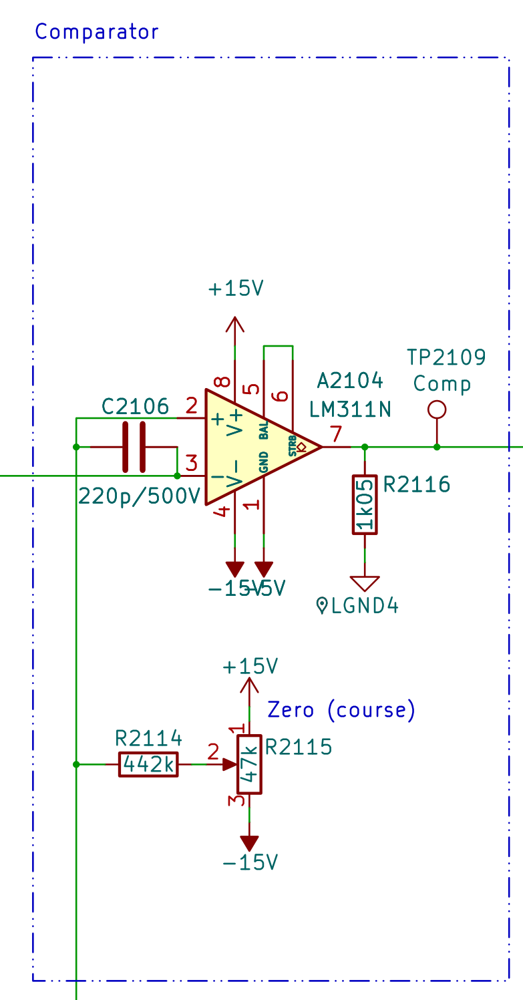
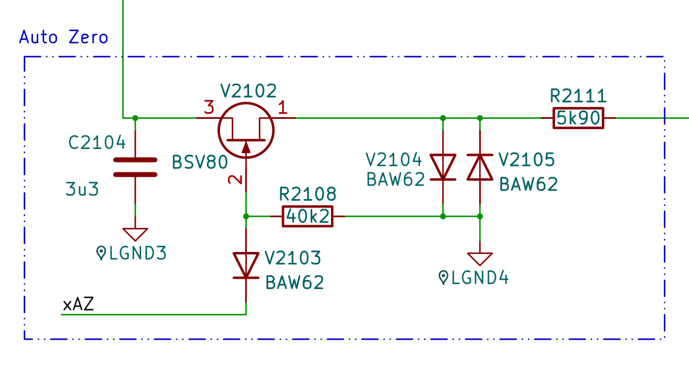
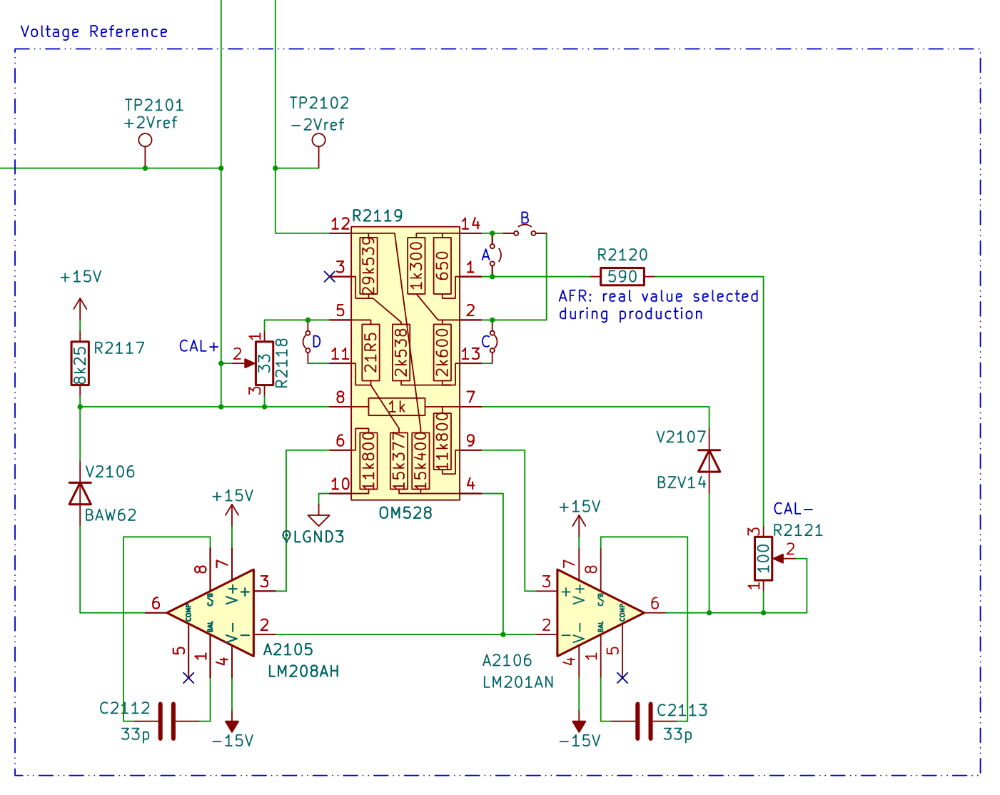

# ADC Analog (Expansionboard N21) · Schematics
N21 › [Overview](README.md) · [Operation](Operation.md) · **Schematics** · [PCB](PCB.md) · [Switching](Switching.md)

I copied and redrew the schematics and PCB in KiCad, using the low‑res Philips docs as a reference. There might be a few small differences since I tweaked them to match my PM2528. You’ll find the KiCad files in other parts of this repo.

## Full schematic

## Internal signals
The signals on the edge connector are listed on the [overview page](README.md#edge-connector). These are the local ones.

| Name | Description | Testpoint |
| - | - | -|
| **Switch** | The signal-to-measure (input, ref, zero) | TP2104
| **Buffer** | The buffered signal-to-measure | TP2105
| **Integrator** | The integrated signal-to-measure | TP2106
| **SlopeAmp** | Integrator voltage x -20.5, saturates at about +/- 13V | TP2107
| **-2Vref** | Negative reference | TP2102

## Sections
### Input selector
This sections decides which signal to feed to the integrator: INPUT, +2VRef, -2VRef or 0V. The [Switching](Switching.md) page shows which switch is closed in each ADC phase.

### Buffer
Unity-gain buffer, so the integrator sees a lower-impedance source.

### Integrator
THe integrator integrates via two JFETS configured as source followers.

### Slope amplifier
This amplifies the integrator voltage by -20.5, making the zero-crossing steep

### Comparator
This detects a zero-crossing.
R2115: This is a zero-offset trimmer, it shifts the comparator-offset (+/- 15mV)
R2104: Adds a little bit of the buffer to the threshold, making the comparator trip slightly late in both polarities.

### Auto-zero
During autozero, the input-signal is 0V. C2104 stores the offset voltage of the buffer and integrator combined. This is compensated in the integrator during the next conversion.

### Voltage reference
Makes **+2VRef** (TP2101, also on pin 7 for N23) and **-2VRef** (TP2102) for the ramp-down phase, with A2105, A2106 and the resistor network R2119 (OM528). **CAL+** (R2118) and **CAL-** (R2121) trim the two references; R2120 is selected during production (AFR).

### Level shifter
D2102 (HEF4104) shifts **UP**, **DN+**, **DN-** and **AZ** from the 0/-5 V logic of N20 to +5/-5 V for the switches of the input selector.

---
N21 › [Overview](README.md) · [Operation](Operation.md) · **Schematics** · [PCB](PCB.md) · [Switching](Switching.md)
