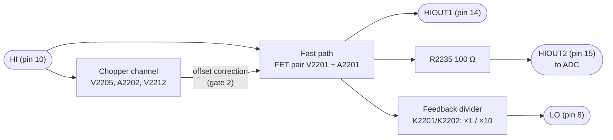

# DC Amplifier (Expansionboard N22)
N22 › **Overview** · [Operation](Operation.md) · [Schematics](Schematics.md) · [PCB](PCB.md) · [Switching](Switching.md)

This expansion board is the high-impedance input amplifier for DC voltage, resistance and current. It sits between the input relays and the ADC.

Its functions include:
- Buffering the input signal with a very high input impedance
- Amplifying it ×1 or ×10, depending on the range
- Keeping the offset at µV level with a chopper-stabilised second channel
- Protecting itself against overvoltage with clamp diodes

### The signals
#### External signals (to/from this board)

🟦 signal · 🟧 supply / zero · ⬛ not connected

| Pin | Name | I/O | Description | Connected to | Testpoint |
| -: | - | :-: | - | - | - |
| 1 | 🟧 **0V** |  | Supply zero | Mainboard |  |
| 2 | ⬛ - |  | Not connected |  |  |
| 3 | 🟧 **-15V** |  | Supply | Mainboard |  |
| 4 | 🟧 **+15V** |  | Supply | Mainboard |  |
| 5 | ⬛ - |  | Not connected |  |  |
| 6 | ⬛ - |  | Not connected |  |  |
| 7 | 🟧 **Measuring zero** |  | Measuring zero | Mainboard | TP2205 |
| 8 | 🟦 **LO** | O | Feedback divider foot, wired to the '0' input socket | Input socket '0' |  |
| 9 | 🟧 **Measuring zero** |  | Measuring zero | Mainboard |  |
| 10 | 🟦 **HI** | I | Signal to amplify | Input relays (K1202-K1204, K1307), N26 |  |
| 11 | 🟧 **Measuring zero** |  | Measuring zero | Mainboard |  |
| 12 | ⬛ - |  | Not connected |  |  |
| 13 | ⬛ - |  | Not connected |  |  |
| 14 | 🟦 **HIOUT1** | O | Amplifier output | Relays K1306, K1606-K1610, N26 | TP2204 |
| 15 | 🟦 **HIOUT2** | O | Amplifier output through R2235 (100 Ω) | ADC input selector (DC_OUT) |  |
| 16 | ⬛ - |  | Not connected |  |  |
| 17 | ⬛ - |  | Not connected |  |  |
| 18 | 🟦 **RELHI** | I | Drives the gain relays K2201/K2202 (energised = ×1) | CPU (port expander D1701) |  |
| 19 | 🟧 **0V** |  | Supply zero | Mainboard |  |

## More about this board
- [Operation](Operation.md): how the amplifier works, and the gain per range
- [Schematics](Schematics.md): the full schematic, internal signals and the sections
- [PCB](PCB.md): the board layout and 3D view
- [Switching](Switching.md): the relays and switching FETs per function and range
