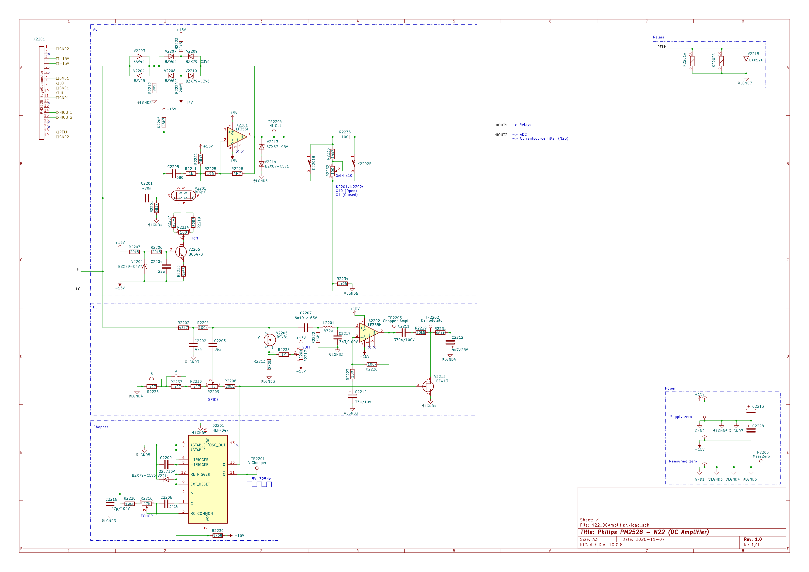
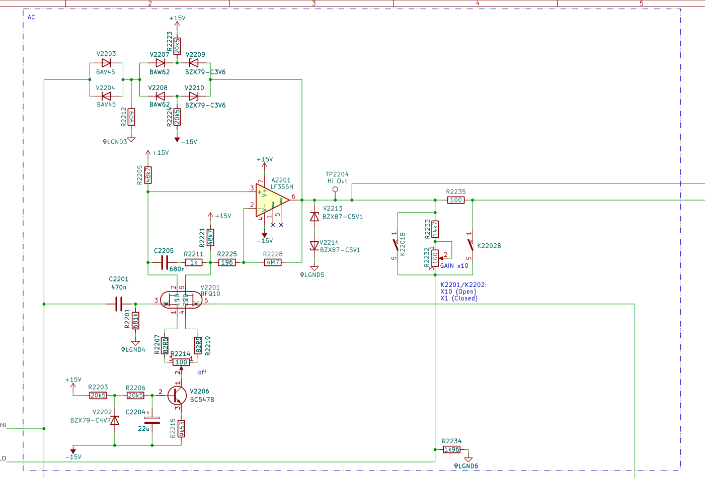
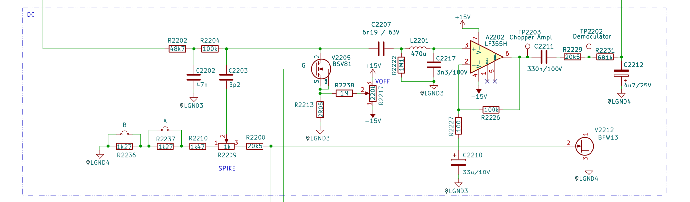
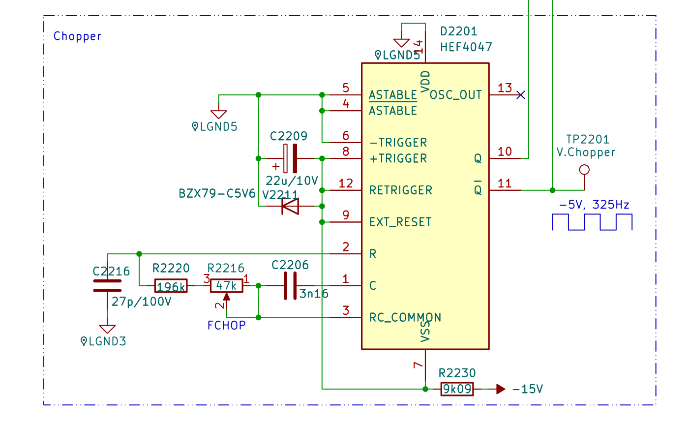
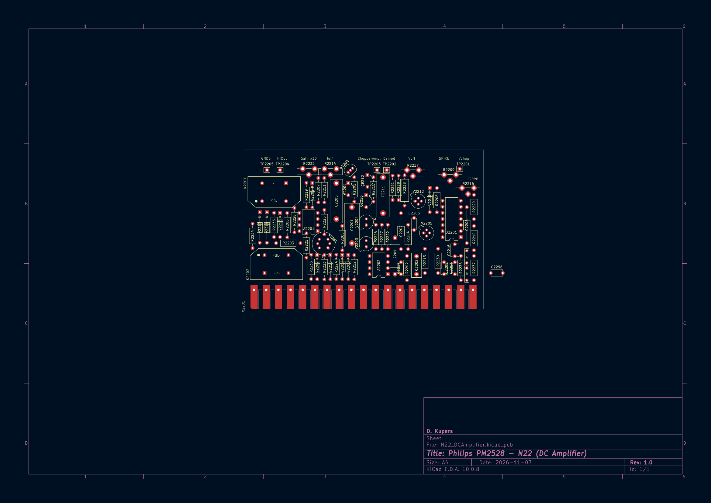
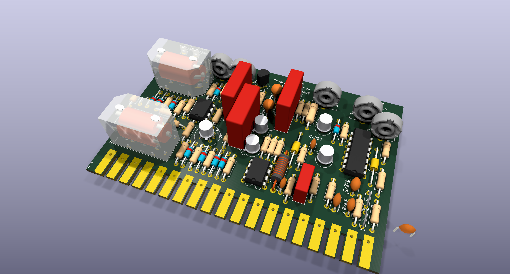

# DC Amplifier (Expansionboard N22)
This expansion board is the high-impedance input amplifier for DC voltage, resistance and current. It sits between the input relays and the ADC.

Its functions include:
- Buffering the input signal with a very high input impedance
- Amplifying it ×1 or ×10, depending on the range
- Keeping the offset at µV level with a chopper-stabilised second channel
- Protecting itself against overvoltage with clamp diodes

### The signals
#### External signals (to/from this board)

🟦 signal · 🟧 supply / zero · ⬛ not connected

| Pin | Name | I/O | Description | Connected to | Testpoint |
| -: | - | :-: | - | - | - |
| 1 | 🟧 **0V** |  | Supply zero | Mainboard |  |
| 2 | ⬛ - |  | Not connected |  |  |
| 3 | 🟧 **-15V** |  | Supply | Mainboard |  |
| 4 | 🟧 **+15V** |  | Supply | Mainboard |  |
| 5 | ⬛ - |  | Not connected |  |  |
| 6 | ⬛ - |  | Not connected |  |  |
| 7 | 🟧 **Measuring zero** |  | Measuring zero | Mainboard | TP2205 |
| 8 | 🟦 **LO** | O | Feedback divider foot, wired to the '0' input socket | Input socket '0' |  |
| 9 | 🟧 **Measuring zero** |  | Measuring zero | Mainboard |  |
| 10 | 🟦 **HI** | I | Signal to amplify | Input relays (K1202-K1204, K1307), N26 |  |
| 11 | 🟧 **Measuring zero** |  | Measuring zero | Mainboard |  |
| 12 | ⬛ - |  | Not connected |  |  |
| 13 | ⬛ - |  | Not connected |  |  |
| 14 | 🟦 **HIOUT1** | O | Amplifier output | Relays K1306, K1606-K1610, N26 | TP2204 |
| 15 | 🟦 **HIOUT2** | O | Amplifier output through R2235 (100 Ω) | ADC input selector (DC_OUT) |  |
| 16 | ⬛ - |  | Not connected |  |  |
| 17 | ⬛ - |  | Not connected |  |  |
| 18 | 🟦 **RELHI** | I | Drives the gain relays K2201/K2202 (energised = ×1) | CPU (port expander D1701) |  |
| 19 | 🟧 **0V** |  | Supply zero | Mainboard |  |

_Note: I haven't made scope captures of this board yet, so the description below is based on the schematics, the Philips documentation and the firmware._

## How it works
N22 is a chopper-stabilised amplifier: a fast DC-coupled path does the work, and a slow chopper channel corrects its offset and drift.

#### The fast path
- HI goes through C2201 (0.47 µF, with R2201 681k to zero) to gate 1 of the dual FET V2201 (BFQ10), followed by op-amp A2201.
- V2206 is the tail current source of the FET pair: about 0.43 mA, so about 0.21 mA per FET.
- **Ioff** (R2214) balances the pair (about ±21 mV), so the second gate sits near 0 V.

#### The chopper channel
- HI also goes through R2202/C2202 and R2204 to the chopper V2205 (BSV81 MOSFET), which shorts the signal to zero about 325 times per second.
- D2201 (HEF4047 astable, **Fchop** R2216) makes the chopper clock.
- A2202 amplifies the chopped signal about 1000×. The synchronous demodulator V2212 turns it back into DC.
- R2231/C2212 filter the result and feed it to gate 2 of V2201. So the DC accuracy comes from the chopper channel, the speed from the fast path.

#### Gain
- The output goes back through the divider R2233 (14k7) + R2232 (**Gain ×10** trim) to LO, then R2234 (1k96) to zero.
- The relays K2201 and K2202 short this divider: closed = ×1, open = ×10. RELHI drives them.

| Function | Ranges | Gain |
| - | - | :-: |
| VDC | 200 mV | ×10 |
| VDC | 2 V - 2000 V | ×1 |
| Ω (2-wire) | all | ×1 |
| ADC | all | ×10 |
| ADC+AC | 2 µA - 2000 µA | ×10 |
| ADC+AC | 20 mA - 2000 mA | ×1 |

_Note: the divider on the card gives 8.52, not 10 (measured 2026-11-21). The missing factor of about 1.17 comes from outside the card, or "×10" is not the literal gain. A powered measurement (100.0 mV on the 200 mV range, TP2204) is still to do._

## Schematics
I copied and redrew the schematics and PCB in KiCad, using the low‑res Philips docs as a reference. There might be a few small differences since I tweaked them to match my PM2528. You’ll find the KiCad files in other parts of this repo.

The input- and output signals of this board are listed at the top of the page. The 'local' signals are listed in the next table.

#### Internal signals
| Name | Description | Testpoint |
| - | - | - |
| **V.Chopper** | Chopper clock (D2201 /Q), about 325 Hz, 0/-5 V | TP2201
| **Demodulator** | Output of the synchronous demodulator V2212 | TP2202
| **Chopper Ampl** | Output of the chopper amplifier A2202 | TP2203
| **Hi Out** | Amplifier output (= HIOUT1) | TP2204
| **MeasZero** | Measuring zero | TP2205

### Section: AC (fast path)
The dual FET V2201 and A2201 form the main amplifier, with its own local loop (R2228 4M7 / R2225 196 Ω). This section also holds the gain relays K2201/K2202 and the input clamps: low-leakage BAV45 diodes from HI to a node near zero (R2212), and BAW62 diodes with 3V6 zeners that reference that node to the output. Two back-to-back BZX87-C5V1 zeners clamp the output.

### Section: DC (chopper channel)
The chopper V2205, the chopper amplifier A2202 (with the L2201/C2217 filter in front of it) and the demodulator V2212. The **Voff** trimmer R2217 injects ±15 µA through R2238 into the chopper's source resistor R2213 (2.05 Ω), which gives about ±30 µV of offset correction.

### Section: Chopper
D2201 (HEF4047) runs as an astable at about 325 Hz (**Fchop** R2216) and drives the chopper and the demodulator, at 0/-5 V. **SPIKE** (R2209) feeds the inverted clock through C2203 (8p2) into the input to cancel the switching spikes of the chopper. JP2201/JP2202 select the trim range.

## PCB

