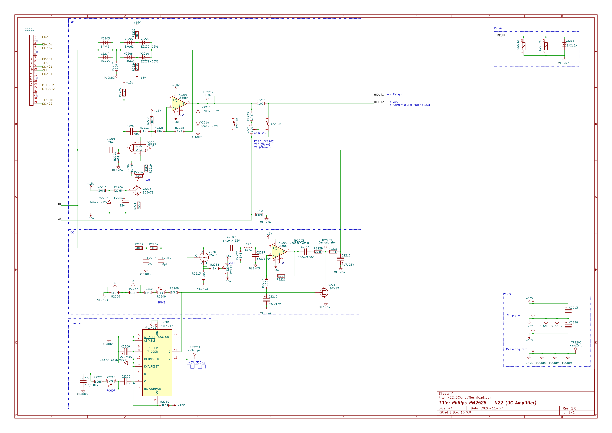
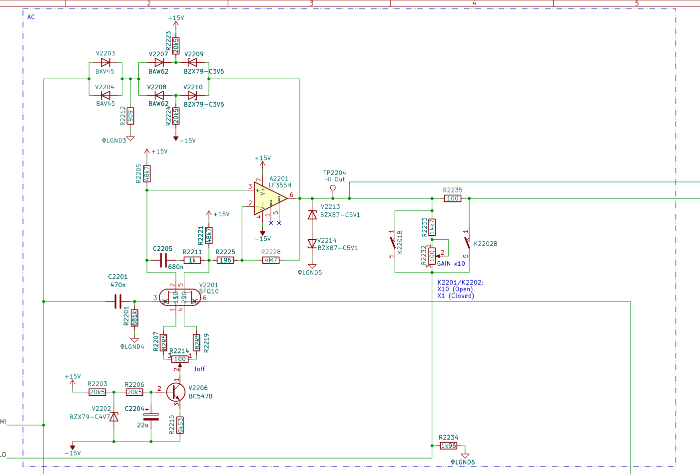
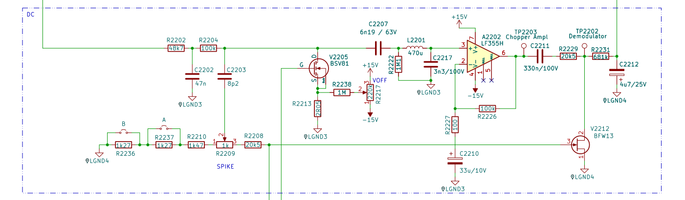
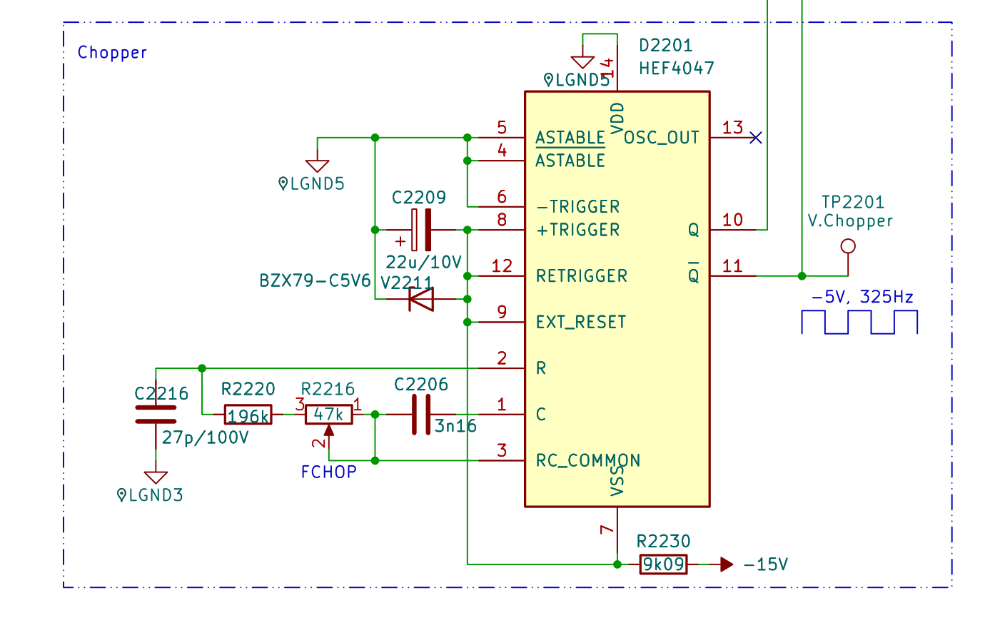

# DC Amplifier (Expansionboard N22) · Schematics
N22 › [Overview](README.md) · [Operation](Operation.md) · **Schematics** · [PCB](PCB.md) · [Switching](Switching.md)

## Schematics
I copied and redrew the schematics and PCB in KiCad, using the low‑res Philips docs as a reference. There might be a few small differences since I tweaked them to match my PM2528. You’ll find the KiCad files in other parts of this repo.

The input- and output signals of this board are listed on the [overview page](README.md#the-signals). The 'local' signals are listed in the next table.

#### Internal signals
| Name | Description | Testpoint |
| - | - | - |
| **V.Chopper** | Chopper clock (D2201 /Q), about 325 Hz, 0/-5 V | TP2201
| **Demodulator** | Output of the synchronous demodulator V2212 | TP2202
| **Chopper Ampl** | Output of the chopper amplifier A2202 | TP2203
| **Hi Out** | Amplifier output (= HIOUT1) | TP2204
| **MeasZero** | Measuring zero | TP2205

### Section: AC (fast path)
The dual FET V2201 and A2201 form the main amplifier, with its own local loop (R2228 4M7 / R2225 196 Ω). This section also holds the gain relays K2201/K2202 and the input clamps: low-leakage BAV45 diodes from HI to a node near zero (R2212), and BAW62 diodes with 3V6 zeners that reference that node to the output. Two back-to-back BZX87-C5V1 zeners clamp the output.

### Section: DC (chopper channel)
The chopper V2205, the chopper amplifier A2202 (with the L2201/C2217 filter in front of it) and the demodulator V2212. The **Voff** trimmer R2217 injects ±15 µA through R2238 into the chopper's source resistor R2213 (2.05 Ω), which gives about ±30 µV of offset correction.

### Section: Chopper
D2201 (HEF4047) runs as an astable at about 325 Hz (**Fchop** R2216) and drives the chopper and the demodulator, at 0/-5 V. **SPIKE** (R2209) feeds the inverted clock through C2203 (8p2) into the input to cancel the switching spikes of the chopper. JP2201/JP2202 select the trim range.

