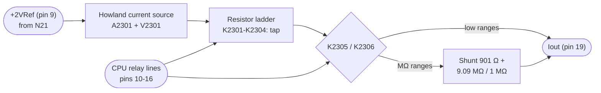

# Current Source (Expansionboard N23) · Operation
N23 › [Overview](README.md) · **Operation** · [Schematics](Schematics.md) · [PCB](PCB.md) · [Switching](Switching.md)

> [!NOTE]
> I haven't made scope captures of this board yet, so the description below is based on the schematics, the Philips documentation and the firmware.

## Block diagram

## How it works
A2301 and V2301 form a Howland current source. A2301 holds the voltage across the ladder, between the selected tap and V2301's emitter, at 2 × Vref = 4 V (R2306 : R2303 = 2 : 1). The taps give 10 mA, 1 mA, 100 µA or 10 µA.

- V2301 is a PNP with its collector on -15 V, so the source can only sink current: it pulls current out of the Ω input, and the voltage across the resistor is negative.
- In the MΩ ranges, K2305 opens and K2306 puts R2326 + R2327 (901 Ω) as a shunt to measuring zero. Only a small part flows to the output: through R2328-R2330 (9.09 MΩ), or with K2307 also through R2331-R2333 (1 MΩ) in parallel. That divides by 10⁴ or 10³.

| Range | Relays (from the firmware) | Current, Rx = 0 | Voltage at full scale |
| - | - | -: | -: |
| 200 Ω | K2301, K2305 | 10 mA | 2 V |
| 2000 Ω, Temp, 4-wire 2000 Ω | K2302, K2305 | 1 mA | 2 V |
| 20 kΩ | K2303, K2305 | 100 µA | 2 V |
| 200 kΩ | K2304, K2305 | 10 µA | 1.95 V |
| 2000 kΩ | K2302, K2306, K2307 | 1 µA | 0.62 V |
| 20 MΩ | K2303, K2306, K2307 | 100 nA | 0.086 V |
| 200 MΩ | K2303, K2306 | 10 nA | 0.086 V |
| 2000 MΩ | K2304, K2306 | 1 nA | 0.009 V |

> [!NOTE]
> The voltages are calculated with an ideal op-amp. In the MΩ ranges the output is a 0.09 V source behind 0.9 MΩ or 9 MΩ, not a current source, so the full-scale voltage is far below 2 V and not linear. The firmware has no Ω linearisation, so something outside N23 must make up for this. Still open: measure the output with 1 MΩ and 10 MΩ on the 2000 kΩ and 20 MΩ ranges.

---
N23 › [Overview](README.md) · **Operation** · [Schematics](Schematics.md) · [PCB](PCB.md) · [Switching](Switching.md)
