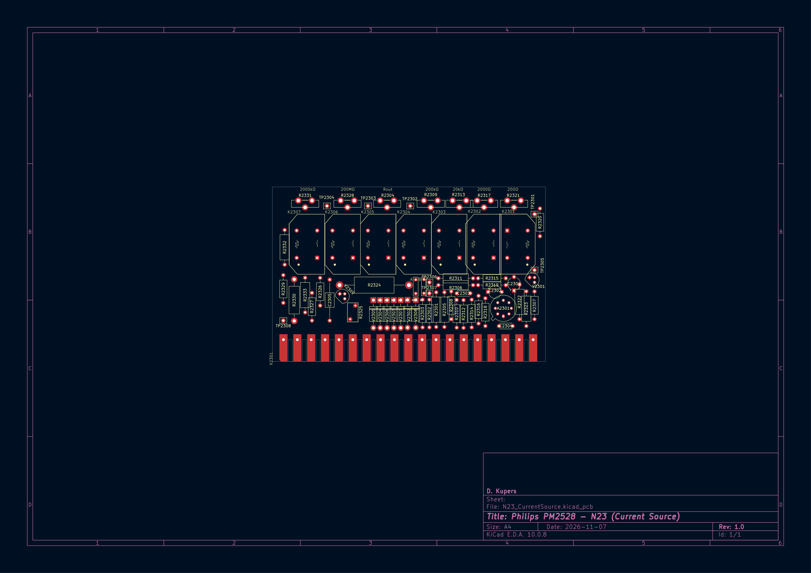
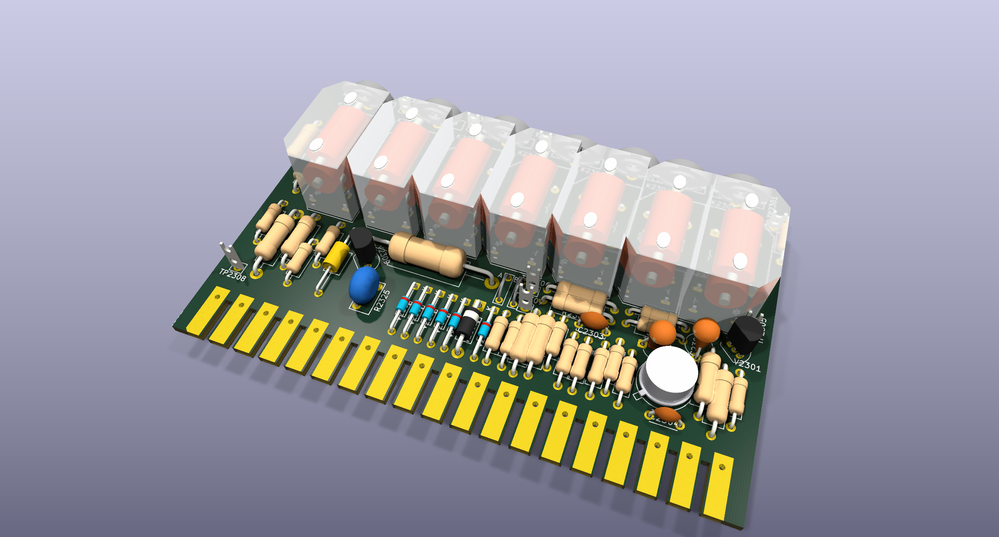

# Current Source (Expansionboard N23) · PCB
N23 › [Overview](README.md) · [Operation](Operation.md) · [Schematics](Schematics.md) · **PCB** · [Switching](Switching.md)

The board as I redrew it in KiCad, using the Philips documentation as a reference.

## Layout

## 3D view

---
N23 › [Overview](README.md) · [Operation](Operation.md) · [Schematics](Schematics.md) · **PCB** · [Switching](Switching.md)
