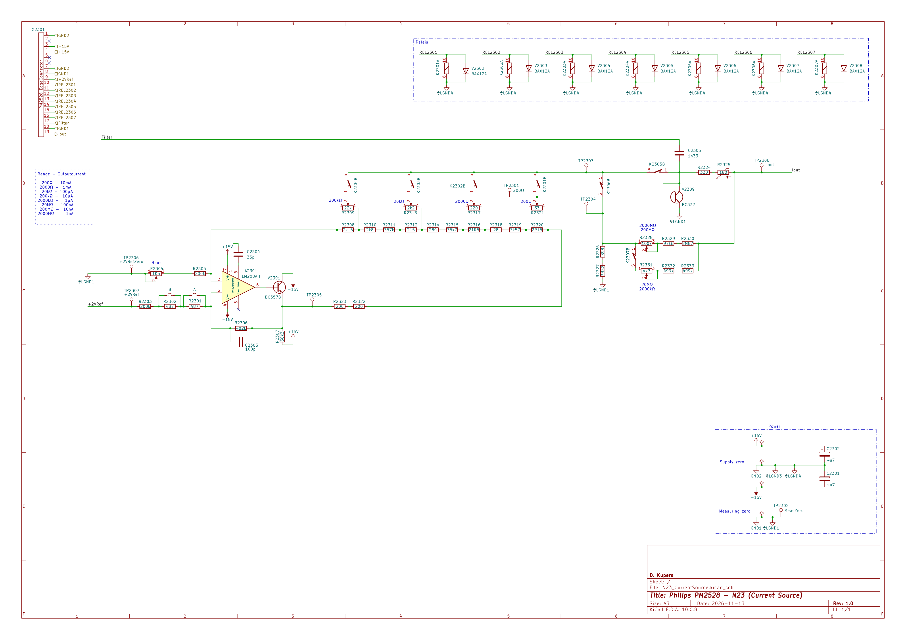
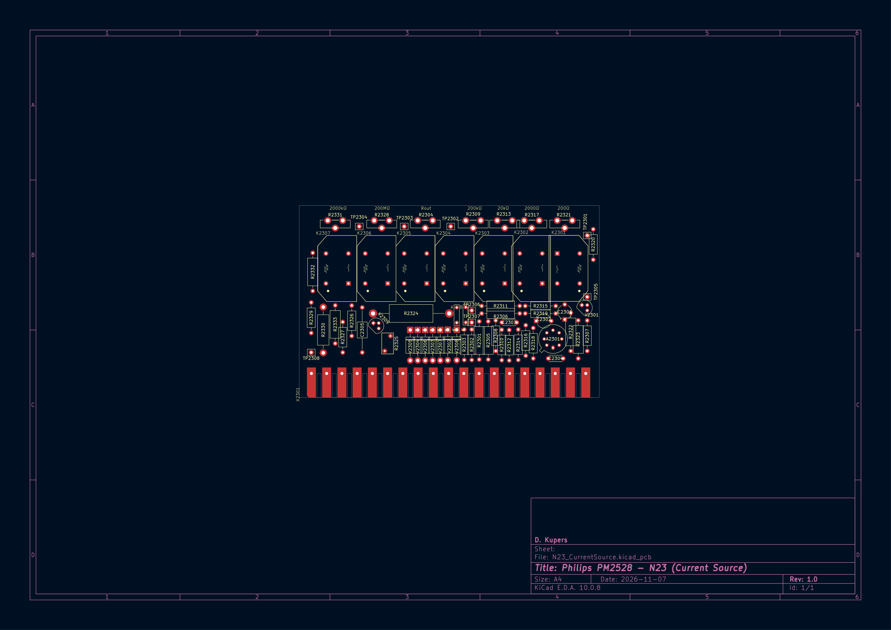
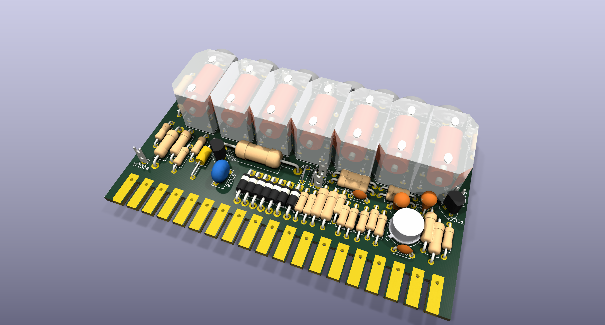

# Current Source (Expansionboard N23)
This expansion board delivers the measuring current for the resistance and temperature functions.

Its functions include:
- Making a precise current from the 2 V reference
- Selecting the current with relays (10 mA down to 10 µA)
- Making a weak source for the MΩ ranges
- Protecting itself against voltage on the Ω input

### The signals
#### External signals (to/from this board)

🟦 signal · 🟧 supply / zero · ⬛ not connected

| Pin | Name | I/O | Description | Connected to | Testpoint |
| -: | - | :-: | - | - | - |
| 1 | 🟧 **0V** |  | Supply zero | Mainboard |  |
| 2 | ⬛ - |  | Not connected |  |  |
| 3 | 🟧 **-15V** |  | Supply | Mainboard |  |
| 4 | 🟧 **+15V** |  | Supply | Mainboard |  |
| 5 | ⬛ - |  | Not connected |  |  |
| 6 | ⬛ - |  | Not connected |  |  |
| 7 | 🟧 **0V** |  | Supply zero | Mainboard |  |
| 8 | 🟧 **Zero** |  | Reference zero | Mainboard | TP2306 |
| 9 | 🟦 **+2VRef** | I | 2 V reference | N21 | TP2307 |
| 10 | 🟦 **REL2301** | I | Relay K2301 (200 Ω tap) | CPU (D1701) |  |
| 11 | 🟦 **REL2302** | I | Relay K2302 (2000 Ω tap) | CPU (D1701) |  |
| 12 | 🟦 **REL2303** | I | Relay K2303 (20 kΩ tap) | CPU (D1701) |  |
| 13 | 🟦 **REL2304** | I | Relay K2304 (200 kΩ tap) | CPU (D1701) |  |
| 14 | 🟦 **REL2305** | I | Relay K2305 (current source direct to the output) | CPU (D1701) |  |
| 15 | 🟦 **REL2306** | I | Relay K2306 (MΩ ranges: shunt and divider) | CPU (D1701) |  |
| 16 | 🟦 **REL2307** | I | Relay K2307 (1 MΩ divider in parallel) | CPU (D1701) |  |
| 17 | 🟦 **Filter** | I | Filter return: C2305 (1.33 nF) from the output node to the DC amplifier output (Fig 7.22: "FILTER N22/15") | N22 pin 15 (HIOUT2) |  |
| 18 | 🟧 **Measuring zero** |  | Measuring zero | Mainboard | TP2302 |
| 19 | 🟦 **Iout** | O | Measuring current to the Ω input | Input relays K1301/K1302 | TP2308 |

_Note: I haven't made scope captures of this board yet, so the description below is based on the schematics, the Philips documentation and the firmware._

## How it works
A2301 and V2301 form a Howland current source. A2301 holds the voltage across the ladder, between the selected tap and V2301's emitter, at 2 × Vref = 4 V (R2306 : R2303 = 2 : 1). The taps give 10 mA, 1 mA, 100 µA or 10 µA.

- V2301 is a PNP with its collector on -15 V, so the source can only sink current: it pulls current out of the Ω input, and the voltage across the resistor is negative.
- In the MΩ ranges, K2305 opens and K2306 puts R2326 + R2327 (901 Ω) as a shunt to measuring zero. Only a small part flows to the output: through R2328-R2330 (9.09 MΩ), or with K2307 also through R2331-R2333 (1 MΩ) in parallel. That divides by 10⁴ or 10³.

| Range | Relays (from the firmware) | Current, Rx = 0 | Voltage at full scale |
| - | - | -: | -: |
| 200 Ω | K2301, K2305 | 10 mA | 2 V |
| 2000 Ω, Temp, 4-wire 2000 Ω | K2302, K2305 | 1 mA | 2 V |
| 20 kΩ | K2303, K2305 | 100 µA | 2 V |
| 200 kΩ | K2304, K2305 | 10 µA | 1.95 V |
| 2000 kΩ | K2302, K2306, K2307 | 1 µA | 0.62 V |
| 20 MΩ | K2303, K2306, K2307 | 100 nA | 0.086 V |
| 200 MΩ | K2303, K2306 | 10 nA | 0.086 V |
| 2000 MΩ | K2304, K2306 | 1 nA | 0.009 V |

_Note: the voltages are calculated with an ideal op-amp. In the MΩ ranges the output is a 0.09 V source behind 0.9 MΩ or 9 MΩ, not a current source, so the full-scale voltage is far below 2 V and not linear. The firmware has no Ω linearisation, so something outside N23 must make up for this. Still open: measure the output with 1 MΩ and 10 MΩ on the 2000 kΩ and 20 MΩ ranges._

## Schematics
I copied and redrew the schematics and PCB in KiCad, using the low‑res Philips docs as a reference. There might be a few small differences since I tweaked them to match my PM2528. You’ll find the KiCad files in other parts of this repo.

#### Internal signals
| Name | Description | Testpoint |
| - | - | - |
| **200Ω** | Ladder tap for the 200 Ω range (K2301) | TP2301
| **MeasZero** | Measuring zero | TP2302
| **K2301 contact** | Ladder node at the K2301 contact | TP2303
| **Shunt** | Top of the MΩ shunt R2326 + R2327 (K2306) | TP2304
| **V2301 emitter** | Current source node at V2301 emitter (C2303, R2306) | TP2305
| **+2VRefZero** | Reference zero | TP2306
| **+2VRef** | 2 V reference | TP2307
| **Iout** | Output current | TP2308

### Section: Current source
A2301 with V2301. **Rout** (R2304) trims the balance of the Howland circuit, so the output resistance gets as high as possible.

### Section: Range ladder
The resistor ladder with the relays K2301-K2304. The trimmers R2309, R2313, R2317 and R2321 set each decade.

### Section: MΩ ranges
K2305 connects the current source straight to the output in the low ranges. K2306 and K2307 switch the shunt and the 9.09 MΩ / 1 MΩ dividers for the MΩ ranges. R2331 trims the 2000 kΩ / 20 MΩ ranges, R2328 the 200 MΩ / 2000 MΩ ranges.

### Section: Filter
C2305 (1.33 nF) connects the output node to pin 17, which the Philips drawing labels "FILTER N22/15": the output of the DC amplifier N22. In the Ω ranges N22 runs at ×1, so its output follows the measured voltage. The capacitor then carries no DC current and doesn't slow down the settling, but hum and noise on the test leads see a low impedance. This is my interpretation; the link on the mainboard is still to be checked.

### Section: Protection
R2325 is a PTC (100 Ω cold) in series with the output. V2309 (BC337, base and collector tied) clamps the output node at about +0.6 V against positive voltage on the Ω input. With the normal negative output it stays off.

## PCB

