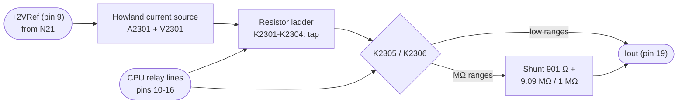

# Current Source (Expansionboard N23)
N23 › **Overview** · [Operation](Operation.md) · [Schematics](Schematics.md) · [PCB](PCB.md) · [Switching](Switching.md)

This expansion board delivers the measuring current for the resistance and temperature functions.

Its functions include:
- Making a precise current from the 2 V reference
- Selecting the current with relays (10 mA down to 10 µA)
- Making a weak source for the MΩ ranges
- Protecting itself against voltage on the Ω input

### The signals
#### External signals (to/from this board)

🟦 signal · 🟧 supply / zero · ⬛ not connected

| Pin | Name | I/O | Description | Connected to | Testpoint |
| -: | - | :-: | - | - | - |
| 1 | 🟧 **0V** |  | Supply zero | Mainboard |  |
| 2 | ⬛ - |  | Not connected |  |  |
| 3 | 🟧 **-15V** |  | Supply | Mainboard |  |
| 4 | 🟧 **+15V** |  | Supply | Mainboard |  |
| 5 | ⬛ - |  | Not connected |  |  |
| 6 | ⬛ - |  | Not connected |  |  |
| 7 | 🟧 **0V** |  | Supply zero | Mainboard |  |
| 8 | 🟧 **Zero** |  | Reference zero | Mainboard | TP2306 |
| 9 | 🟦 **+2VRef** | I | 2 V reference | N21 | TP2307 |
| 10 | 🟦 **REL2301** | I | Relay K2301 (200 Ω tap) | CPU (D1701) |  |
| 11 | 🟦 **REL2302** | I | Relay K2302 (2000 Ω tap) | CPU (D1701) |  |
| 12 | 🟦 **REL2303** | I | Relay K2303 (20 kΩ tap) | CPU (D1701) |  |
| 13 | 🟦 **REL2304** | I | Relay K2304 (200 kΩ tap) | CPU (D1701) |  |
| 14 | 🟦 **REL2305** | I | Relay K2305 (current source direct to the output) | CPU (D1701) |  |
| 15 | 🟦 **REL2306** | I | Relay K2306 (MΩ ranges: shunt and divider) | CPU (D1701) |  |
| 16 | 🟦 **REL2307** | I | Relay K2307 (1 MΩ divider in parallel) | CPU (D1701) |  |
| 17 | 🟦 **Filter** | I | Filter return: C2305 (1.33 nF) from the output node to the DC amplifier output (Fig 7.22: "FILTER N22/15") | N22 pin 15 (HIOUT2) |  |
| 18 | 🟧 **Measuring zero** |  | Measuring zero | Mainboard | TP2302 |
| 19 | 🟦 **Iout** | O | Measuring current to the Ω input | Input relays K1301/K1302 | TP2308 |

## More about this board
- [Operation](Operation.md): how the current source works, and the current per range
- [Schematics](Schematics.md): the full schematic, internal signals and the sections
- [PCB](PCB.md): the board layout and 3D view
- [Switching](Switching.md): the relays per function and range
