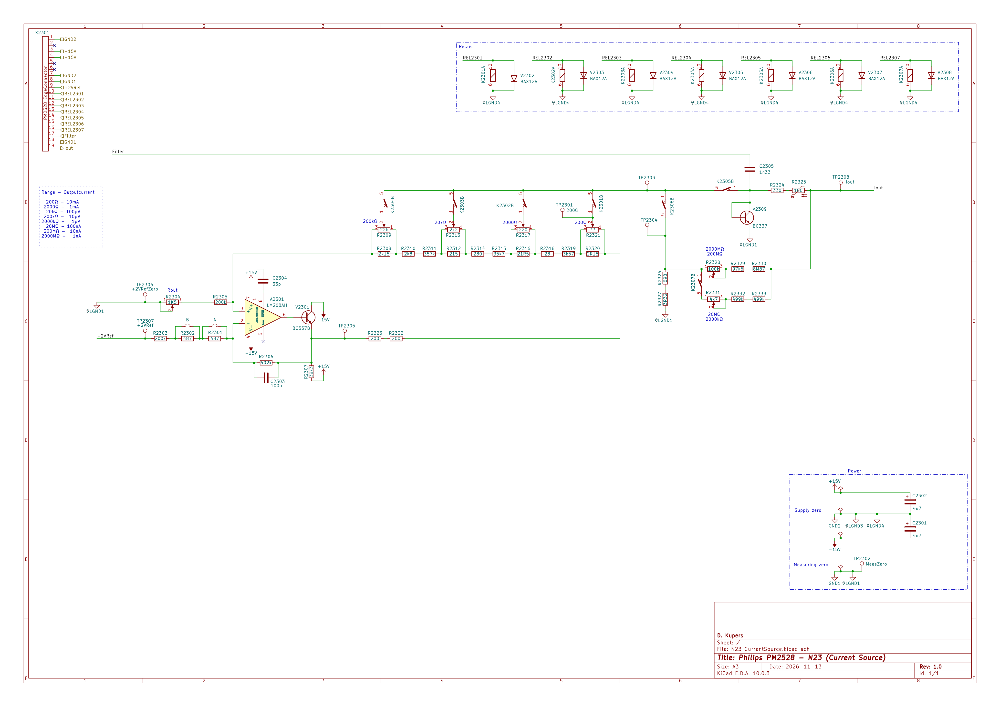
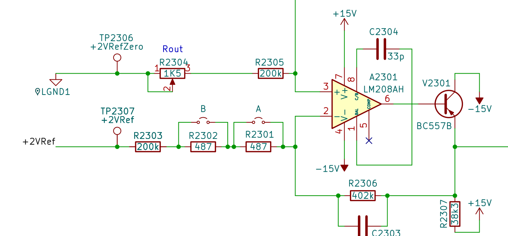
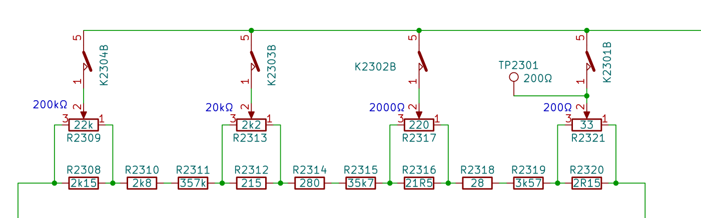
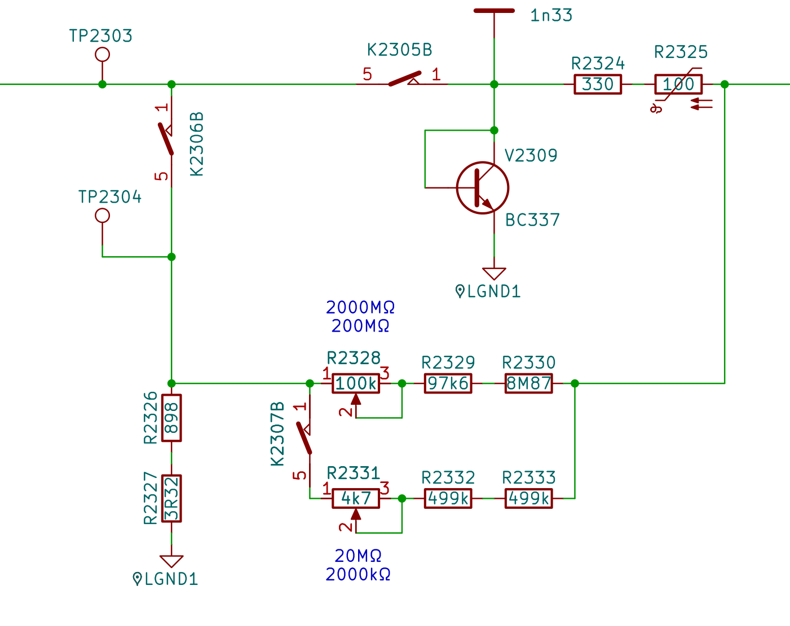
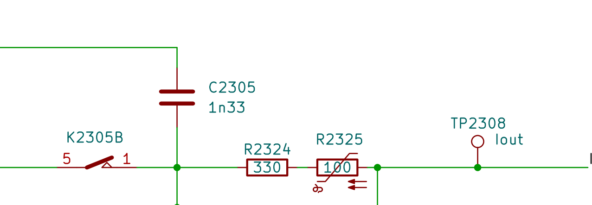
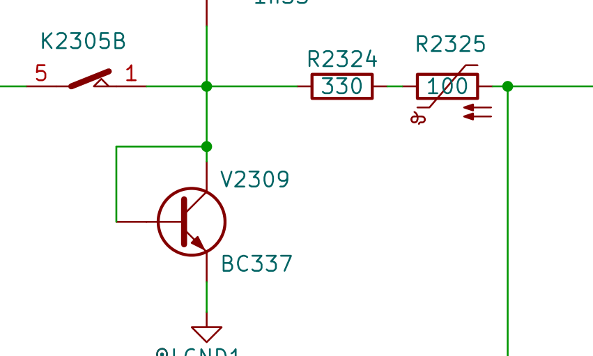

# Current Source (Expansionboard N23) · Schematics
N23 › [Overview](README.md) · [Operation](Operation.md) · **Schematics** · [PCB](PCB.md) · [Switching](Switching.md)

I copied and redrew the schematics and PCB in KiCad, using the low‑res Philips docs as a reference. There might be a few small differences since I tweaked them to match my PM2528. You’ll find the KiCad files in other parts of this repo.

## Full schematic

## Internal signals
The signals on the edge connector are listed on the [overview page](README.md#edge-connector). These are the local ones.

| Name | Description | Testpoint |
| - | - | - |
| **200Ω** | Ladder tap for the 200 Ω range (K2301) | TP2301
| **MeasZero** | Measuring zero | TP2302
| **K2301 contact** | Ladder node at the K2301 contact | TP2303
| **Shunt** | Top of the MΩ shunt R2326 + R2327 (K2306) | TP2304
| **V2301 emitter** | Current source node at V2301 emitter (C2303, R2306) | TP2305
| **+2VRefZero** | Reference zero | TP2306
| **+2VRef** | 2 V reference | TP2307
| **Iout** | Output current | TP2308

## Sections
### Current source
A2301 with V2301. **Rout** (R2304) trims the balance of the Howland circuit, so the output resistance gets as high as possible.

### Range ladder
The resistor ladder with the relays K2301-K2304. The trimmers R2309, R2313, R2317 and R2321 set each decade.

### MΩ ranges
K2305 connects the current source straight to the output in the low ranges. K2306 and K2307 switch the shunt and the 9.09 MΩ / 1 MΩ dividers for the MΩ ranges. R2331 trims the 2000 kΩ / 20 MΩ ranges, R2328 the 200 MΩ / 2000 MΩ ranges.

### Filter
C2305 (1.33 nF) connects the output node to pin 17, which the Philips drawing labels "FILTER N22/15": the output of the DC amplifier N22. In the Ω ranges N22 runs at ×1, so its output follows the measured voltage. The capacitor then carries no DC current and doesn't slow down the settling, but hum and noise on the test leads see a low impedance. This is my interpretation; the link on the mainboard is still to be checked.

### Protection
R2325 is a PTC (100 Ω cold) in series with the output. V2309 (BC337, base and collector tied) clamps the output node at about +0.6 V against positive voltage on the Ω input. With the normal negative output it stays off.

---
N23 › [Overview](README.md) · [Operation](Operation.md) · **Schematics** · [PCB](PCB.md) · [Switching](Switching.md)
