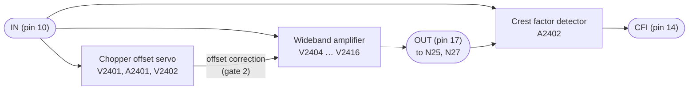

# AC Amplifier (Expansionboard N24) · Operation
N24 › [Overview](README.md) · **Operation** · [Schematics](Schematics.md) · [PCB](PCB.md)

> [!NOTE]
> I haven't made scope captures of this board yet, so the description below is based on the schematics, the Philips documentation and the firmware.

## Block diagram

## How it works

### Signal path
- IN goes through C2411 (330n) to gate 1 of the dual FET V2404 (BFQ14). R2417 (10M) biases it, and **Ioff** (R2422) balances the pair.
- Then, in turn: the emitter followers V2405/V2406, the PNP pair V2407/V2408, the FET followers V2409/V2410, the BF199 pair V2411/V2412 (V2413 as tail current source) and the complementary output followers V2415/V2416 to OUT.
- C2415 (15p) feeds the input straight to V2409, a feed-forward path for high frequencies. C2416/R2432, C2414/R2427 and R2442/C2418 shape the frequency response.

### Offset servo
The same idea as on N22, but much slower:
- IN also goes through R2401 (1M) / R2402 to the chopper V2401 (BSV81), clocked by D2401 (HEF4047) at about 27 Hz.
- A2401 (LM308) amplifies the chopped signal about 250×. The demodulator V2402 and R2411 / C2407 (22 µ) turn it into a DC correction for gate 2 of V2404.

### Crest factor indicator
- BAV45 / BAW62 diodes clamp the input to a node (R2446 to zero), and BZX79-B8V2 zeners reference it to OUT.
- A2402 (LM393, outputs wired together) compares both polarities against about ±0.5 V. When the amplifier runs out of headroom, one of them trips and pulls **CFI** down.
- On the mainboard, CFI sets the latch D1801 (cleared by SAZ), and the CPU reads it as /CFI.

---
N24 › [Overview](README.md) · **Operation** · [Schematics](Schematics.md) · [PCB](PCB.md)
