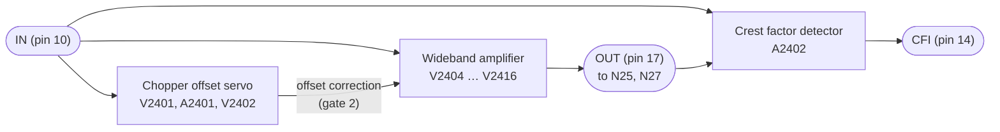
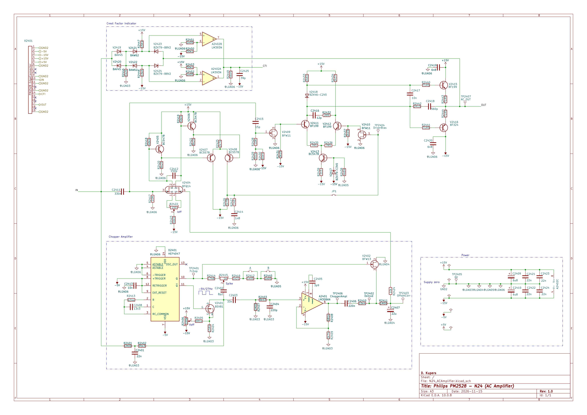
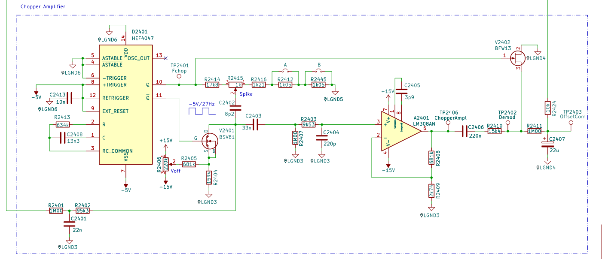
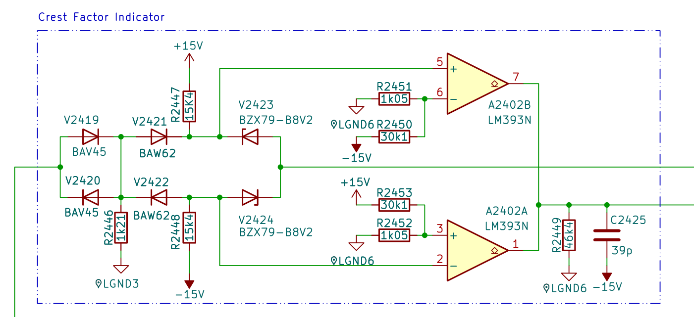
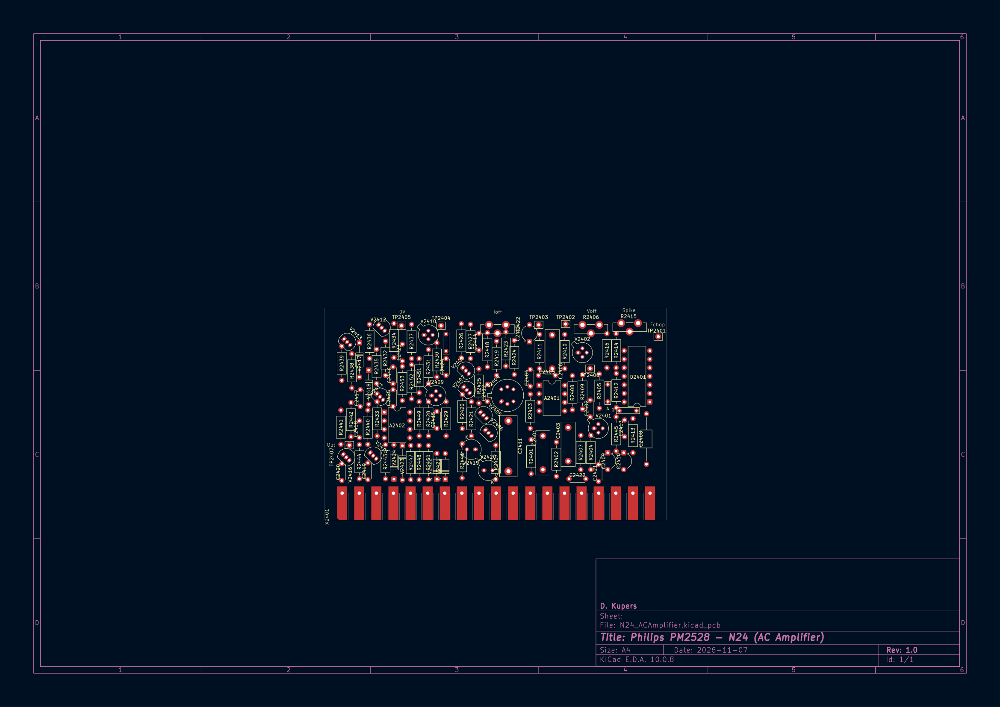
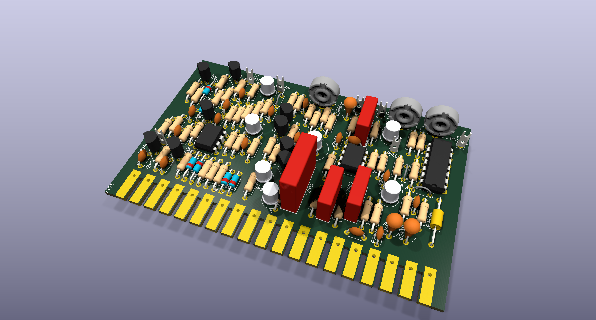

# AC Amplifier (Expansionboard N24)
This expansion board is the wideband amplifier for the AC functions. Its output feeds the RMS converter (N25) and the peak detector (N27).

Its functions include:
- Amplifying the AC input signal over a wide frequency range
- Keeping its own DC offset at zero with a slow chopper servo
- Detecting signals with a crest factor that is too high (CFI)

N24 has no relays: the gain is set by the input network on the mainboard, and the firmware doesn't touch this board.

### The signals
#### External signals (to/from this board)

🟦 signal · 🟧 supply / zero · ⬛ not connected

| Pin | Name | I/O | Description | Connected to | Testpoint |
| -: | - | :-: | - | - | - |
| 1 | 🟧 **0V** |  | Supply zero (▽6) | Mainboard |  |
| 2 | 🟧 **-5V** |  | Supply | Mainboard |  |
| 3 | 🟧 **-15V** |  | Supply | Mainboard |  |
| 4 | 🟧 **+15V** |  | Supply | Mainboard |  |
| 5 | 🟧 **+5V** |  | Supply (not used on the card) | Mainboard |  |
| 6 | 🟧 **Zero** |  | Zero (▽3) | Mainboard |  |
| 7 | ⬛ - |  | Not connected |  |  |
| 8 | ⬛ - |  | Not connected |  |  |
| 9 | 🟧 **Zero** |  | Zero (▽4) | Mainboard |  |
| 10 | 🟦 **IN** | I | AC input signal, from the input network | Mainboard (K1404-K1406) |  |
| 11 | 🟧 **Zero** |  | Zero (▽4) | Mainboard |  |
| 12 | ⬛ - |  | Not connected |  |  |
| 13 | 🟧 **Zero** |  | Zero (▽5) | Mainboard |  |
| 14 | 🟦 **CFI** | O | Crest Factor Indicator: 0 V at rest, pulled towards -15 V when the signal is too high | CFI latch D1801 (CPU) |  |
| 15 | ⬛ - |  | Not connected |  |  |
| 16 | ⬛ - |  | Not connected |  |  |
| 17 | 🟦 **OUT** | O | Amplified AC signal | N25 (IN), N27 (IN), K1403 | TP2407 |
| 18 | ⬛ - |  | Not connected |  |  |
| 19 | 🟧 **0V** |  | Supply zero (▽6) | Mainboard |  |

_Note: I haven't made scope captures of this board yet, so the description below is based on the schematics, the Philips documentation and the firmware._

## How it works

#### Signal path
- IN goes through C2411 (330n) to gate 1 of the dual FET V2404 (BFQ14). R2417 (10M) biases it, and **Ioff** (R2422) balances the pair.
- Then, in turn: the emitter followers V2405/V2406, the PNP pair V2407/V2408, the FET followers V2409/V2410, the BF199 pair V2411/V2412 (V2413 as tail current source) and the complementary output followers V2415/V2416 to OUT.
- C2415 (15p) feeds the input straight to V2409, a feed-forward path for high frequencies. C2416/R2432, C2414/R2427 and R2442/C2418 shape the frequency response.

#### Offset servo
The same idea as on N22, but much slower:
- IN also goes through R2401 (1M) / R2402 to the chopper V2401 (BSV81), clocked by D2401 (HEF4047) at about 27 Hz.
- A2401 (LM308) amplifies the chopped signal about 250×. The demodulator V2402 and R2411 / C2407 (22 µ) turn it into a DC correction for gate 2 of V2404.

#### Crest factor indicator
- BAV45 / BAW62 diodes clamp the input to a node (R2446 to zero), and BZX79-B8V2 zeners reference it to OUT.
- A2402 (LM393, outputs wired together) compares both polarities against about ±0.5 V. When the amplifier runs out of headroom, one of them trips and pulls **CFI** down.
- On the mainboard, CFI sets the latch D1801 (cleared by SAZ), and the CPU reads it as /CFI.

## Schematics
I copied and redrew the schematics and PCB in KiCad, using the low‑res Philips docs as a reference. There might be a few small differences since I tweaked them to match my PM2528. You’ll find the KiCad files in other parts of this repo.

The input- and output signals of this board are listed at the top of the page. The 'local' signals are listed in the next table.

#### Internal signals
| Name | Description | Testpoint |
| - | - | - |
| **Fchop** | Chopper clock (D2401 Q), about 27 Hz | TP2401
| **Demod** | Output of the demodulator V2402 | TP2402
| **OffsetCorr** | Offset correction voltage (C2407), to gate 2 of V2404 | TP2403
| **DriverBias** | Bias point of the output stage driver (V2410 gate, behind link JP1) | TP2404
| **0V** | Zero | TP2405
| **ChopperAmpl** | Output of the chopper amplifier A2401 | TP2406

### Section: Wideband amplifier
The discrete amplifier from V2404 to the output followers V2415/V2416. The boxed values on the Philips drawing are the DC levels at Vin = 0 (OUT = 0 V).

### Section: Chopper Amplifier
The offset servo: chopper V2401, amplifier A2401, demodulator V2402 and the oscillator D2401. **Voff** (R2406) and **Spike** (R2415, JP2401/JP2402) are the same trims as on N22.

### Section: Crest Factor Indicator
A2402 with its threshold divider R2450-R2453 and the clamp network at the input.

## PCB

