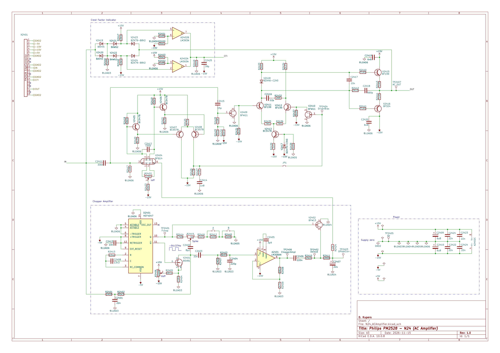
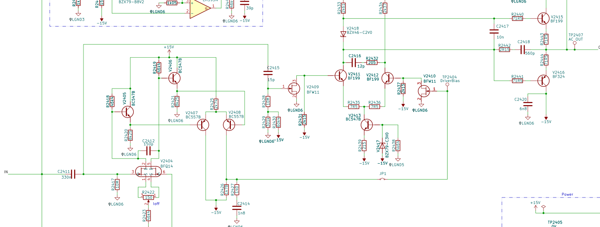
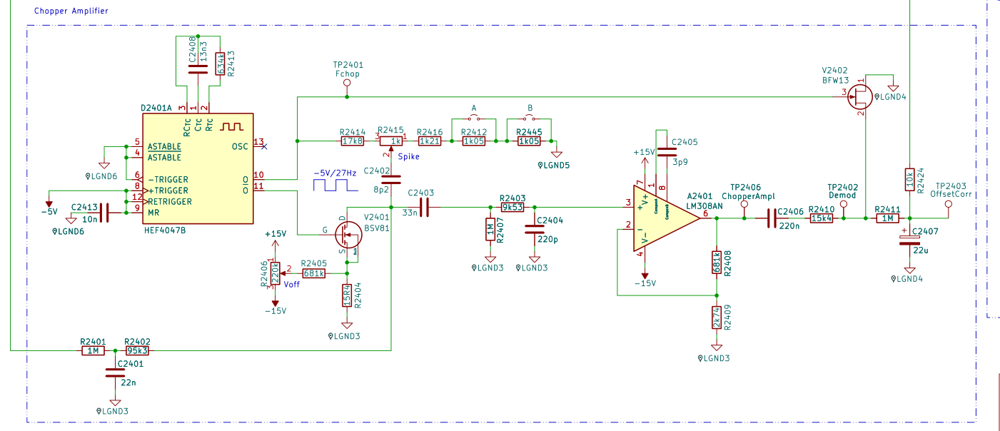
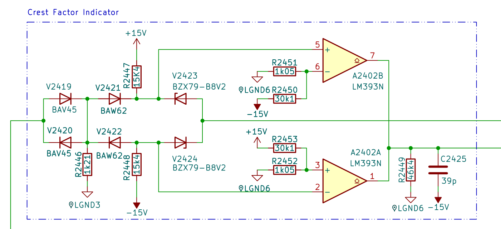

# AC Amplifier (Expansionboard N24) · Schematics
N24 › [Overview](README.md) · [Operation](Operation.md) · **Schematics** · [PCB](PCB.md)

I copied and redrew the schematics and PCB in KiCad, using the low‑res Philips docs as a reference. There might be a few small differences since I tweaked them to match my PM2528. You’ll find the KiCad files in other parts of this repo.

## Full schematic

## Internal signals
The signals on the edge connector are listed on the [overview page](README.md#edge-connector). These are the local ones.

| Name | Description | Testpoint |
| - | - | - |
| **Fchop** | Chopper clock (D2401 Q), about 27 Hz | TP2401
| **Demod** | Output of the demodulator V2402 | TP2402
| **OffsetCorr** | Offset correction voltage (C2407), to gate 2 of V2404 | TP2403
| **DriverBias** | Bias point of the output stage driver (V2410 gate, behind link JP1) | TP2404
| **0V** | Zero | TP2405
| **ChopperAmpl** | Output of the chopper amplifier A2401 | TP2406

## Sections
### Wideband amplifier
The discrete amplifier from V2404 to the output followers V2415/V2416. The boxed values on the Philips drawing are the DC levels at Vin = 0 (OUT = 0 V).

### Chopper Amplifier
The offset servo: chopper V2401, amplifier A2401, demodulator V2402 and the oscillator D2401. **Voff** (R2406) and **Spike** (R2415, JP2401/JP2402) are the same trims as on N22.

### Crest Factor Indicator
A2402 with its threshold divider R2450-R2453 and the clamp network at the input.

---
N24 › [Overview](README.md) · [Operation](Operation.md) · **Schematics** · [PCB](PCB.md)
