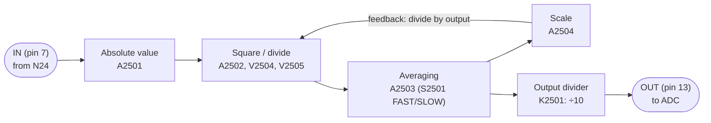

# RMS Converter (Expansionboard N25) · Operation
N25 › [Overview](README.md) · **Operation** · [Schematics](Schematics.md) · [PCB](PCB.md) · [Switching](Switching.md)

> [!NOTE]
> I haven't made scope captures of this board yet, so the description below is based on the schematics, the Philips documentation and the firmware.

## Block diagram

## How it works
N25 is a discrete log/antilog RMS converter, built the way an AD536 works internally. It solves Vout = average(Vin²) / Vout.

### Absolute value
A2501 (LM308) with V2501-V2503, V2508/V2509 and the rectifier section of the thin-film network R2501 (OM529) form a precision full-wave rectifier. Pin 15 of the OM529 adds IN (through 22k6) and the half-wave signal (through 11k3), which gives |Vin|.

### Square and divide
A2502 (LF356) with the matched transistor pairs V2504/V2505 (MAT01GH). V2504a makes log|Vin|, V2505a/b add it twice and subtract log(Vout), which comes from V2504b driven by A2504. The result is Vin² / Vout.

### Averaging
A2503 (LM308) averages Vin² / Vout with C2507 (330n), plus C2506 (3µ3) when S2501A is closed. The averaged value is the RMS value.

| S2501 | Time constant | Accurate (0.1 %) from | Settling (0.1 %) |
| - | -: | -: | -: |
| FAST (open) | 7.5 ms | about 200-300 Hz | about 30 ms |
| SLOW (closed) | 82 ms | about 15-30 Hz | about 330 ms |

SLOW is the factory setting ("norm" on my board), and the only one that meets the 30 Hz specification. S2501B also adds C2515/C2516 to the output filter. These figures come from a simulation of an ideal converter, so they are indicative.

### Output
A2503's output goes through 2k61 + 9k09 to OUT, then through 1k3 and K2501 to zero. With K2501 closed that divides by exactly 10. The firmware closes K2501 in the 2000 V range (VAC and VDC+AC) and in the Vpeak functions. V2514 (BAV45) clamps OUT at about +3.6 V to protect the ADC input.

---
N25 › [Overview](README.md) · **Operation** · [Schematics](Schematics.md) · [PCB](PCB.md) · [Switching](Switching.md)
