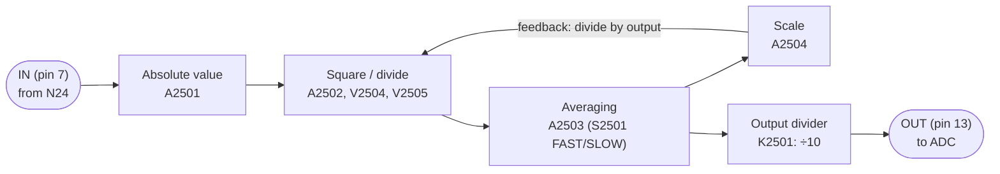
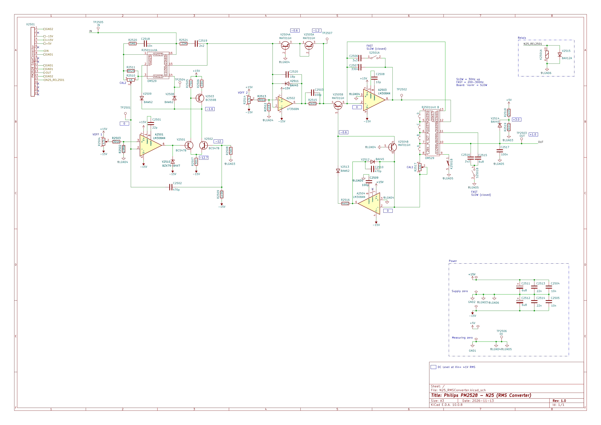
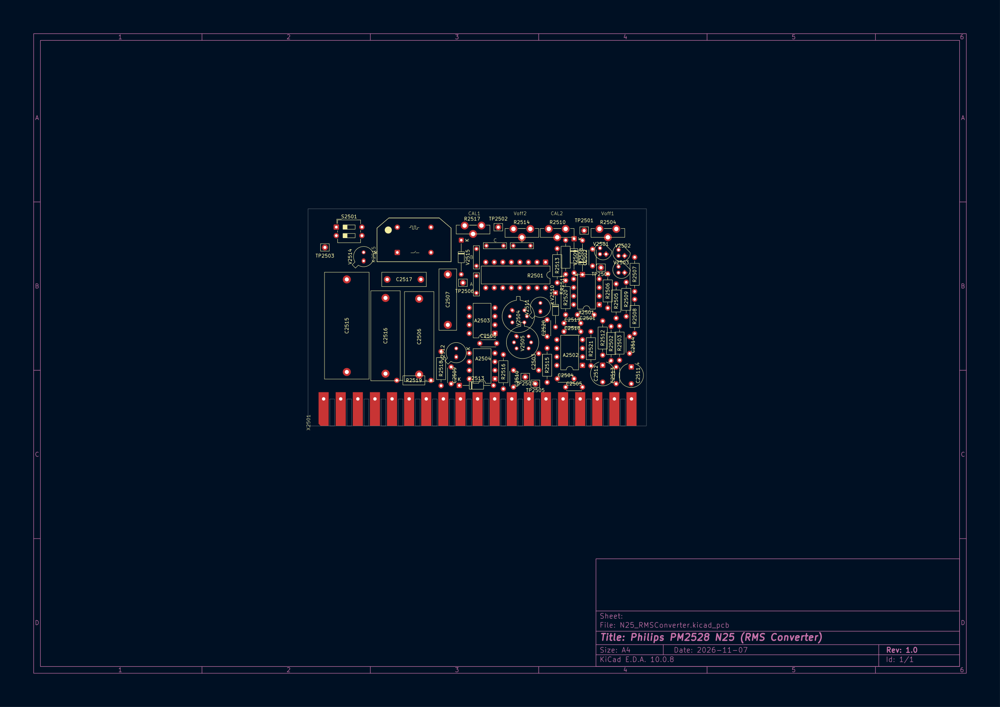
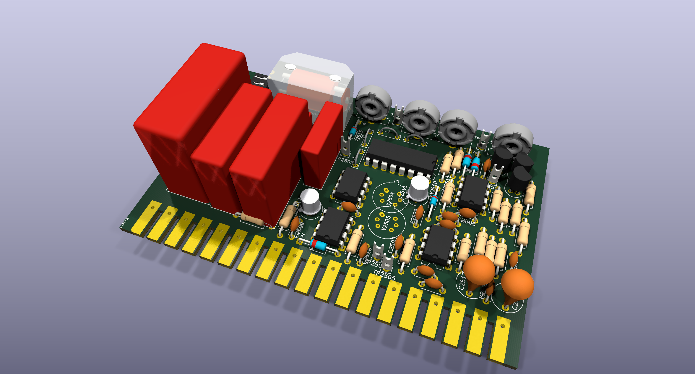

# RMS Converter (Expansionboard N25)
This expansion board turns the amplified AC signal from N24 into a DC voltage equal to its true RMS value. The ADC then measures that DC voltage.

Its functions include:
- Full-wave rectifying the signal (absolute value)
- Computing the RMS value with a log/antilog circuit
- Averaging, with a FAST or SLOW setting (S2501)
- Dividing the output by 10 in the 2000 V range (K2501)

### The signals
#### External signals (to/from this board)

🟦 signal · 🟧 supply / zero · ⬛ not connected

| Pin | Name | I/O | Description | Connected to | Testpoint |
| -: | - | :-: | - | - | - |
| 1 | 🟧 **0V** |  | Supply zero | Mainboard |  |
| 2 | ⬛ - |  | Not connected |  |  |
| 3 | 🟧 **-15V** |  | Supply | Mainboard |  |
| 4 | 🟧 **+15V** |  | Supply | Mainboard |  |
| 5 | 🟧 **+5V** |  | Supply (output clamp) | Mainboard |  |
| 6 | ⬛ - |  | Not connected |  |  |
| 7 | 🟦 **IN** | I | AC signal | N24 (OUT) | TP2505 |
| 8 | 🟧 **Measuring zero** |  | Measuring zero | Mainboard |  |
| 9 | ⬛ - |  | Not connected |  |  |
| 10 | ⬛ - |  | Not connected |  |  |
| 11 | 🟧 **Measuring zero** |  | Measuring zero | Mainboard |  |
| 12 | 🟧 **Measuring zero** |  | Measuring zero | Mainboard |  |
| 13 | 🟦 **OUT** | O | DC voltage = RMS value of IN | ADC input selector (D1101) | TP2503 |
| 14 | 🟧 **0V** |  | Supply zero | Mainboard |  |
| 15 | 🟦 **REL2501** | I | Relay K2501 (÷10) | CPU (D1703) |  |
| 16 | ⬛ - |  | Not connected |  |  |
| 17 | ⬛ - |  | Not connected |  |  |
| 18 | ⬛ - |  | Not connected |  |  |
| 19 | ⬛ - |  | Not connected |  |  |

_Note: I haven't made scope captures of this board yet, so the description below is based on the schematics, the Philips documentation and the firmware._

## How it works
N25 is a discrete log/antilog RMS converter, built the way an AD536 works internally. It solves Vout = average(Vin²) / Vout.

#### Absolute value
A2501 (LM308) with V2501-V2503, V2508/V2509 and the rectifier section of the thin-film network R2501 (OM529) form a precision full-wave rectifier. Pin 15 of the OM529 adds IN (through 22k6) and the half-wave signal (through 11k3), which gives |Vin|.

#### Square and divide
A2502 (LF356) with the matched transistor pairs V2504/V2505 (MAT01GH). V2504a makes log|Vin|, V2505a/b add it twice and subtract log(Vout), which comes from V2504b driven by A2504. The result is Vin² / Vout.

#### Averaging
A2503 (LM308) averages Vin² / Vout with C2507 (330n), plus C2506 (3µ3) when S2501A is closed. The averaged value is the RMS value.

| S2501 | Time constant | Accurate (0.1 %) from | Settling (0.1 %) |
| - | -: | -: | -: |
| FAST (open) | 7.5 ms | about 200-300 Hz | about 30 ms |
| SLOW (closed) | 82 ms | about 15-30 Hz | about 330 ms |

SLOW is the factory setting ("norm" on my board), and the only one that meets the 30 Hz specification. S2501B also adds C2515/C2516 to the output filter. These figures come from a simulation of an ideal converter, so they are indicative.

#### Output
A2503's output goes through 2k61 + 9k09 to OUT, then through 1k3 and K2501 to zero. With K2501 closed that divides by exactly 10. The firmware closes K2501 in the 2000 V range (VAC and VDC+AC) and in the Vpeak functions. V2514 (BAV45) clamps OUT at about +3.6 V to protect the ADC input.

## Schematics
I copied and redrew the schematics and PCB in KiCad, using the low‑res Philips docs as a reference. There might be a few small differences since I tweaked them to match my PM2528. You’ll find the KiCad files in other parts of this repo.

The values in the small boxes on the schematic are the DC levels with about 1 V RMS at the input, copied from the Philips drawing.

The input- and output signals of this board are listed at the top of the page. The 'local' signals are listed in the next table.

#### Internal signals
| Name | Description | Testpoint |
| - | - | - |
| **Virtual ground** | Input of the rectifier A2501 | TP2501
| **FAST/SLOW** | Averaging node, at switch S2501A | TP2502
| **Rectifier** | Half-wave node (V2508 cathode, OM529 pin 14) | TP2504
| **-2 Vbe** | Emitters of V2505 (about -1.2 V) | TP2507
| **0V** | Measuring zero | TP2506

### Section: Rectifier
A2501 and the OM529 rectifier section. **CAL 2** (R2510) trims the balance between the two half-waves, **VOFF 1** (R2504) the offset.

### Section: Squaring and dividing
A2502 with the MAT01 pairs. **VOFF 2** (R2514) trims the offset.

### Section: Averaging and scale
A2503 with S2501 (FAST/SLOW), and A2504 which drives the "divide by output" side. The scale chain in the OM529 sets the gain, with **CAL 1** (R2517) and the jumpers JP2501-JP2504 (A-D) as a binary coarse trim. On my board A and D are closed, B and C open, which gives OUT = 0.994 × IN in the ideal model.

### Section: Output
The output divider with K2501, the filter capacitors C2515-C2517 and the clamp V2514.

## PCB

