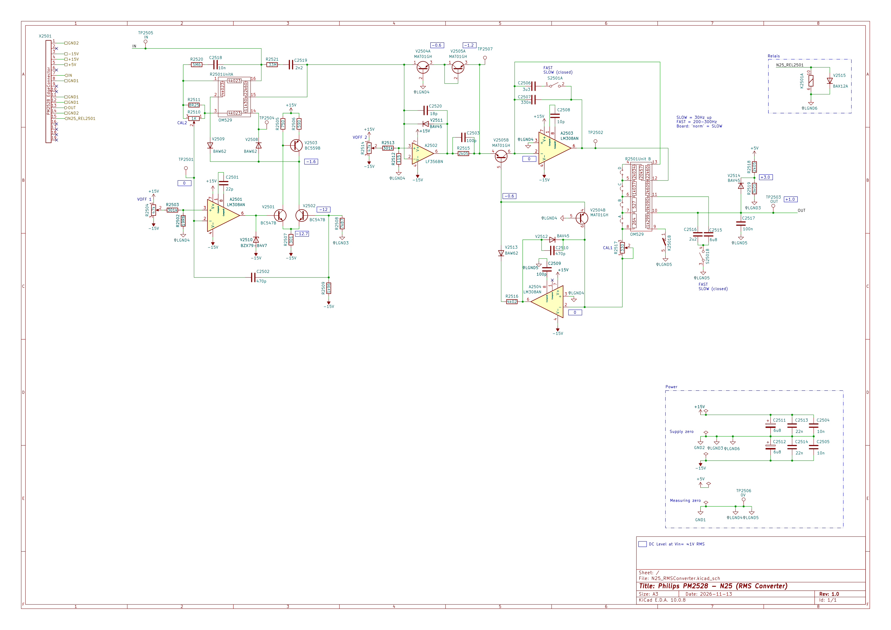
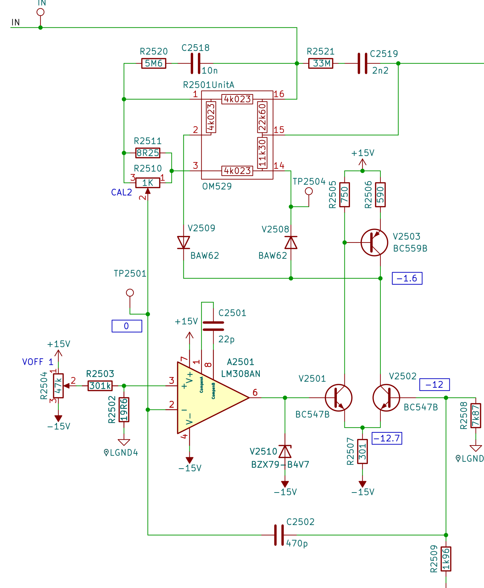
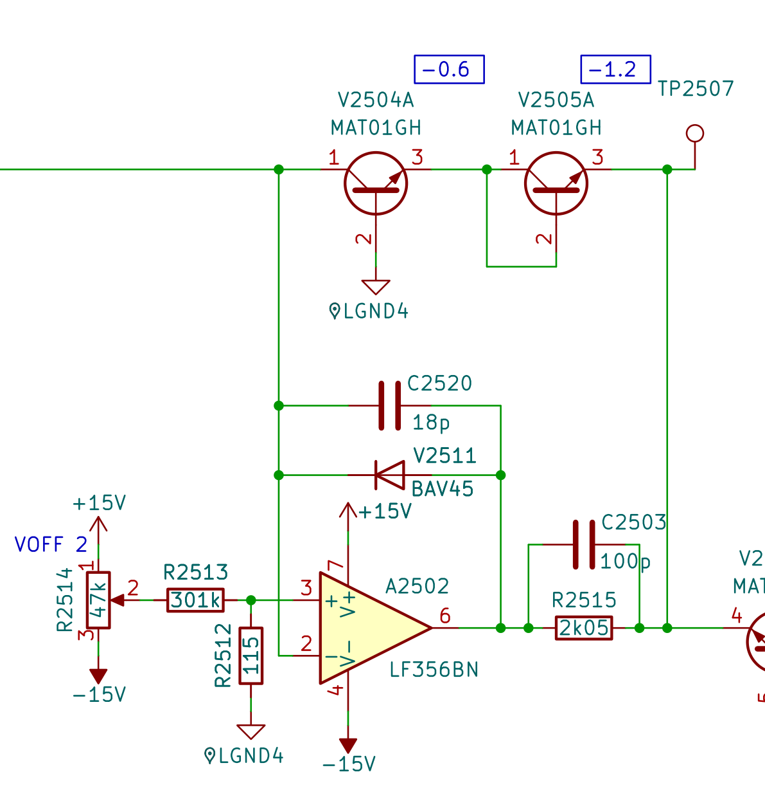
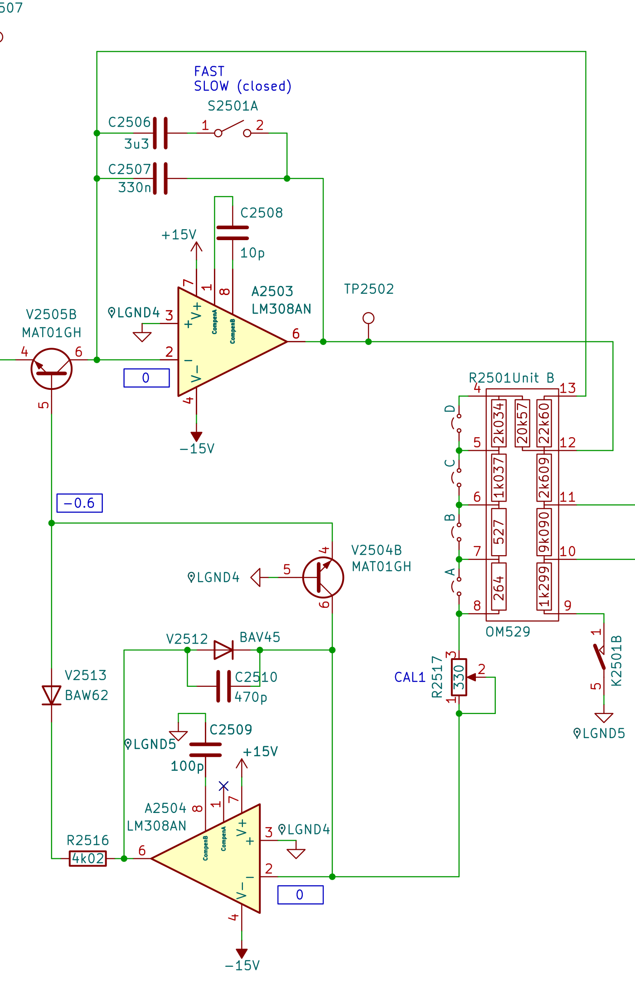
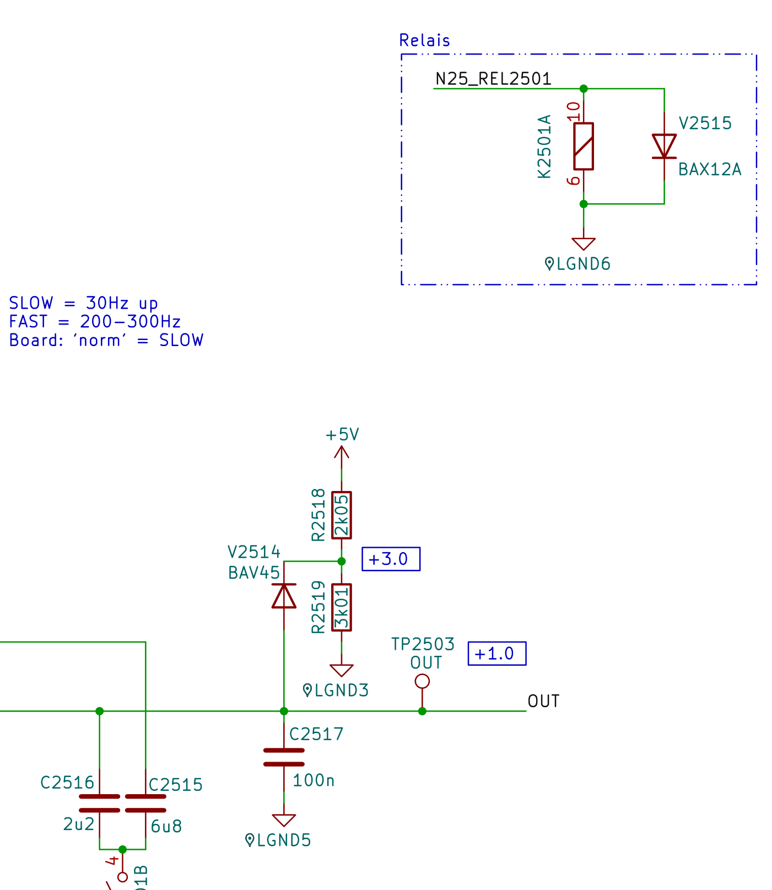

# RMS Converter (Expansionboard N25) · Schematics
N25 › [Overview](README.md) · [Operation](Operation.md) · **Schematics** · [PCB](PCB.md) · [Switching](Switching.md)

I copied and redrew the schematics and PCB in KiCad, using the low‑res Philips docs as a reference. There might be a few small differences since I tweaked them to match my PM2528. You’ll find the KiCad files in other parts of this repo.

## Full schematic

The values in the small boxes on the schematic are the DC levels with about 1 V RMS at the input, copied from the Philips drawing.

## Internal signals
The signals on the edge connector are listed on the [overview page](README.md#edge-connector). These are the local ones.

| Name | Description | Testpoint |
| - | - | - |
| **Virtual ground** | Input of the rectifier A2501 | TP2501
| **FAST/SLOW** | Averaging node, at switch S2501A | TP2502
| **Rectifier** | Half-wave node (V2508 cathode, OM529 pin 14) | TP2504
| **-2 Vbe** | Emitters of V2505 (about -1.2 V) | TP2507
| **0V** | Measuring zero | TP2506

## Sections
### Rectifier
A2501 and the OM529 rectifier section. **CAL 2** (R2510) trims the balance between the two half-waves, **VOFF 1** (R2504) the offset.

### Squaring and dividing
A2502 with the MAT01 pairs. **VOFF 2** (R2514) trims the offset.

### Averaging and scale
A2503 with S2501 (FAST/SLOW), and A2504 which drives the "divide by output" side. The scale chain in the OM529 sets the gain, with **CAL 1** (R2517) and the jumpers JP2501-JP2504 (A-D) as a binary coarse trim. On my board A and D are closed, B and C open, which gives OUT = 0.994 × IN in the ideal model.

### Output
The output divider with K2501, the filter capacitors C2515-C2517 and the clamp V2514.

---
N25 › [Overview](README.md) · [Operation](Operation.md) · **Schematics** · [PCB](PCB.md) · [Switching](Switching.md)
