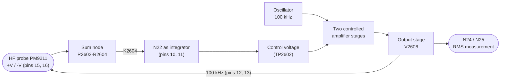
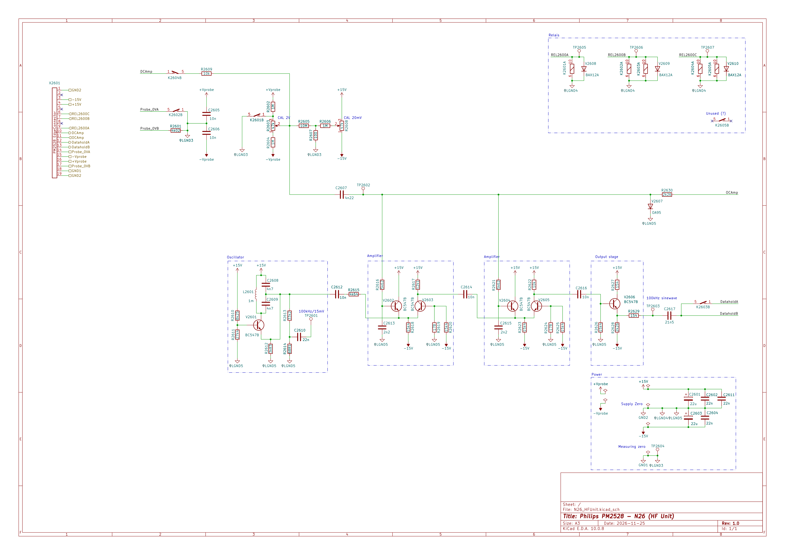
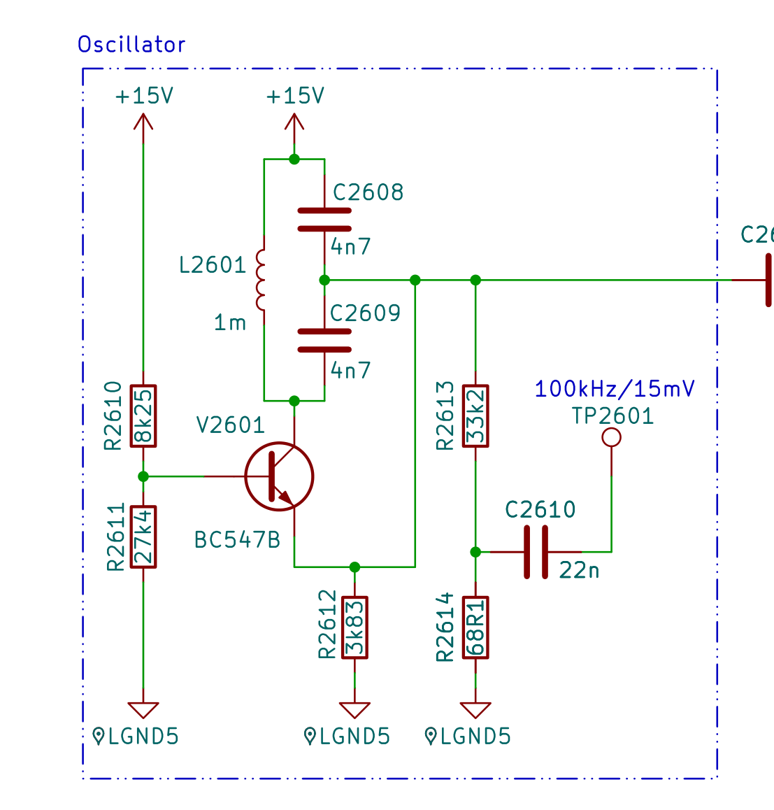
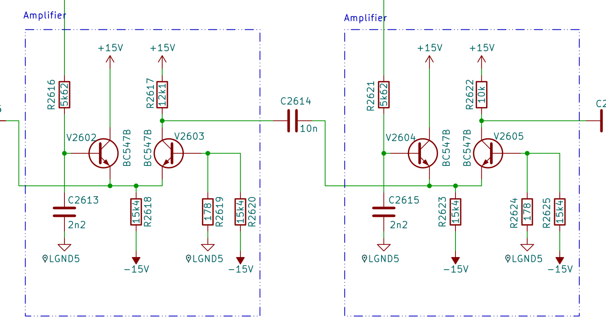
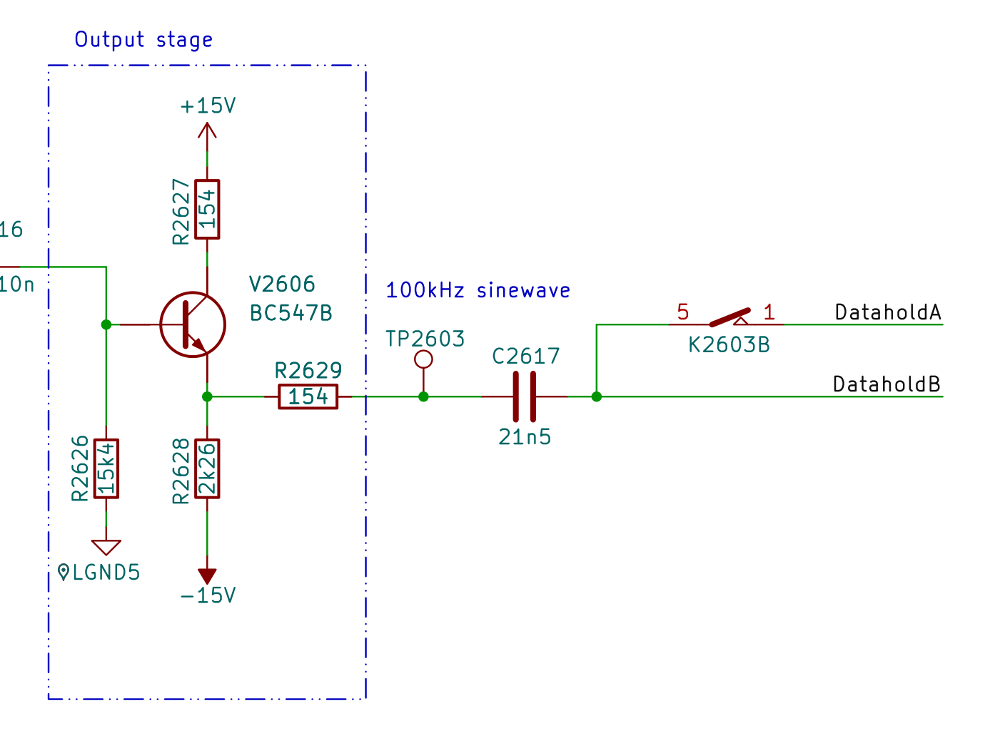
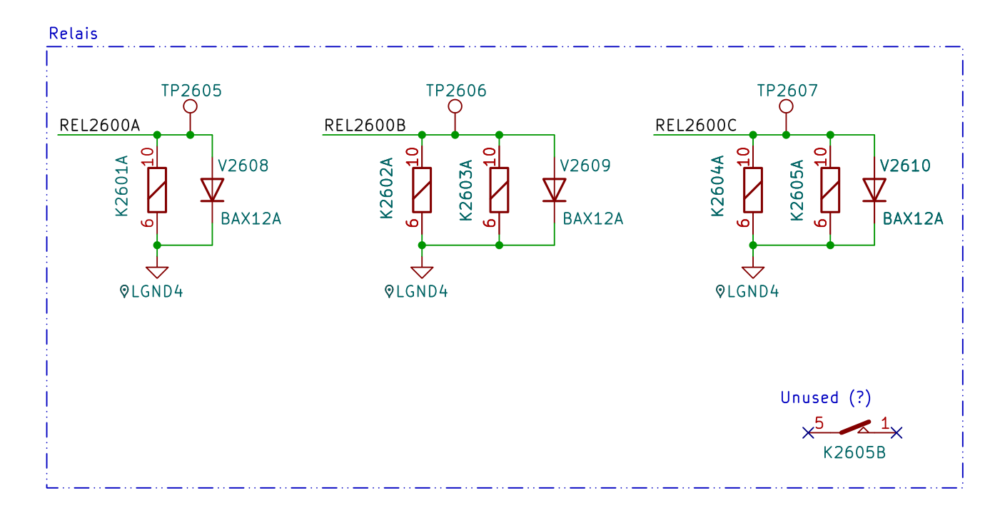
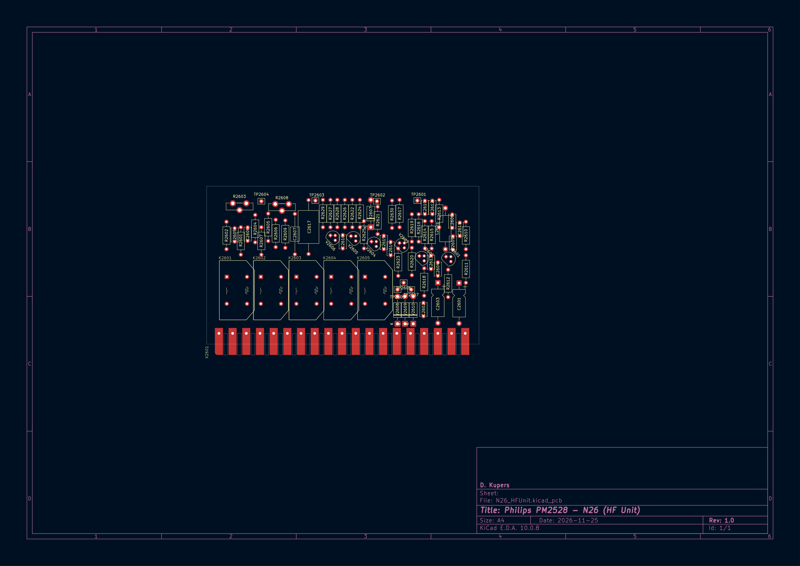
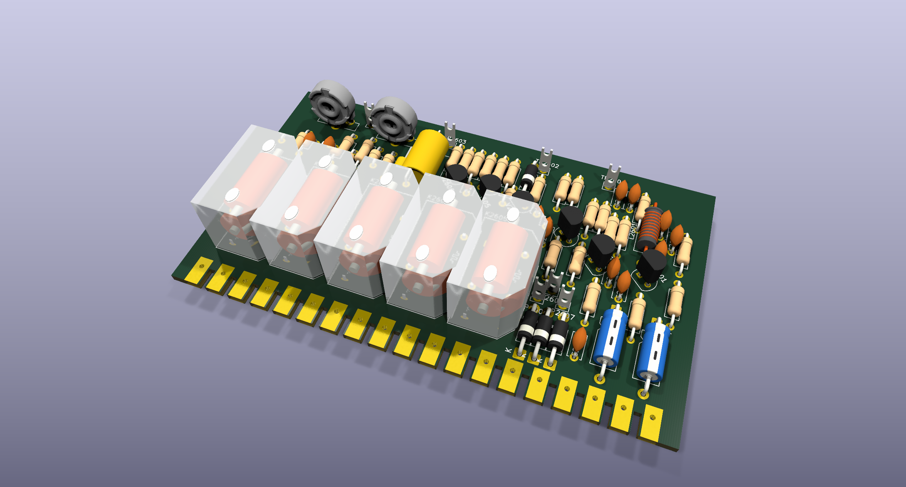

# HF Unit (Expansionboard N26)
This expansion board, together with the HF probe PM9211, measures high-frequency AC voltages (function Vhf). It is an option.

Its functions include:
- Making a 100 kHz carrier with an adjustable level
- Balancing that carrier against the HF signal, using N22 as an integrator
- Handing the carrier to N24/N25, which measure its RMS value
- Switching the probe lines with relays

### The signals
#### External signals (to/from this board)

🟦 signal · 🟧 supply / zero · ⬛ not connected

| Pin | Name | I/O | Description | Connected to | Testpoint |
| -: | - | :-: | - | - | - |
| 1 | 🟧 **0V** |  | Supply zero | Mainboard |  |
| 2 | ⬛ - |  | Not connected |  |  |
| 3 | 🟧 **-15V** |  | Supply | Mainboard |  |
| 4 | 🟧 **+15V** |  | Supply | Mainboard |  |
| 5 | ⬛ - |  | Not connected |  |  |
| 6 | 🟦 **REL2600C** | I | Relays K2604 + K2605 | CPU (D1702) | TP2607 |
| 7 | 🟦 **REL2600B** | I | Relays K2602 + K2603 | CPU (D1702) | TP2606 |
| 8 | ⬛ - |  | Not connected |  |  |
| 9 | 🟦 **REL2600A** | I | Relay K2601 | CPU (D1702) | TP2605 |
| 10 | 🟦 **DC AMPL INPUT** | O | To the input of N22 | N22 (HI) |  |
| 11 | 🟦 **DC AMPL OUTPUT** | I | From the output of N22 | N22 (HIOUT1) |  |
| 12 | 🟦 **HF A** | O | 100 kHz sinewave | N24 input network, probe socket |  |
| 13 | 🟦 **HF B** | O | 100 kHz sinewave | Probe socket |  |
| 14 | 🟦 **Data hold (J)** | I/O | Data hold line J of the probe | Probe socket; DATA HOLD FET V1805 |  |
| 15 | 🟦 **-VDC** | I | Rectified signal from the probe | Probe socket |  |
| 16 | 🟦 **+VDC** | I | Rectified signal from the probe | Probe socket |  |
| 17 | 🟧 **0V probe** |  | Probe zero | Probe socket |  |
| 18 | 🟧 **Measuring zero** |  | Measuring zero | Mainboard | TP2604 |
| 19 | 🟧 **0V** |  | Relay zero | Mainboard |  |

_Note: the edge connector is called K1 in my schematic, X2601 on the mainboard. I haven't made scope captures of this board, so the description below is based on the schematics, the Philips documentation, the firmware and a simulation._

## How it works
The HF probe rectifies two signals: the HF input voltage, and the 100 kHz carrier from N26. N26 changes the carrier level until both rectified voltages are equal. The PM2528 then measures the RMS value of the carrier, which is a clean 100 kHz signal, instead of the HF signal itself.

1. The two rectified probe signals (+VDC, -VDC) are added through R2602, R2603 and R2604.
2. K2604 and R2609 feed the sum to the input of N22. C2607 closes the loop from N22's output, so N22 acts as an integrator.
3. The integrator output (TP2602) steers two controlled amplifier stages, and so sets the 100 kHz level.
4. The carrier leaves through V2606 and C2617 on pin 13, to the probe. K2603 also connects it to pin 12.
5. Pin 12 reaches N24's input network. The firmware selects the RMS converter (N25) as ADC input in Vhf, so the ADC reads the carrier level.

The firmware only allows the 200 mV and 2 V ranges in Vhf; the 20 V and 200 V ranges come from the probe's 100:1 attenuator.

| Function | K2601 (REL2600A) | K2602 + K2603 (REL2600B) | K2604 + K2605 (REL2600C) |
| - | :-: | :-: | :-: |
| Vhf 200 mV, 2 V | Off | On | On |
| Ω 4-wire, °C | **On** | Off | Off |
| All others | Off | Off | Off |

- **K2601** shorts the sum node to zero in Ω 4-wire and °C: the probe socket is shared with the Pt100 probe, and pins 15/16 then carry the 4-wire sense lines.
- **K2602** ties the data hold line J to zero in Vhf, so the HF probe's data hold button doesn't work in its own function.

## Schematics
I copied and redrew the schematics and PCB in KiCad, using the low‑res Philips docs as a reference. There might be a few small differences since I tweaked them to match my PM2528. You’ll find the KiCad files in other parts of this repo.

The input- and output signals of this board are listed at the top of the page. The 'local' signals are listed in the next table.

#### Internal signals
| Name | Description | Testpoint |
| - | - | - |
| **Oscillator** | 100 kHz, about 15 mV (Philips drawing) | TP2601
| **Control** | Control voltage from the integrator (N22), about 0 to -0.3 V in Vhf | TP2602
| **100 kHz out** | Carrier at the output stage | TP2603
| **0V** | Measuring zero | TP2604

### Section: Oscillator
An LC oscillator at about 100 kHz (simulation: about 94 kHz, 25 mVpp at TP2601).

### Section: Amplifier
Two long-tailed pairs (V2602/V2603 and V2604/V2605), both steered by the same control voltage. Together they cover about 40 dB in 100 mV of control voltage. In the simulation the carrier is gone at 0 V on TP2602 and at its maximum (about 480 mV RMS) from -0.3 V. **CAL 20mV** and **CAL 2V** are the calibration trimmers, named after their calibration points.

### Section: Output stage
V2606 drives the carrier through C2617 to the probe and to N24.

### Section: Relais
K2601-K2605 with their drive lines REL2600A-C. The contacts of K2605 aren't drawn on the Philips drawing; R2631 (2.26 kΩ, in the parts list but not on the drawing) is probably what it switches.

## PCB

