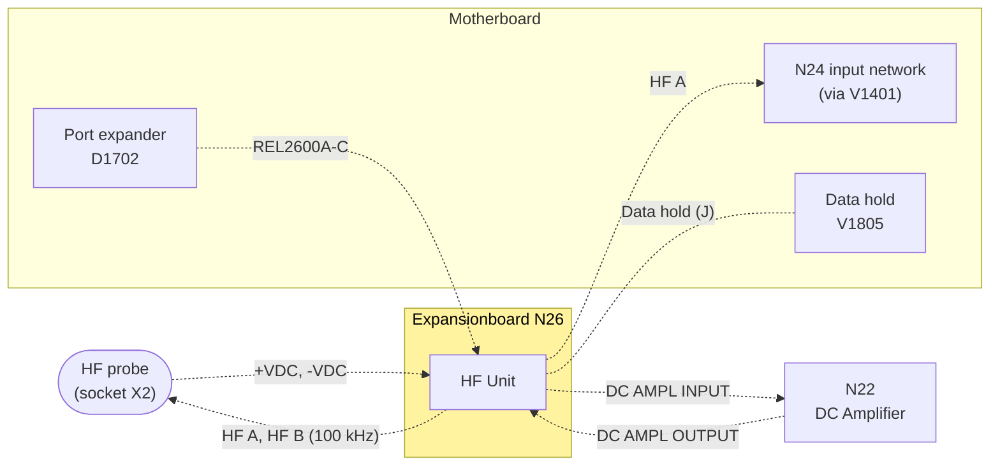

# HF Unit (Expansionboard N26)
N26 › **Overview** · [Operation](Operation.md) · [Schematics](Schematics.md) · [PCB](PCB.md) · [Switching](Switching.md)

This expansion board, together with the HF probe PM9211, measures high-frequency AC voltages (function Vhf). It is an option.

## Functions
- Making a 100 kHz carrier with an adjustable level
- Balancing that carrier against the HF signal, using N22 as an integrator
- Handing the carrier to N24/N25, which measure its RMS value
- Switching the probe lines with relays

## Signal flow
N26 runs a control loop through the HF probe, with N22 as integrator. Its 100 kHz carrier goes to the AC amplifier N24 and on to the RMS converter.

## Edge connector

🟦 signal · 🟧 supply / zero · ⬛ not connected

| Pin | Name | I/O | Description | Connected to | Testpoint |
| -: | - | :-: | - | - | - |
| 1 | 🟧 **0V** |  | Supply zero | Mainboard |  |
| 2 | ⬛ - |  | Not connected |  |  |
| 3 | 🟧 **-15V** |  | Supply | Mainboard |  |
| 4 | 🟧 **+15V** |  | Supply | Mainboard |  |
| 5 | ⬛ - |  | Not connected |  |  |
| 6 | 🟦 **REL2600C** | I | Relays K2604 + K2605 | CPU (D1702) | TP2607 |
| 7 | 🟦 **REL2600B** | I | Relays K2602 + K2603 | CPU (D1702) | TP2606 |
| 8 | ⬛ - |  | Not connected |  |  |
| 9 | 🟦 **REL2600A** | I | Relay K2601 | CPU (D1702) | TP2605 |
| 10 | 🟦 **DC AMPL INPUT** | O | To the input of N22 | N22 (HI) |  |
| 11 | 🟦 **DC AMPL OUTPUT** | I | From the output of N22 | N22 (HIOUT1) |  |
| 12 | 🟦 **HF A** | O | 100 kHz sinewave | N24 input network, probe socket |  |
| 13 | 🟦 **HF B** | O | 100 kHz sinewave | Probe socket |  |
| 14 | 🟦 **Data hold (J)** | I/O | Data hold line J of the probe | Probe socket; DATA HOLD FET V1805 |  |
| 15 | 🟦 **-VDC** | I | Rectified signal from the probe | Probe socket |  |
| 16 | 🟦 **+VDC** | I | Rectified signal from the probe | Probe socket |  |
| 17 | 🟧 **0V probe** |  | Probe zero | Probe socket |  |
| 18 | 🟧 **Measuring zero** |  | Measuring zero | Mainboard | TP2604 |
| 19 | 🟧 **0V** |  | Relay zero | Mainboard |  |

> [!NOTE]
> The edge connector is called K1 in my schematic, X2601 on the mainboard.

## More about this board
- [Operation](Operation.md): how the HF probe loop works
- [Schematics](Schematics.md): the full schematic, internal signals and the sections
- [PCB](PCB.md): the board layout and 3D view
- [Switching](Switching.md): the relays per function and range

---
N26 › **Overview** · [Operation](Operation.md) · [Schematics](Schematics.md) · [PCB](PCB.md) · [Switching](Switching.md)
