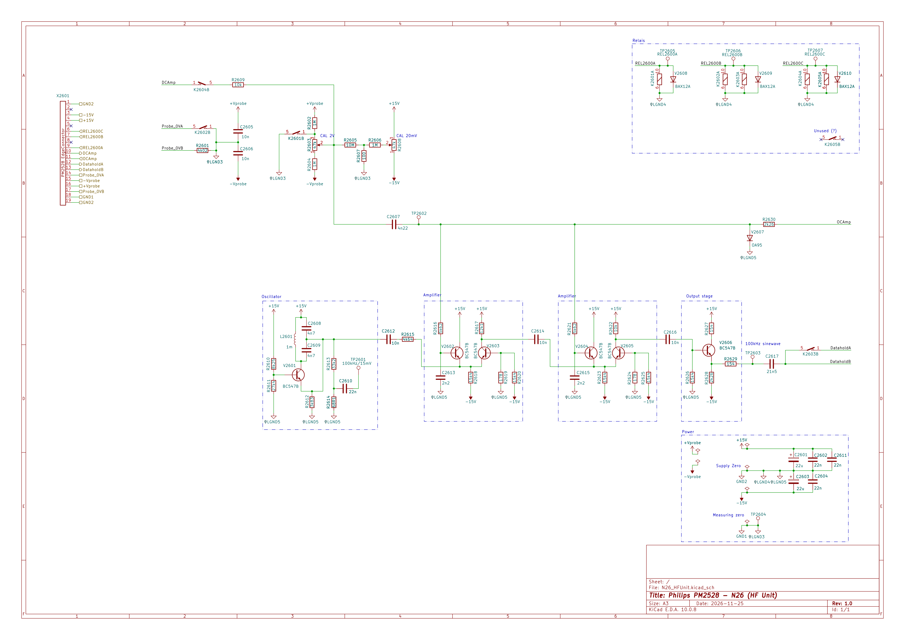
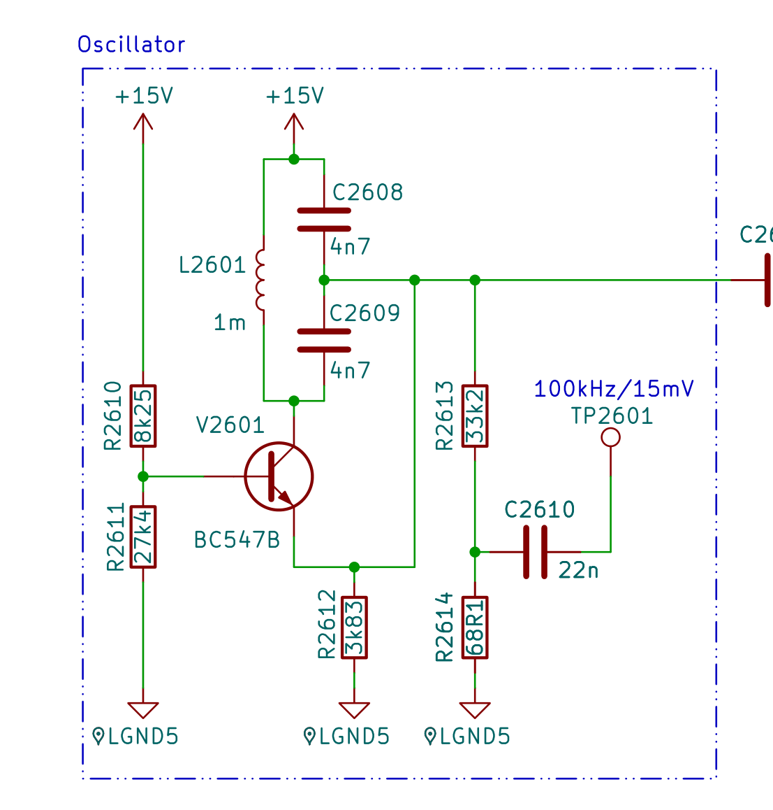
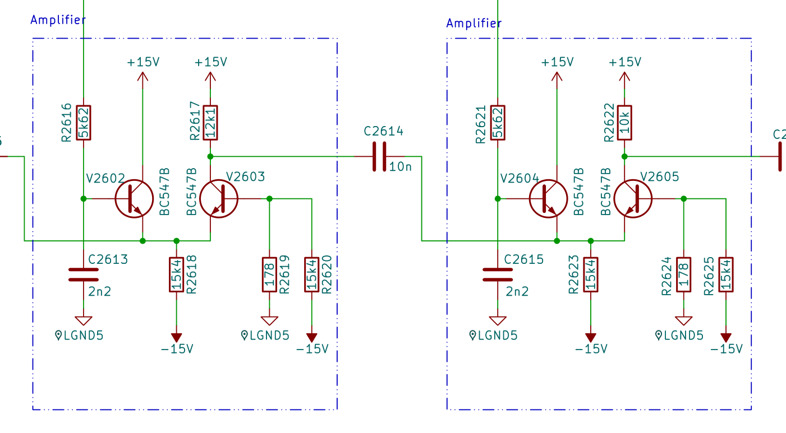
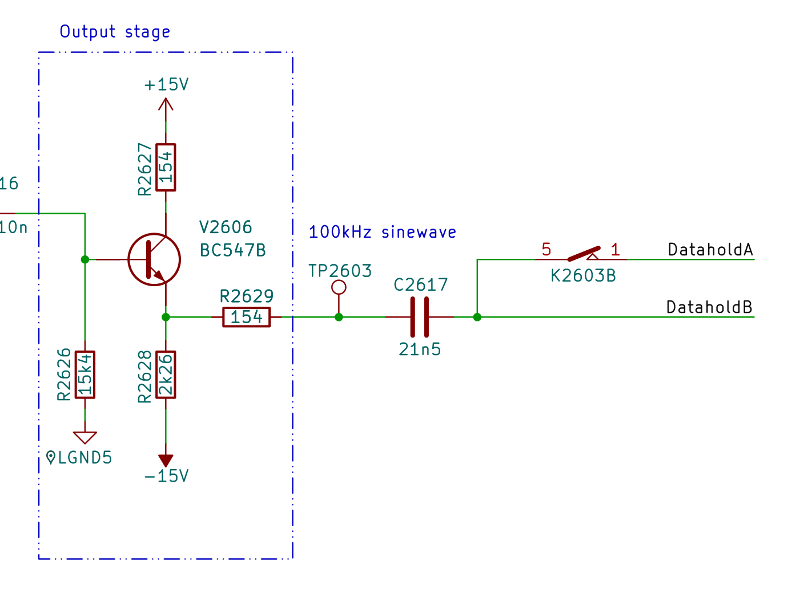
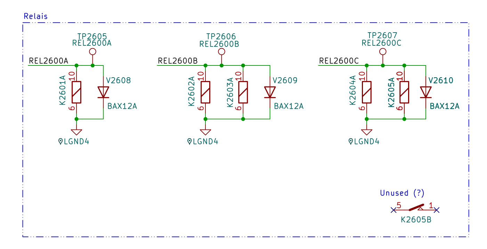

# HF Unit (Expansionboard N26) · Schematics
N26 › [Overview](README.md) · [Operation](Operation.md) · **Schematics** · [PCB](PCB.md) · [Switching](Switching.md)

## Schematics
I copied and redrew the schematics and PCB in KiCad, using the low‑res Philips docs as a reference. There might be a few small differences since I tweaked them to match my PM2528. You’ll find the KiCad files in other parts of this repo.

The input- and output signals of this board are listed on the [overview page](README.md#the-signals). The 'local' signals are listed in the next table.

#### Internal signals
| Name | Description | Testpoint |
| - | - | - |
| **Oscillator** | 100 kHz, about 15 mV (Philips drawing) | TP2601
| **Control** | Control voltage from the integrator (N22), about 0 to -0.3 V in Vhf | TP2602
| **100 kHz out** | Carrier at the output stage | TP2603
| **0V** | Measuring zero | TP2604

### Section: Oscillator
An LC oscillator at about 100 kHz (simulation: about 94 kHz, 25 mVpp at TP2601).

### Section: Amplifier
Two long-tailed pairs (V2602/V2603 and V2604/V2605), both steered by the same control voltage. Together they cover about 40 dB in 100 mV of control voltage. In the simulation the carrier is gone at 0 V on TP2602 and at its maximum (about 480 mV RMS) from -0.3 V. **CAL 20mV** and **CAL 2V** are the calibration trimmers, named after their calibration points.

### Section: Output stage
V2606 drives the carrier through C2617 to the probe and to N24.

### Section: Relais
K2601-K2605 with their drive lines REL2600A-C. The contacts of K2605 aren't drawn on the Philips drawing; R2631 (2.26 kΩ, in the parts list but not on the drawing) is probably what it switches.

