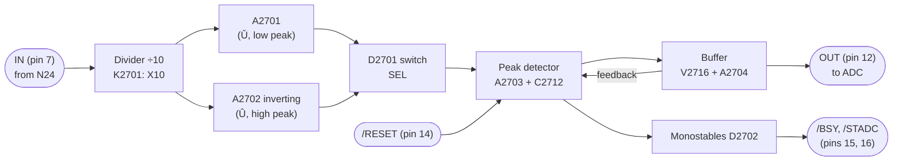

# Peak Detector (Expansionboard N27) · Operation
N27 › [Overview](README.md) · **Operation** · [Schematics](Schematics.md) · [PCB](PCB.md) · [Switching](Switching.md)

> [!NOTE]
> I haven't made scope captures of this board, so the description below is based on the schematics, the Philips documentation and the firmware.

## Block diagram

## A measurement from the Peak Detector's perspective

### Step 1: reset
- The firmware pulls **/RESET** low for about 10 ms before each peak reading. V2715/V2714 then discharge the hold capacitor C2712 through R2728.
- The firmware sets **SEL**: 0 for the high peak, 1 for the low peak. In the amplitude function (Û - Ǔ) it measures both, one after the other.

### Step 2: capturing the peak
- The selected amplifier output goes to the comparator A2703. As long as the input is higher than the held value, A2703 charges C2712 further.
- Every time the comparator acts, the monostable D2702A starts again and keeps **/BSY** active.

### Step 3: the peak is stable
- When the comparator has been quiet for a while, D2702B gives a **/STADC** pulse: the peak is captured and stable (about 60 ms on the Philips drawing).
- The CPU starts a conversion of **OUT**. With manual or external start, the firmware also reads **/BSY**: if the board is still busy, it discards the reading and waits for the next /STADC.

---
N27 › [Overview](README.md) · **Operation** · [Schematics](Schematics.md) · [PCB](PCB.md) · [Switching](Switching.md)
