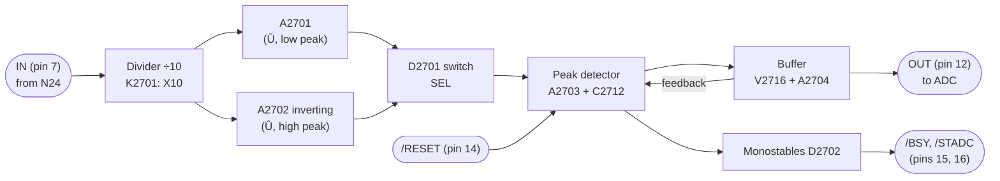
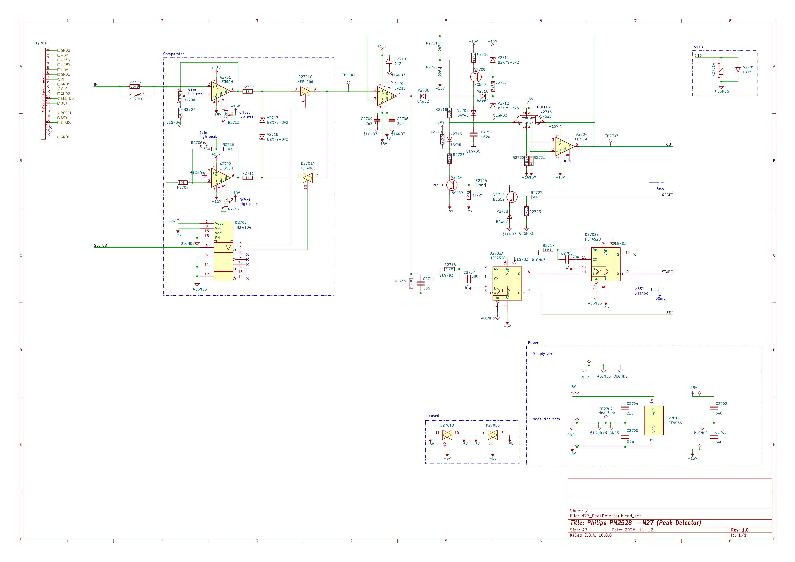
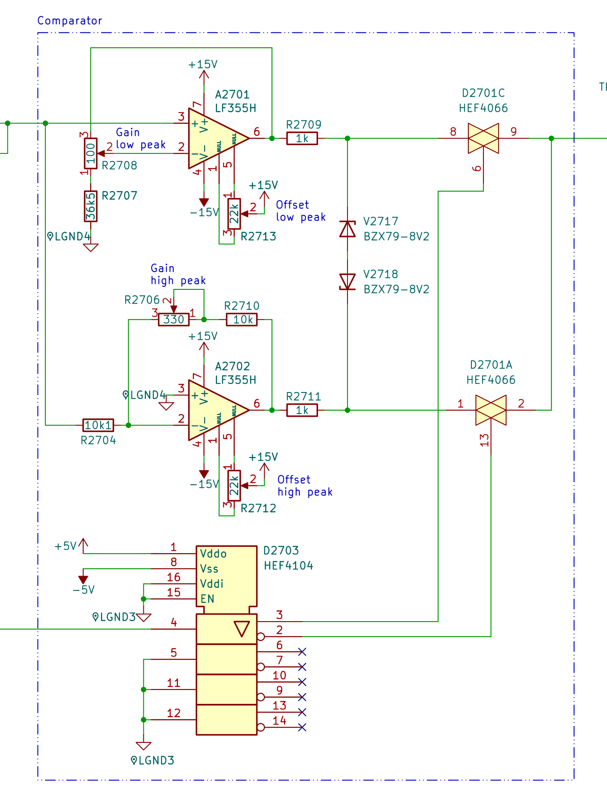
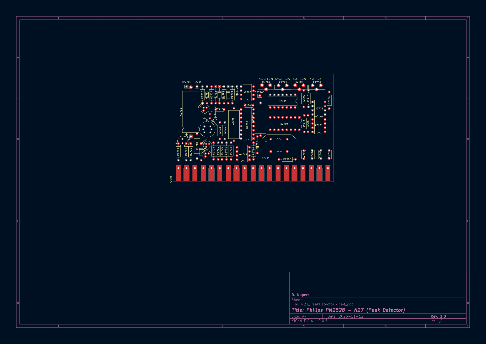
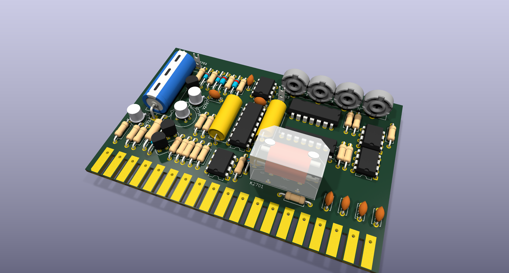

# Peak Detector (Expansionboard N27)
This expansion board captures the highest or lowest value of the AC signal (function Vpeak). It is an option.

Its functions include:
- Scaling the signal from N24 (×1 or ×0.1)
- Selecting the high peak (Û) or the low peak (Ǔ)
- Holding the peak on a capacitor, with a reset by the CPU
- Telling the CPU when a peak is captured and stable (/BSY, /STADC)

### The signals
#### External signals (to/from this board)

🟦 signal · 🟧 supply / zero · ⬛ not connected

| Pin | Name | I/O | Description | Connected to | Testpoint |
| -: | - | :-: | - | - | - |
| 1 | 🟧 **0V** |  | Supply zero (▽3) | Mainboard |  |
| 2 | 🟧 **-5V** |  | Supply | Mainboard |  |
| 3 | 🟧 **-15V** |  | Supply | Mainboard |  |
| 4 | 🟧 **+15V** |  | Supply | Mainboard |  |
| 5 | 🟧 **+5V** |  | Supply | Mainboard |  |
| 6 | 🟧 **Measuring zero** |  | Measuring zero (▽4) | Mainboard |  |
| 7 | 🟦 **IN** | I | AC signal | N24 (OUT) |  |
| 8 | 🟧 **Measuring zero** |  | Measuring zero (▽4) | Mainboard |  |
| 9 | 🟦 **X10** | I | Relay K2701: shorts the ÷10 divider | CPU (D1703 P73) |  |
| 10 | 🟧 **0V** |  | Supply zero (▽6) | Mainboard |  |
| 11 | 🟦 **SEL** | I | Peak select: 0 = high peak (Û), 1 = low peak (Ǔ) | CPU (D1703 P50) |  |
| 12 | 🟦 **OUT** | O | Held peak value | ADC input selector | TP2703 |
| 13 | ⬛ - |  | Not connected |  |  |
| 14 | 🟦 **/RESET** | I | Discharges the hold capacitor (low pulse before each reading) | CPU (D1703 P53) |  |
| 15 | 🟦 **/BSY** | O | Busy: the comparator is still active | CPU (D1703 P41) |  |
| 16 | 🟦 **/STADC** | O | Start ADC: the peak is captured and stable | CPU (D1703 P42) |  |
| 17 | ⬛ - |  | Not connected |  |  |
| 18 | ⬛ - |  | Not connected |  |  |
| 19 | 🟧 **Measuring zero** |  | Measuring zero (▽5) | Mainboard | TP2702 |

_Note: I haven't made scope captures of this board, so the description below is based on the schematics, the Philips documentation and the firmware._

## A measurement from the Peak Detector's perspective

#### Step 1: reset
- The firmware pulls **/RESET** low for about 10 ms before each peak reading. V2715/V2714 then discharge the hold capacitor C2712 through R2728.
- The firmware sets **SEL**: 0 for the high peak, 1 for the low peak. In the amplitude function (Û - Ǔ) it measures both, one after the other.

#### Step 2: capturing the peak
- The selected amplifier output goes to the comparator A2703. As long as the input is higher than the held value, A2703 charges C2712 further.
- Every time the comparator acts, the monostable D2702A starts again and keeps **/BSY** active.

#### Step 3: the peak is stable
- When the comparator has been quiet for a while, D2702B gives a **/STADC** pulse: the peak is captured and stable (about 60 ms on the Philips drawing).
- The CPU starts a conversion of **OUT**. With manual or external start, the firmware also reads **/BSY**: if the board is still busy, it discards the reading and waits for the next /STADC.

## Schematics
I copied and redrew the schematics and PCB in KiCad, using the low‑res Philips docs as a reference. There might be a few small differences since I tweaked them to match my PM2528. You’ll find the KiCad files in other parts of this repo.

The input- and output signals of this board are listed at the top of the page. The 'local' signals are listed in the next table.

#### Internal signals
| Name | Description | Testpoint |
| - | - | - |
| **Selected peak** | Output of the selected input amplifier, input of the comparator A2703 | TP2701
| **MeasZero** | Measuring zero | TP2702
| **SEL_UD** | Peak select, level-shifted by D2703 (HEF4104) to drive the D2701 switches | |

### Section: Input amplifiers (box "Comparator")
R2705 (90k9) and R2704 (10k1) divide the input by 10; relay K2701 (**X10**) shorts R2705, so the input passes at full size. The firmware has X10 on in all ranges except the highest. A2701 amplifies without inverting (low peak, Ǔ), A2702 inverts (high peak, Û). Each has a **Gain** and an **Offset** trimmer. The switches D2701A/C pass one of the two, chosen by **SEL** through the level shifter D2703. The zeners V2717/V2718 limit the signal.

### Section: Peak detector
A2703 compares the selected signal with the held value and charges C2712 (162n) through V2706, V2710 and the current source V2709. The dual FET V2716 (ON528) and A2704 buffer the held voltage to **OUT**, and OUT goes back to the comparator.

### Section: Reset
V2715 (BC559) and V2714 (BC547) translate **/RESET** and discharge C2712 through R2728 (time constant about 4 µs).

### Section: Busy and Start ADC
The comparator output triggers D2702A (HEF4528) through C2711; its output is **/BSY**. The end of /BSY triggers D2702B, which gives the **/STADC** pulse.

## PCB

