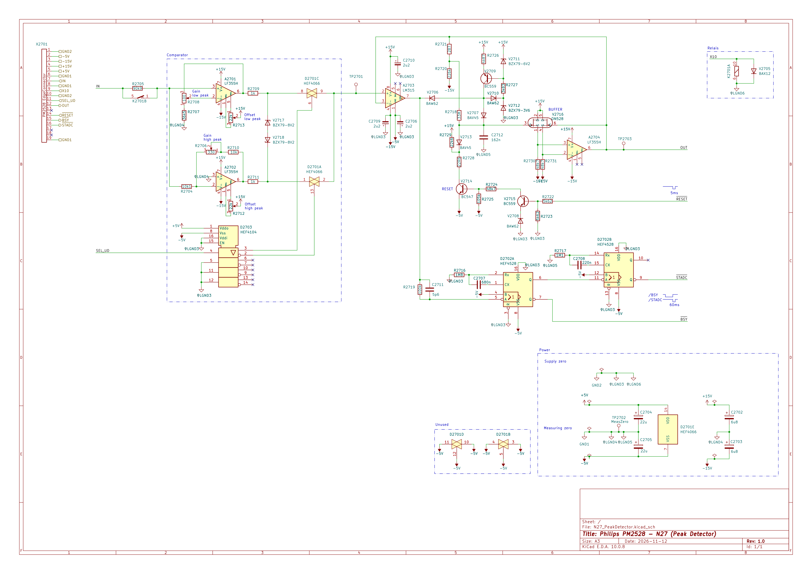
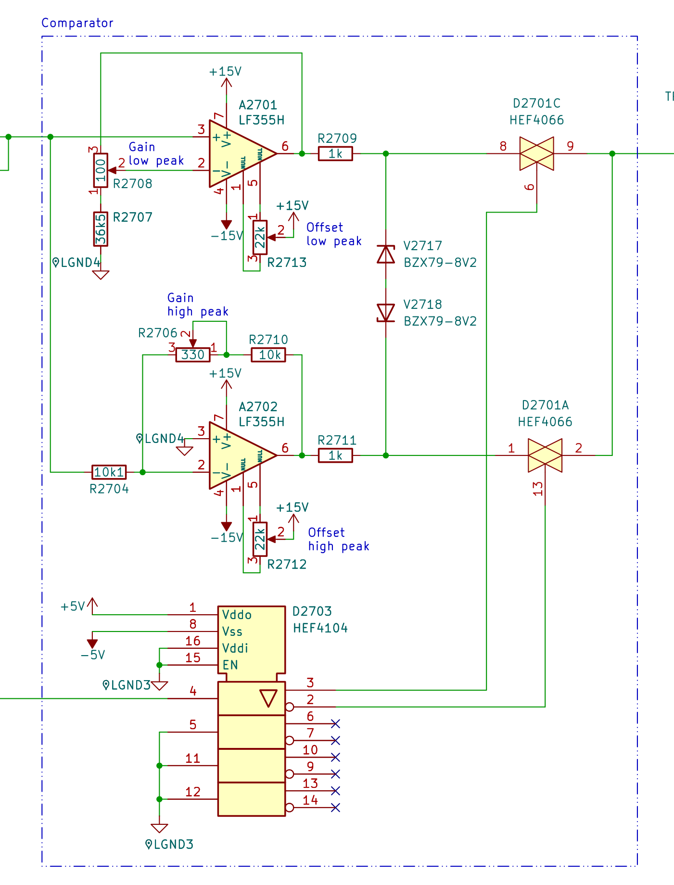
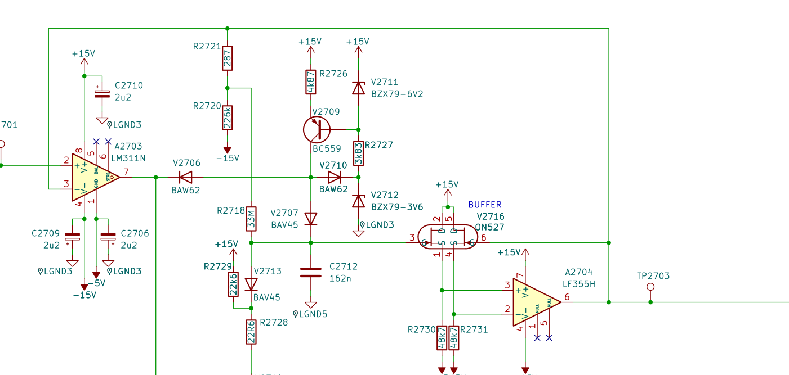
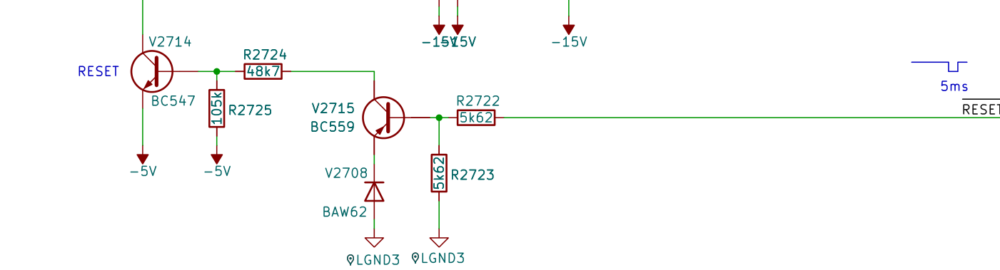
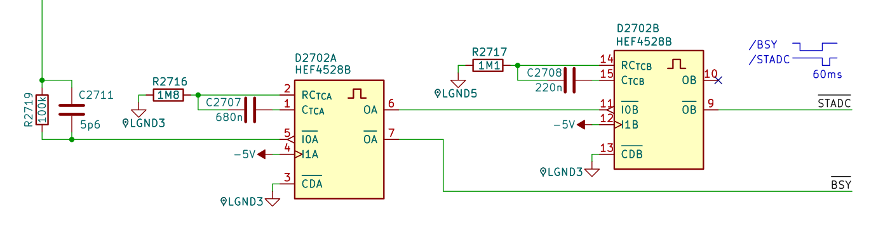

# Peak Detector (Expansionboard N27) · Schematics
N27 › [Overview](README.md) · [Operation](Operation.md) · **Schematics** · [PCB](PCB.md) · [Switching](Switching.md)

I copied and redrew the schematics and PCB in KiCad, using the low‑res Philips docs as a reference. There might be a few small differences since I tweaked them to match my PM2528. You’ll find the KiCad files in other parts of this repo.

## Full schematic

## Internal signals
The signals on the edge connector are listed on the [overview page](README.md#edge-connector). These are the local ones.

| Name | Description | Testpoint |
| - | - | - |
| **Selected peak** | Output of the selected input amplifier, input of the comparator A2703 | TP2701
| **MeasZero** | Measuring zero | TP2702
| **SEL_UD** | Peak select, level-shifted by D2703 (HEF4104) to drive the D2701 switches | |

## Sections
### Input amplifiers (box "Comparator")
R2705 (90k9) and R2704 (10k1) divide the input by 10; relay K2701 (**X10**) shorts R2705, so the input passes at full size. The firmware has X10 on in all ranges except the highest. A2701 amplifies without inverting (low peak, Ǔ), A2702 inverts (high peak, Û). Each has a **Gain** and an **Offset** trimmer. The switches D2701A/C pass one of the two, chosen by **SEL** through the level shifter D2703. The zeners V2717/V2718 limit the signal.

### Peak detector
A2703 compares the selected signal with the held value and charges C2712 (162n) through V2706, V2710 and the current source V2709. The dual FET V2716 (ON528) and A2704 buffer the held voltage to **OUT**, and OUT goes back to the comparator.

### Reset
V2715 (BC559) and V2714 (BC547) translate **/RESET** and discharge C2712 through R2728 (time constant about 4 µs).

### Busy and Start ADC
The comparator output triggers D2702A (HEF4528) through C2711; its output is **/BSY**. The end of /BSY triggers D2702B, which gives the **/STADC** pulse.

---
N27 › [Overview](README.md) · [Operation](Operation.md) · **Schematics** · [PCB](PCB.md) · [Switching](Switching.md)
