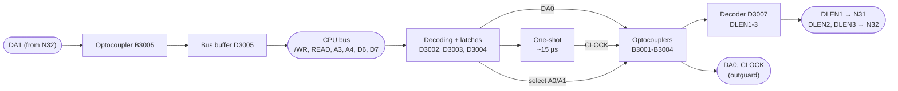

# Galvanic Separation (Expansionboard N30)
N30 › **Overview** · [Operation](Operation.md) · [Schematics](Schematics.md) · [PCB](PCB.md)

This expansion board connects the CPU to the option boards on the "outguard" side: the IEC (GPIB) interface N32 and the analog output N31. The measuring circuit floats with the input terminals, so these connections have to be isolated. N30 does that with optocouplers.

Its functions include:
- Turning CPU bus writes and reads into a serial interface (DATA, CLOCK)
- Selecting one of three serial devices (DLEN1, DLEN2, DLEN3)
- Isolating all lines with optocouplers (CNX35)
- Reading back the serial data from the option boards (DA1)
- Reading an option strap

### The signals
#### External signals (to/from this board)

🟦 signal · 🟧 supply / zero · ⬛ not connected

| Pin | Name | I/O | Description | Connected to | Testpoint |
| -: | - | :-: | - | - | - |
| 1 | 🟦 **DA0** | O | Serial data to the option boards (outguard) | N31 (DATA), N32 |  |
| 2 | 🟦 **DA1** | I | Serial data from the option boards (outguard) | N32 |  |
| 3 | 🟦 **CLOCK** | O | Serial clock (outguard) | N31, N32 |  |
| 4 | 🟦 **DLEN3** | O | Device select 3 (outguard) | N32 |  |
| 5 | 🟦 **DLEN2** | O | Device select 2 (outguard) | N32 |  |
| 6 | 🟦 **DLEN1** | O | Device select 1 (outguard) | N31 |  |
| 7 | 🟧 **+5V outguard** |  | Outguard supply | Mainboard |  |
| 8 | 🟧 **0V outguard** |  | Outguard zero | Mainboard |  |
| 9 | ⬛ - |  | Not connected |  |  |
| 10 | ⬛ - |  | Not connected |  |  |
| 11 | 🟧 **0V** |  | Supply zero | Mainboard |  |
| 12 | 🟧 **-5V** |  | Supply | Mainboard |  |
| 13 | ⬛ - |  | Not connected |  |  |
| 14 | 🟦 **D7** | I/O | CPU data bus bit 7 | CPU |  |
| 15 | 🟦 **/WR** | I | CPU write strobe | CPU |  |
| 16 | 🟦 **D6** | I/O | CPU data bus bit 6 | CPU |  |
| 17 | 🟦 **A4** | I | CPU address bit 4 | CPU |  |
| 18 | 🟦 **READ** | I | I/O read strobe (IORD) | Mainboard |  |
| 19 | 🟦 **A3** | I | CPU address bit 3 | CPU |  |

_Note: the Philips drawing shows DA0 and DA1 both on pin 2; I haven't traced that on the board yet._

## More about this board
- [Operation](Operation.md): the bus, a serial transfer and the option strap
- [Schematics](Schematics.md): the full schematic, internal signals and the sections
- [PCB](PCB.md): the board layout and 3D view

_N30 has no relays or analog switches._
