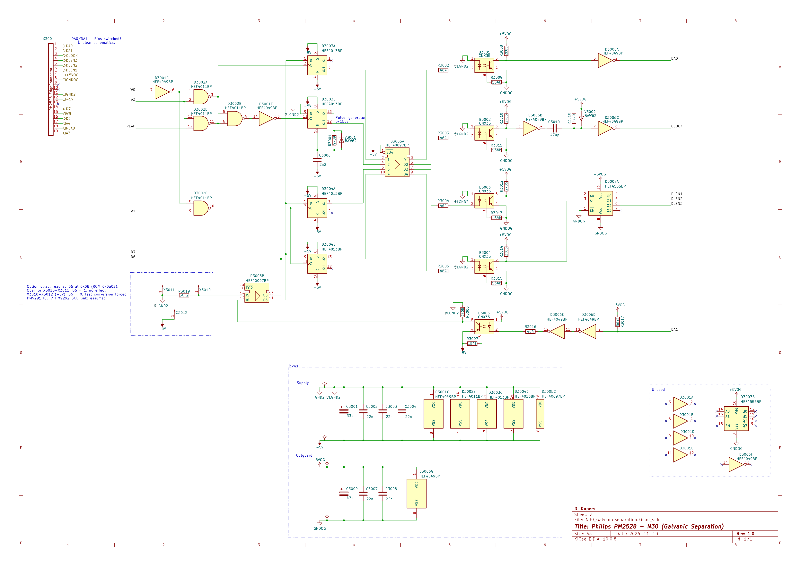
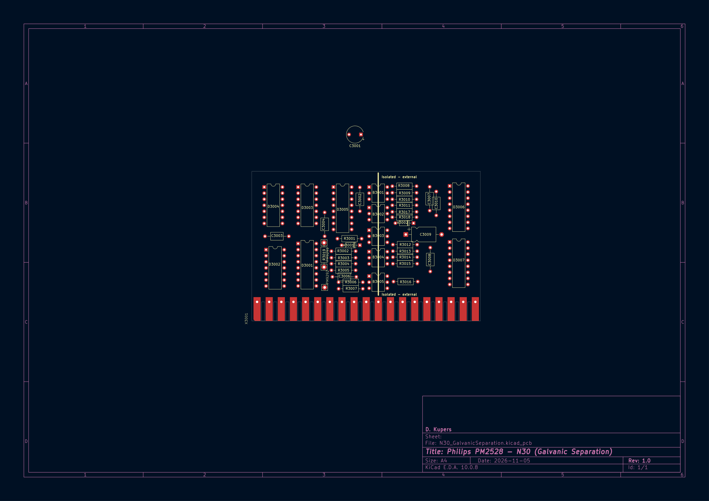
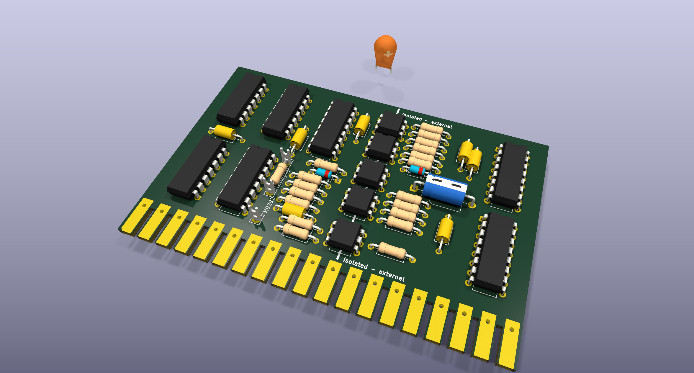

# Galvanic Separation (Expansionboard N30)
This expansion board connects the CPU to the option boards on the "outguard" side: the IEC (GPIB) interface N32 and the analog output N31. The measuring circuit floats with the input terminals, so these connections have to be isolated. N30 does that with optocouplers.

Its functions include:
- Turning CPU bus writes and reads into a serial interface (DATA, CLOCK)
- Selecting one of three serial devices (DLEN1, DLEN2, DLEN3)
- Isolating all lines with optocouplers (CNX35)
- Reading back the serial data from the option boards (DA1)
- Reading an option strap

### The signals
#### External signals (to/from this board)

🟦 signal · 🟧 supply / zero · ⬛ not connected

| Pin | Name | I/O | Description | Connected to | Testpoint |
| -: | - | :-: | - | - | - |
| 1 | 🟦 **DA0** | O | Serial data to the option boards (outguard) | N31 (DATA), N32 |  |
| 2 | 🟦 **DA1** | I | Serial data from the option boards (outguard) | N32 |  |
| 3 | 🟦 **CLOCK** | O | Serial clock (outguard) | N31, N32 |  |
| 4 | 🟦 **DLEN3** | O | Device select 3 (outguard) | N32 |  |
| 5 | 🟦 **DLEN2** | O | Device select 2 (outguard) | N32 |  |
| 6 | 🟦 **DLEN1** | O | Device select 1 (outguard) | N31 |  |
| 7 | 🟧 **+5V outguard** |  | Outguard supply | Mainboard |  |
| 8 | 🟧 **0V outguard** |  | Outguard zero | Mainboard |  |
| 9 | ⬛ - |  | Not connected |  |  |
| 10 | ⬛ - |  | Not connected |  |  |
| 11 | 🟧 **0V** |  | Supply zero | Mainboard |  |
| 12 | 🟧 **-5V** |  | Supply | Mainboard |  |
| 13 | ⬛ - |  | Not connected |  |  |
| 14 | 🟦 **D7** | I/O | CPU data bus bit 7 | CPU |  |
| 15 | 🟦 **/WR** | I | CPU write strobe | CPU |  |
| 16 | 🟦 **D6** | I/O | CPU data bus bit 6 | CPU |  |
| 17 | 🟦 **A4** | I | CPU address bit 4 | CPU |  |
| 18 | 🟦 **READ** | I | I/O read strobe (IORD) | Mainboard |  |
| 19 | 🟦 **A3** | I | CPU address bit 3 | CPU |  |

_Note: the Philips drawing shows DA0 and DA1 both on pin 2; I haven't traced that on the board yet. I also haven't made scope captures of this board, so the description below is based on the schematics, the Philips documentation and the firmware._

## How it works
The CPU sees N30 as two I/O addresses:

| Address | Read | Write |
| - | - | - |
| 0x08 | D7 = DA1 (data from the option board), D6 = option strap | D7 = DA0 (data to the option board) |
| 0x10 | - | D7, D6 = device select |

| Value written to 0x10 | Selects |
| - | - |
| 0x00 | DLEN1 (N31 analog output) |
| 0x80 | DLEN2 (N32: board to CPU) |
| 0x40 | DLEN3 (N32: CPU to board) |
| 0xC0 | none |

#### A serial transfer
1. The CPU writes the device select to 0x10. D3004A/B latch D7 and D6, the optocouplers B3003/B3004 pass them to the outguard side, and the decoder D3007 (HEF4555) raises one DLEN line.
2. For each bit, the CPU writes the bit (D7) to 0x08, or reads 0x08. D3003A latches the data bit, which goes through B3001 to **DA0**.
3. Every access to 0x08, read or write, fires a one-shot of about 15 µs (D3003B with R3001/C3006). At its end, a **CLOCK** pulse goes through B3002 to the outguard side. So the data is stable before the clock edge.
4. On a read, the data from the option board (**DA1**) comes back through B3005, and the bus buffer D3005B puts it on D7.

#### Option strap
The strap X3010-X3012 is read as D6 at address 0x08. Open (or X3010-X3011): D6 = 1, no effect. X3010-X3012: D6 = 0, the firmware forces fast conversion. Which option board goes with which setting comes from a note on the schematic; it isn't proven.

## Schematics
I copied and redrew the schematics and PCB in KiCad, using the low‑res Philips docs as a reference. There might be a few small differences since I tweaked them to match my PM2528. You’ll find the KiCad files in other parts of this repo.

### Section: Address decoding
D3001C inverts /WR. D3002A (WR and A3) and D3002D (READ and A3) mark an access to 0x08, D3002C (WR and A4) a write to 0x10.

### Section: Latches and one-shot
D3003A holds the data bit DA0, D3004A/B hold the device select. D3003B is the one-shot (about 15 µs) that makes the CLOCK pulse.

### Section: Optocouplers
B3001-B3004 (CNX35) carry DA0, CLOCK and the two select bits from the CPU side (-5 V/0 V) to the outguard side (+5 V outguard). On the outguard side, D3006B/C and C3010 shape the CLOCK pulse. B3005 carries DA1 back.

### Section: Device select
D3007A (HEF4555) decodes the two select bits into DLEN1, DLEN2 and DLEN3. Q3 (value 0xC0) is not connected, so that value selects nothing.

### Section: Bus buffer
D3005 (HEF40097, tri-state) drives the optocouplers (D3005A) and puts DA1 and the option strap on the data bus during a read (D3005B).

## PCB

