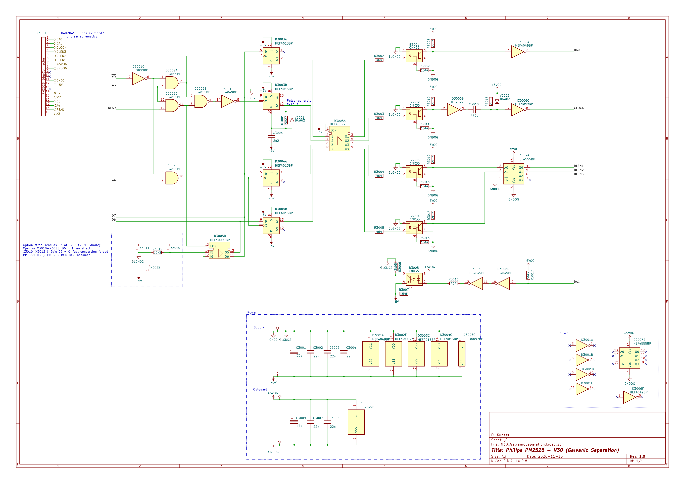

# Galvanic Separation (Expansionboard N30) · Schematics
N30 › [Overview](README.md) · [Operation](Operation.md) · **Schematics** · [PCB](PCB.md)

## Schematics
I copied and redrew the schematics and PCB in KiCad, using the low‑res Philips docs as a reference. There might be a few small differences since I tweaked them to match my PM2528. You’ll find the KiCad files in other parts of this repo.

### Section: Address decoding
D3001C inverts /WR. D3002A (WR and A3) and D3002D (READ and A3) mark an access to 0x08, D3002C (WR and A4) a write to 0x10.

### Section: Latches and one-shot
D3003A holds the data bit DA0, D3004A/B hold the device select. D3003B is the one-shot (about 15 µs) that makes the CLOCK pulse.

### Section: Optocouplers
B3001-B3004 (CNX35) carry DA0, CLOCK and the two select bits from the CPU side (-5 V/0 V) to the outguard side (+5 V outguard). On the outguard side, D3006B/C and C3010 shape the CLOCK pulse. B3005 carries DA1 back.

### Section: Device select
D3007A (HEF4555) decodes the two select bits into DLEN1, DLEN2 and DLEN3. Q3 (value 0xC0) is not connected, so that value selects nothing.

### Section: Bus buffer
D3005 (HEF40097, tri-state) drives the optocouplers (D3005A) and puts DA1 and the option strap on the data bus during a read (D3005B).
