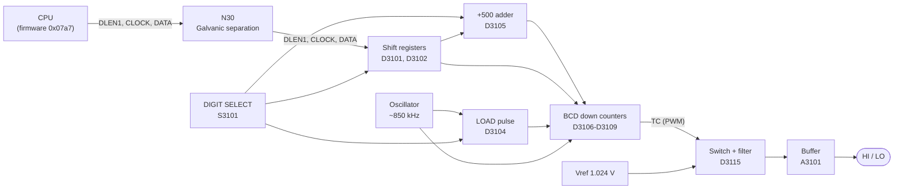
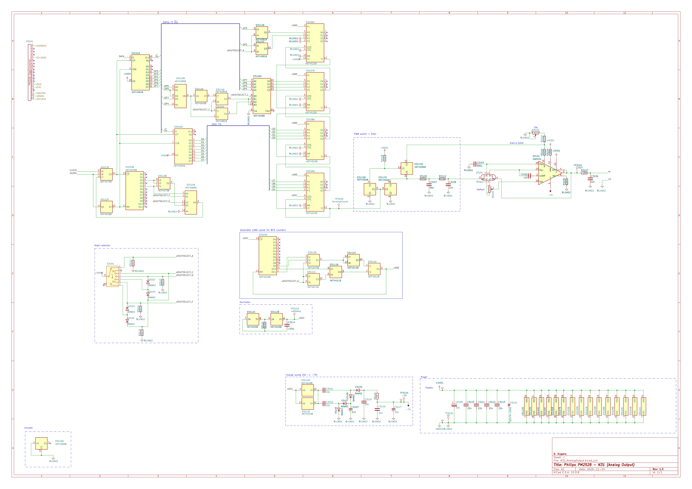
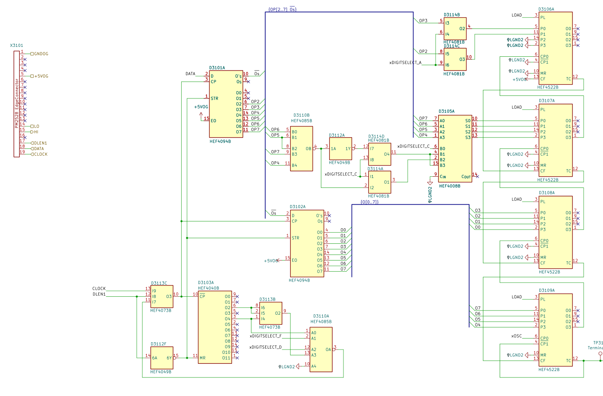
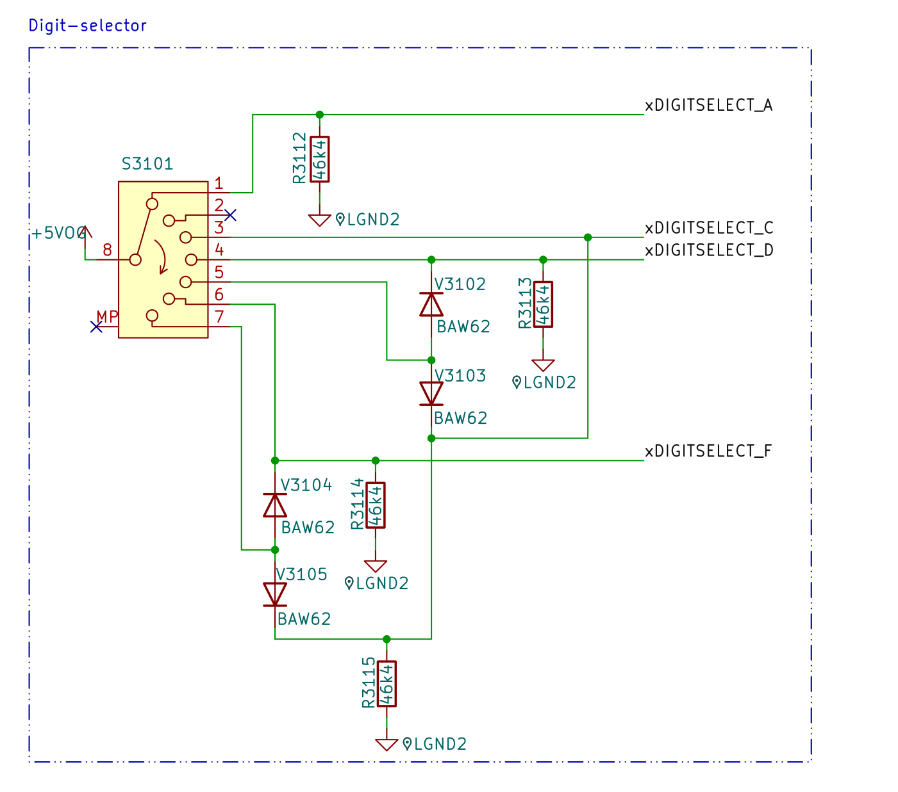
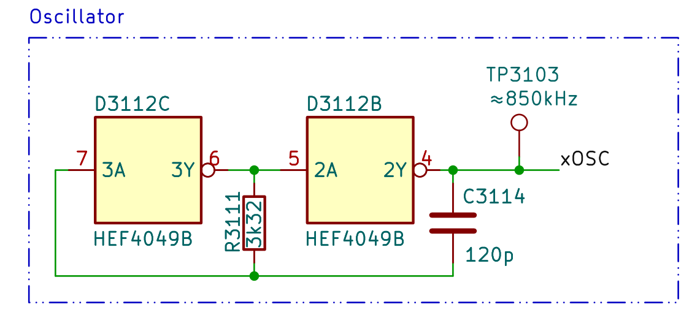
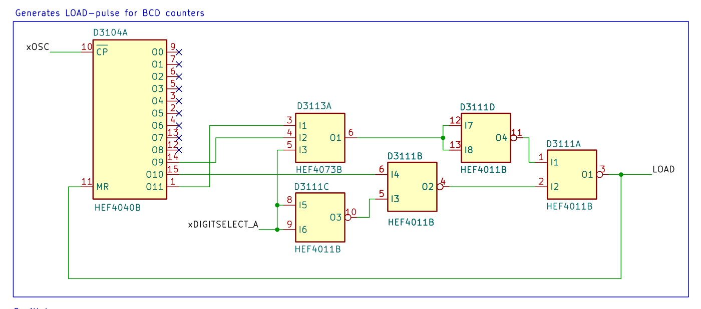
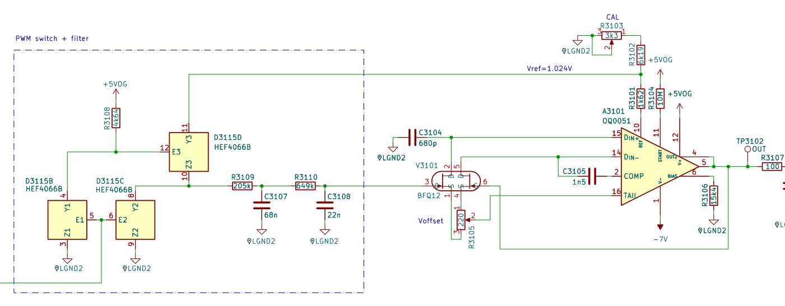
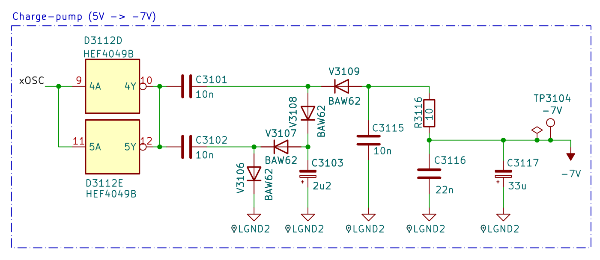

# Analog Output (Expansionboard N31)
This expansion board turns the displayed reading into a DC voltage, for example to drive a chart recorder.

Its functions include:
- Receiving the reading from the CPU over the serial DLEN1 bus
- Selecting which digits of the reading go to the output (DIGIT SELECT switch)
- Converting these digits into a voltage with a PWM DAC
- Filtering and buffering the result to the HI/LO output

The board sits on the outguard side: it gets its data, clock and supply through the galvanic separation (N30).

### The signals
#### External signals (to/from this board)

🟦 signal · 🟧 supply / zero · ⬛ not connected

| Pin | Name | I/O | Description | Connected to | Testpoint |
| -: | - | :-: | - | - | - |
| 1 | 🟧 **0V** |  | Outguard ground | Mainboard | TP3101 |
| 2 | ⬛ - |  | Not connected |  |  |
| 3 | ⬛ - |  | Not connected |  |  |
| 4 | ⬛ - |  | Not connected |  |  |
| 5 | 🟧 **+5V** |  | Outguard supply | Mainboard |  |
| 6 | ⬛ - |  | Not connected |  |  |
| 7 | ⬛ - |  | Not connected |  |  |
| 8 | ⬛ - |  | Not connected |  |  |
| 9 | ⬛ - |  | Not connected |  |  |
| 10 | ⬛ - |  | Not connected |  |  |
| 11 | ⬛ - |  | Not connected |  |  |
| 12 | ⬛ - |  | Not connected |  |  |
| 13 | ⬛ - |  | Not connected |  |  |
| 14 | 🟦 **LO** | O | Output ground (= outguard 0 V) | Back panel | TP3101 |
| 15 | 🟦 **HI** | O | Analog output, 0 to about 1 V | Back panel | TP3102 |
| 16 | ⬛ - |  | Not connected |  |  |
| 17 | 🟦 **DLEN1** | I | Data enable: high while the CPU shifts the reading out | CPU (via N30) |  |
| 18 | 🟦 **DATA** | I | Serial data, LSB first | CPU (via N30) |  |
| 19 | 🟦 **CLOCK** | I | Serial clock, 24 pulses per transfer | CPU (via N30) |  |

_Note: I haven't made scope captures of this board yet, so the description below is based on the schematics and the firmware._

## A data transfer from the Analog Output's perspective

This section describes how the N31 receives a new reading and turns it into a voltage.

#### Step 1: the CPU sends the reading
- After every reading the firmware raises **DLEN1** and shifts out 3 bytes: `m37`, `m36`, `m35` (digits D1 D0, D3 D2, D5 D4), each LSB first. That is 24 **CLOCK** pulses.
- The sign, the decimal point and overload are not sent. The output is the magnitude of the displayed digits only.
- Blank digits (in the reduced-resolution modes) are turned into 0 by the firmware before the transfer.

#### Step 2: the digit selector keeps the right digits
- The clock reaches the shift registers D3101/D3102 through gate D3113C, and the clock counter D3103 counts along.
- Depending on **DIGIT SELECT**, the gate closes after 16, 20 or 24 clocks. The shift registers then hold exactly the digits that were selected (see the table below).

#### Step 3: DLEN1 drops
- **DLEN1** low resets D3103 and strobes the shift registers: the selected digits appear on their outputs.
- In positions C, E and G, the adder D3105 adds 5 to the top digit (modulo 10).

#### Step 4: the PWM DAC picks up the new value
- At the next **LOAD** pulse the BCD down counters D3106-D3109 are loaded with the new digits.
- From then on, every PWM period outputs the new value. The filter needs some tens of milliseconds to settle.

## Output scaling
The output voltage is the reference voltage times the duty cycle of the PWM signal:

> Vout = 1.024 V × N / period

N is the number loaded into the counters, the period is set by the **LOAD** pulse: 2560 oscillator clocks in position A, 1024 in all other positions. This gives round numbers: **0.4 mV per count** in A, **1 mV per count** in B to G.

| S3101 | Front-panel legend | Digits loaded (N) | Clocks | Period | Scale | Range |
| :-: | - | - | :-: | :-: | - | - |
| A | D5 … D2 | D5 D4 D3 D2 (D5: bits 0 and 1 only) | 24 | 2560 | 0.4 mV/count | 0 … 0.96 V (N = 2399, just below overload) |
| B | D4 … D2 | D4 D3 D2 | 24 | 1024 | 1 mV/count | 0 … 0.999 V |
| C | D4 … D2 +500 | D4 D3 D2, top digit +5 | 24 | 1024 | 1 mV/count | 0 … 0.999 V, centred |
| D | D3 … D1 | D3 D2 D1 | 20 | 1024 | 1 mV/count | 0 … 0.999 V |
| E | D3 … D1 +500 | D3 D2 D1, top digit +5 | 20 | 1024 | 1 mV/count | 0 … 0.999 V, centred |
| F | D2 … D0 | D2 D1 D0 | 16 | 1024 | 1 mV/count | 0 … 0.999 V |
| G | D2 … D0 +500 | D2 D1 D0, top digit +5 | 16 | 1024 | 1 mV/count | 0 … 0.999 V, centred |

Example: the display reads **123456** (D5 … D0 = 1 2 3 4 5 6):

| S3101 | N | Vout |
| :-: | -: | -: |
| A | 1234 | 0.494 V |
| B | 234 | 0.234 V |
| C | 734 | 0.734 V |
| D | 345 | 0.345 V |
| E | 845 | 0.845 V |
| F | 456 | 0.456 V |
| G | 956 | 0.956 V |

What the positions are for:
- **A** gives the whole reading, at a coarse resolution.
- **B, D and F** zoom in on the lower digits. The output wraps around like a sawtooth whenever the selected digits roll over (999 → 000).
- **C, E and G** move that wrap point to mid-scale. A reading that hovers around a round value (for example 1.00000 V in position D) then sits around 0.5 V on the recorder, instead of jumping between 0 V and 0.999 V.

## Schematics
I copied and redrew the schematics in KiCad, using the low‑res Philips docs as a reference. There might be a few small differences since I tweaked them to match my PM2528. You’ll find the KiCad files in other parts of this repo.

The input- and output signals of this board are listed at the top of the page. The 'local' signals are listed in the next table.

#### Internal signals
| Name | Description | Testpoint |
| - | - | - |
| **xOSC** | Oscillator, about 850 kHz. Clocks the PWM counters, the LOAD counter and the charge pump | TP3103
| **LOAD** | Short pulse at the start of every PWM period: loads the BCD counters and resets D3104 |
| **TC** | Terminal count of the BCD counters: low while counting down, high when they reach 0 (= the PWM signal) | TP3105
| **Vref** | 1.024 V reference, set with the CAL trimmer R3103 |
| **xDIGITSELECT_A/C/D/F** | Switch lines from S3101. Positions E and G drive two lines each through diodes (E = D + C, G = F + C) |
| **OP0-OP7, O0-O7** | Outputs of the shift registers D3101/D3102 (the selected digits) |
| **-7V** | Negative supply for the output amplifier, made by the charge pump | TP3104

### Section: Receiver
The shift registers D3101/D3102 (HEF4094, in cascade) take in the serial data. The clock counter D3103 (HEF4040) counts the clock pulses, and D3110A (HEF4085) closes the clock gate D3113C early: after 16 clocks in positions F/G, after 20 in D/E. The registers then hold the last 16 bits that were sent. **DLEN1** low resets D3103 and strobes the outputs of both registers.

The digit that ends up in D3101 OP4-OP7 is the top digit of the selection. It goes through the adder D3105 (HEF4008). D3110B detects a digit of 5 or more: the adder then adds 1011 instead of 0101 and drops the carry, so the top digit gets +5 modulo 10. Without C on, the adder adds 0.

In position A, the AND gates D3114 pass bits 0 and 1 of D5 to the most significant counter D3106. In all other positions D3106 gets 0.

### Section: Digit-selector
S3101 sets the selection lines A, C, D and F (each with a 46k4 pull-down). Positions E and G each set two lines through the diodes V3102-V3105. Position B sets none: 24 clocks, no adder, no D5.

### Section: Oscillator
Two inverters of D3112 (HEF4049) with R3111 and C3114 form an RC oscillator of about 850 kHz.

### Section: LOAD-pulse generator
D3104 (HEF4040) counts the oscillator pulses. D3113A and D3111 decode the end of the PWM period:
- Position A: at count 2560 (outputs O11 and O9 high)
- Other positions: at count 1024 (output O10 high)

The resulting **LOAD** pulse resets D3104 straight away (so the pulse is very short) and loads the BCD counters.

### Section: BCD down counters
D3106-D3109 (HEF4522) form a 4-decade down counter, clocked by **xOSC**. D3109 holds the lowest digit, D3106 the highest (only 0-3). After a **LOAD**, the counters count down from N to 0. At 0, **TC** goes high and stops the counters (CP1) until the next **LOAD**. So **TC** is low for N clock pulses of every period.

### Section: PWM switch + filter
The analog switches D3115 (HEF4066) connect the filter input to **Vref** while **TC** is low, and to 0 V while it is high. R3108 and switch D3115B invert **TC** for the Vref switch. The two RC stages R3109/C3107 and R3110/C3108 (time constants of about 14 ms each) turn the PWM signal into its average: Vref × N / period. The ripple frequency is about 830 Hz (330 Hz in position A).

### Section: Output buffer
A3101 (Philips OQ0051) with the dual FET V3101 (BFQ12) at its input is a unity-gain buffer, so the filter isn't loaded. R3105 (Voffset) trims the offset of the FET pair. The output goes through R3107 (100 Ω) and C3106 to the HI/LO jacks.

The reference comes from A3101 as well: its REF pin (about 1.23 V) feeds the divider R3101, R3102 and the CAL trimmer R3103, which sets **Vref** to 1.024 V.

### Section: Charge pump
Two inverters of D3112 drive C3101/C3102 with the oscillator signal. The diodes V3106-V3109 pump this into a negative supply of about -7 V for A3101, so the output can swing down to 0 V.

