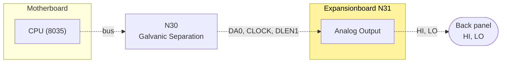

# Analog Output (Expansionboard N31)
N31 › **Overview** · [Operation](Operation.md) · [Schematics](Schematics.md)

This expansion board turns the displayed reading into a DC voltage, for example to drive a chart recorder.

## Functions
- Receiving the reading from the CPU over the serial DLEN1 bus
- Selecting which digits of the reading go to the output (DIGIT SELECT switch)
- Converting these digits into a voltage with a PWM DAC
- Filtering and buffering the result to the HI/LO output

The board sits on the outguard side: it gets its data, clock and supply through the galvanic separation (N30).

## Signal flow
N31 receives the reading from the CPU through the galvanic separation N30 and turns it into a voltage on the back panel.

## Edge connector

🟦 signal · 🟧 supply / zero · ⬛ not connected

| Pin | Name | I/O | Description | Connected to | Testpoint |
| -: | - | :-: | - | - | - |
| 1 | 🟧 **0V** |  | Outguard ground | Mainboard | TP3101 |
| 2 | ⬛ - |  | Not connected |  |  |
| 3 | ⬛ - |  | Not connected |  |  |
| 4 | ⬛ - |  | Not connected |  |  |
| 5 | 🟧 **+5V** |  | Outguard supply | Mainboard |  |
| 6 | ⬛ - |  | Not connected |  |  |
| 7 | ⬛ - |  | Not connected |  |  |
| 8 | ⬛ - |  | Not connected |  |  |
| 9 | ⬛ - |  | Not connected |  |  |
| 10 | ⬛ - |  | Not connected |  |  |
| 11 | ⬛ - |  | Not connected |  |  |
| 12 | ⬛ - |  | Not connected |  |  |
| 13 | ⬛ - |  | Not connected |  |  |
| 14 | 🟦 **LO** | O | Output ground (= outguard 0 V) | Back panel | TP3101 |
| 15 | 🟦 **HI** | O | Analog output, 0 to about 1 V | Back panel | TP3102 |
| 16 | ⬛ - |  | Not connected |  |  |
| 17 | 🟦 **DLEN1** | I | Data enable: high while the CPU shifts the reading out | CPU (via N30) |  |
| 18 | 🟦 **DA0** | I | Serial data, LSB first | CPU (via N30) |  |
| 19 | 🟦 **CLOCK** | I | Serial clock, 24 pulses per transfer | CPU (via N30) |  |

## More about this board
- [Operation](Operation.md): a data transfer step by step, and the output scaling
- [Schematics](Schematics.md): the full schematic, internal signals and the sections

_N31 has no relays. Its PWM switch is described on the Schematics page._

---
N31 › **Overview** · [Operation](Operation.md) · [Schematics](Schematics.md)
