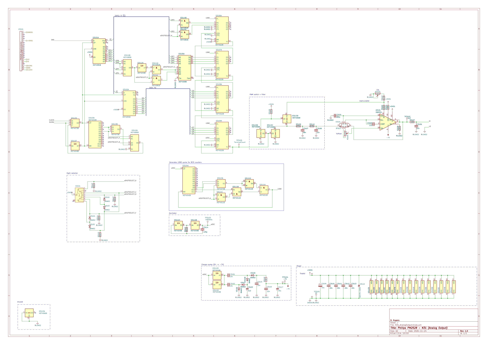
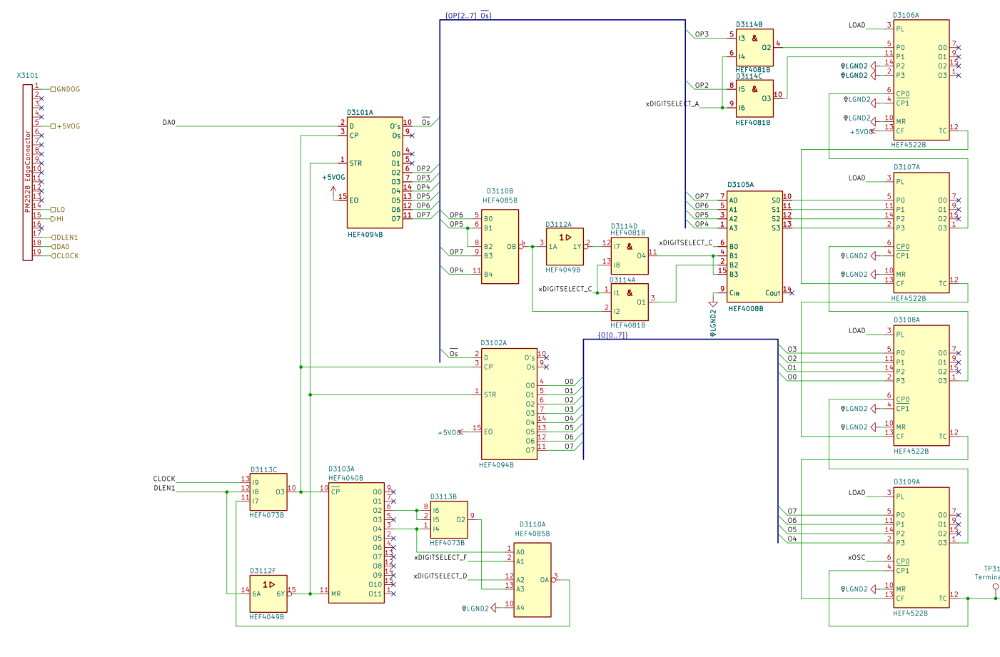
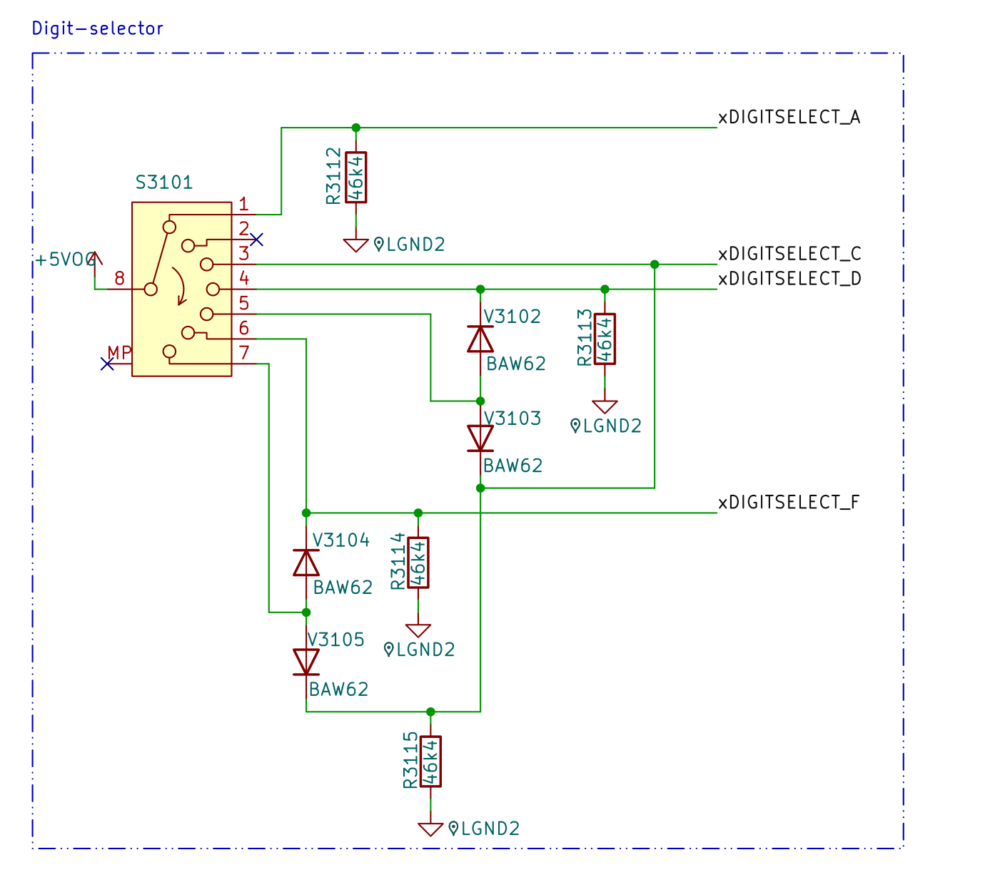
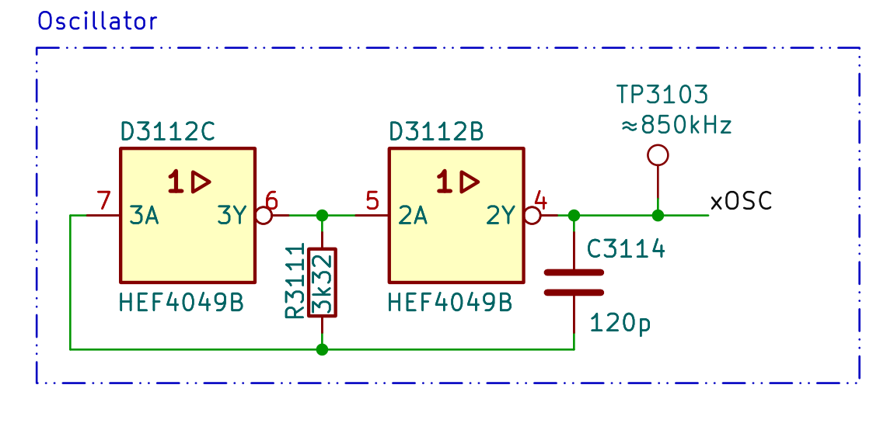
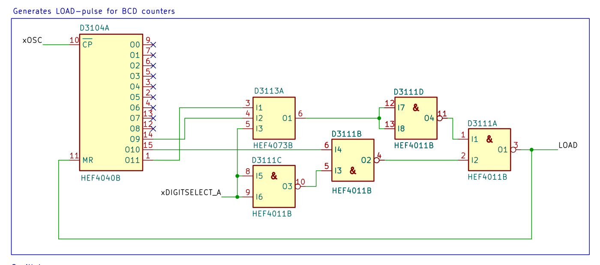
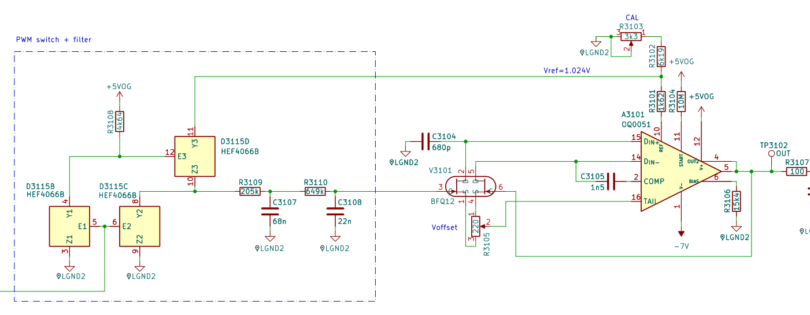
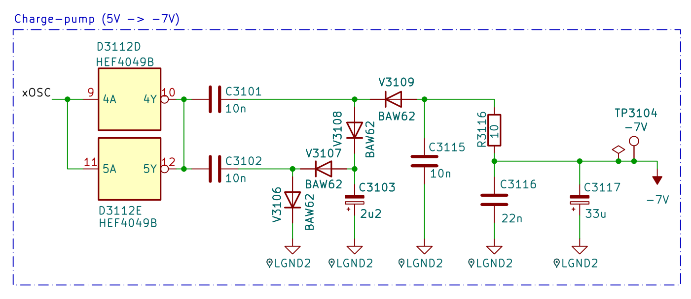

# Analog Output (Expansionboard N31) · Schematics
N31 › [Overview](README.md) · [Operation](Operation.md) · **Schematics**

## Schematics
I copied and redrew the schematics in KiCad, using the low‑res Philips docs as a reference. There might be a few small differences since I tweaked them to match my PM2528. You’ll find the KiCad files in other parts of this repo.

The input- and output signals of this board are listed on the [overview page](README.md#the-signals). The 'local' signals are listed in the next table.

#### Internal signals
| Name | Description | Testpoint |
| - | - | - |
| **xOSC** | Oscillator, about 850 kHz. Clocks the PWM counters, the LOAD counter and the charge pump | TP3103
| **LOAD** | Short pulse at the start of every PWM period: loads the BCD counters and resets D3104 |
| **TC** | Terminal count of the BCD counters: low while counting down, high when they reach 0 (= the PWM signal) | TP3105
| **Vref** | 1.024 V reference, set with the CAL trimmer R3103 |
| **xDIGITSELECT_A/C/D/F** | Switch lines from S3101. Positions E and G drive two lines each through diodes (E = D + C, G = F + C) |
| **OP0-OP7, O0-O7** | Outputs of the shift registers D3101/D3102 (the selected digits) |
| **-7V** | Negative supply for the output amplifier, made by the charge pump | TP3104

### Section: Receiver
The shift registers D3101/D3102 (HEF4094, in cascade) take in the serial data. The clock counter D3103 (HEF4040) counts the clock pulses, and D3110A (HEF4085) closes the clock gate D3113C early: after 16 clocks in positions F/G, after 20 in D/E. The registers then hold the last 16 bits that were sent. **DLEN1** low resets D3103 and strobes the outputs of both registers.

The digit that ends up in D3101 OP4-OP7 is the top digit of the selection. It goes through the adder D3105 (HEF4008). D3110B detects a digit of 5 or more: the adder then adds 1011 instead of 0101 and drops the carry, so the top digit gets +5 modulo 10. Without C on, the adder adds 0.

In position A, the AND gates D3114 pass bits 0 and 1 of D5 to the most significant counter D3106. In all other positions D3106 gets 0.

### Section: Digit-selector
S3101 sets the selection lines A, C, D and F (each with a 46k4 pull-down). Positions E and G each set two lines through the diodes V3102-V3105. Position B sets none: 24 clocks, no adder, no D5.

### Section: Oscillator
Two inverters of D3112 (HEF4049) with R3111 and C3114 form an RC oscillator of about 850 kHz.

### Section: LOAD-pulse generator
D3104 (HEF4040) counts the oscillator pulses. D3113A and D3111 decode the end of the PWM period:
- Position A: at count 2560 (outputs O11 and O9 high)
- Other positions: at count 1024 (output O10 high)

The resulting **LOAD** pulse resets D3104 straight away (so the pulse is very short) and loads the BCD counters.

### Section: BCD down counters
D3106-D3109 (HEF4522) form a 4-decade down counter, clocked by **xOSC**. D3109 holds the lowest digit, D3106 the highest (only 0-3). After a **LOAD**, the counters count down from N to 0. At 0, **TC** goes high and stops the counters (CP1) until the next **LOAD**. So **TC** is low for N clock pulses of every period.

### Section: PWM switch + filter
The analog switches D3115 (HEF4066) connect the filter input to **Vref** while **TC** is low, and to 0 V while it is high. R3108 and switch D3115B invert **TC** for the Vref switch. The two RC stages R3109/C3107 and R3110/C3108 (time constants of about 14 ms each) turn the PWM signal into its average: Vref × N / period. The ripple frequency is about 830 Hz (330 Hz in position A).

### Section: Output buffer
A3101 (Philips OQ0051) with the dual FET V3101 (BFQ12) at its input is a unity-gain buffer, so the filter isn't loaded. R3105 (Voffset) trims the offset of the FET pair. The output goes through R3107 (100 Ω) and C3106 to the HI/LO jacks.

The reference comes from A3101 as well: its REF pin (about 1.23 V) feeds the divider R3101, R3102 and the CAL trimmer R3103, which sets **Vref** to 1.024 V.

### Section: Charge pump
Two inverters of D3112 drive C3101/C3102 with the oscillator signal. The diodes V3106-V3109 pump this into a negative supply of about -7 V for A3101, so the output can swing down to 0 V.

