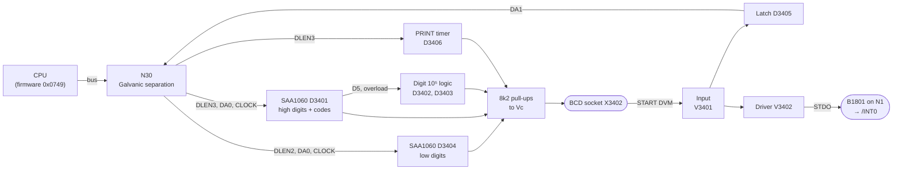

# BCD Output (Expansionboard N34) · Operation
N34 › [Overview](README.md) · **Operation** · [Schematics](Schematics.md) · [PCB](PCB.md)

> [!NOTE]
> I don't have this board, so there are no scope captures. The description below is based on the schematics, the firmware and the owner's manual (3.5, BCD parallel output PM9292). Firmware and manual agree on every code.

## Block diagram

## A reading from N34's perspective
After each reading the firmware updates the display and then sends the reading to the option boards (`FinishReadingOutput`, 0x0735). It only takes the BCD route when no IEC board was found at start-up: N32 and N34 use the same select lines.

### Step 1: the low digits go to D3404
- The firmware selects **DLEN2** and sends one SAA1060 word (`WriteToExtmem`, 0x0365): a leading 0, 16 data bits LSB first, a 1 (latch A), and a load clock with DLEN low. That is 19 **CLOCK** pulses of about 30 µs each.
- The 16 bits are `m37` (D1 D0) and `m36` (D3 D2), so the outputs of D3404 hold digits 10⁰ to 10³.

### Step 2: the high digit and the codes go to D3401
- Then **DLEN3** and a second word, with digit 10⁴, the two bits of digit 10⁵, an overload flag, the sign flag, the function code and the range code (see the bit map below).
- The firmware builds these bytes at 0x0751-0x0790. The function code comes from a 12-byte table (`BcdOutputFunctionCode`, 0x0729), the range code is 9 minus the range number.

### Step 3: PRINT
- The load clock ends with **DLEN3** low. That falling edge triggers D3406A, which waits about 40 µs, and then D3406B, which makes a pulse of about 900 µs.
- D3403C inverts it into **PRINT**, a negative-going pulse on pin 48. By then both latches hold the new reading, so the printer always reads a complete and consistent set of data.

### Step 4: the analog output
The firmware then sends the same reading over DLEN1 to the analog output N31, if fitted. N34 doesn't react to that.

## Bit map
Each SAA1060 output follows its data bit: a 1 turns the open-collector transistor off, and the 8k2 pull-up makes the pin high. So the socket uses positive logic.

| Word | Bits | SAA1060 output | Signal | Socket pins |
| - | - | - | - | - |
| DLEN2, byte 1 (`m37`) | 0-3 | D3404 Q1-Q4 | 10⁰ (D0) | 1, 2, 26, 27 |
|  | 4-7 | D3404 Q5-Q8 | 10¹ (D1) | 3, 4, 28, 29 |
| DLEN2, byte 2 (`m36`) | 0-3 | D3404 Q9-Q12 | 10² (D2) | 5, 6, 30, 31 |
|  | 4-7 | D3404 Q13-Q16 | 10³ (D3) | 7, 8, 32, 33 |
| DLEN3, byte 1 | 0-3 | D3401 Q1-Q4 | 10⁴ (D4) | 9, 10, 34, 35 |
|  | 4, 5 | D3401 Q5, Q6 | D5 bits 0 and 1 | through the 10⁵ logic |
|  | 6 | D3401 Q7 | Overload | through the 10⁵ logic |
|  | 7 | D3401 Q8 | Polarity bit 2 | 16 |
| DLEN3, byte 2 | 0 | D3401 Q9 | Polarity bit 4 | 40 |
|  | 1-3 | D3401 Q10-Q12 | Function code bits 1, 2, 4 | 17, 18, 42 |
|  | 4-7 | D3401 Q13-Q16 | Range code bits 1, 2, 4, 8 | 13, 14, 38, 39 |

The fixed bits are wired on the board: polarity bits 1 and 8 (pins 15, 41) to +5 V, function bit 8 (pin 43) and 10⁵ bit 4 (pin 36) to zero.

## The codes
### Digits
The digits are sent as they are in the display memory. In the reduced-resolution modes (3½ and 4½ digits) the firmware leaves the blank code 0xF in the unused low digits, so they come out as **1111**. That's what the owner's manual says too. The analog output path clears them to 0 first; this one doesn't.

Digit 10⁵ comes from D5 bits 0 and 1 and the overload flag, through the NOR gates D3402 and the inverters D3403:

| Bit | Logic | Normal | Overload |
| - | - | - | - |
| 1 (pin 11) | D5 bit 0 AND NOT overload | D5 bit 0 | 0 |
| 2 (pin 12) | D5 bit 1 OR overload | D5 bit 1 | 1 |
| 4 (pin 36) | always 0 | 0 | 0 |
| 8 (pin 37) | overload | 0 | 1 |

So the top digit reads 0, 1 or 2, and **1010** (10) on overload.

### Polarity
The firmware sets one of two bits:

| Polarity | Code | Byte 1 bit 7 | Byte 2 bit 0 | When |
| - | - | :-: | :-: | - |
| + | 1011 | 1 | 0 | Signed function or OFFSET on, result positive |
| − | 1101 | 0 | 1 | Signed function or OFFSET on, result negative |
| none | 1111 | 1 | 1 | Unsigned function, OFFSET off |

The signed functions are the ones with bit 7 set in the table: V DC, A DC, °C and Vpeak high/low. With OFFSET (relative reference) on, every function can go negative, so it gets a sign as well.

### Function code
| FuncRange function | Table byte (0x0729) | Code | Owner's manual |
| - | :-: | :-: | - |
| V DC (0) | 0x8A | 5 | V DC |
| V AC (1) | 0x08 | 4 | V~, Vhf |
| V DC+AC (2) | 0x00 | 0 | V DC+AC |
| Ω 2-wire (3), Ω 4-wire (4) | 0x02 | 1 | Ω |
| A DC (5) | 0x86 | 3 | A DC |
| A DC+AC (6) | 0x04 | 2 | A DC+AC |
| °C (7) | 0x8C | 6 | °C |
| Vhf (8) | 0x08 | 4 | V~, Vhf |
| Vpeak high / low (9, 10) | 0x8E | 7 | Vpeak |
| Vpeak amplitude (11) | 0x0E | 7 | Vpeak |

Bits 1-3 of the table byte are the code (bit 0 is the polarity bit, bit 7 the "signed" flag).

### Range code
The range code is **9 − r**, with r the range number (0-7) from FuncRange. Ω 200 Ω (r0) gives 9, the 2 V range (r4) gives 5, the 2000 V range (r7) gives 2. These are exactly the codes in the owner's manual.

## Output levels
- **Vc** sets the high level of all outputs. JP1 (closed at delivery) connects it to the outguard +5 V; with JP2 the outputs are pulled up to an external +12…+15 V on pin 49 instead.
- The SAA1060 outputs and the 7406 inverters are open collector; each output has 8k2 to Vc (the networks R3414-R3418). The owner's manual specifies "0" = 0…0.4 V at 5 mA and R out = 8.2 kΩ.
- Polarity bits 1 and 8 are tied straight to +5 V, so with an external supply they stay at 5 V.

> [!NOTE]
> The drawing only shows a pull-up on 10⁵ bit 1. Bits 2 and 8 come from open-collector 7406 outputs too, and the manual specifies 8k2 on all outputs. The networks hold 35 resistors, and 31 are drawn, so they are probably two of the spares. That still has to be checked on a board.

## START DVM
A device on the socket can start a measurement with a low pulse on pin 46 (15 µs to 100 ms; "1" = 2.4…50 V).

### The input
R3411 pulls the input up, R3410 and R3407 divide it into the base of V3401. While the input is high, V3401 conducts and its collector is low. A low pulse switches V3401 off, and R3406 pulls the collector high.

### Two actions
- **STDO:** the collector, inverted by D3403B, switches the PNP V3402 on. V3402 drives current into STDO, which runs through X1901 pin 8 straight to the LED of optocoupler B1801 (pin 1) on the motherboard. That's the optocoupler of the rear EXT START BNC as well, which feeds the same LED through V1903 and R1904; it pulls `/INT0` low and interrupts the CPU.
- **DA1:** the rising collector also clocks the flip-flop D3405B (D = 1), so its ~Q output pulls **DA1** low. **DLEN2** high clears it again.

### What the firmware does with it
The interrupt handler (0x0003) sees `/INT0` low, pulses DLEN2 (`N30PrepareSerialRead`, 0x0245) and reads 10 bits from DA1:
- **all 0:** start in trigger mode T1 or T2,
- **all 1:** start only in T2 (the BNC case),
- **mixed:** an IEC board event.

> [!NOTE]
> On N34 the DLEN2 pulse is also the clear of D3405. If the clear arrives before the bits are read, the firmware sees all ones and starts only in T2; if not, all zeros and it starts in T1 and T2. The DLEN2 pulse is very short and passes through the optocouplers of N30, so this depends on timing. Needs a measurement.

---
N34 › [Overview](README.md) · **Operation** · [Schematics](Schematics.md) · [PCB](PCB.md)
