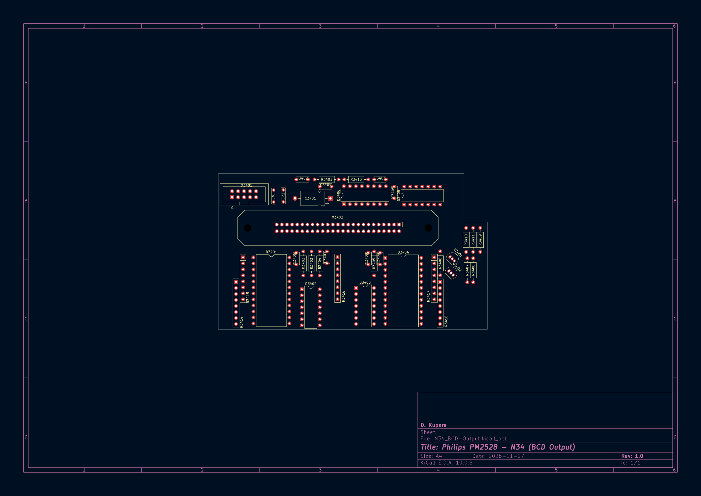
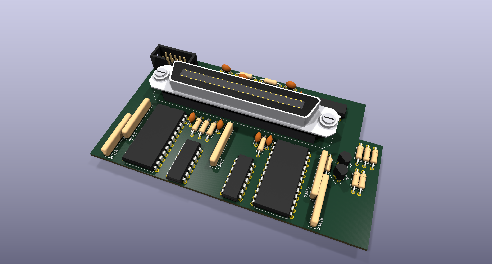

# BCD Output (Expansionboard N34) · PCB
N34 › [Overview](README.md) · [Operation](Operation.md) · [Schematics](Schematics.md) · **PCB**

The board as I redrew it in KiCad, using the component layout in the Philips documentation (Fig. 7.44) as a reference. The parts are placed as on that drawing; the tracks aren't drawn.

## Layout

## 3D view

> [!NOTE]
> The 50-pin BCD socket X3402 has a custom footprint and 3D model, drawn from the layout and the connector figure in the owner's manual. The contact pitch (2.16 mm) is the standard one for this type of D-shell socket; the row spacing is an assumption until I can measure a real board.

---
N34 › [Overview](README.md) · [Operation](Operation.md) · [Schematics](Schematics.md) · **PCB**
