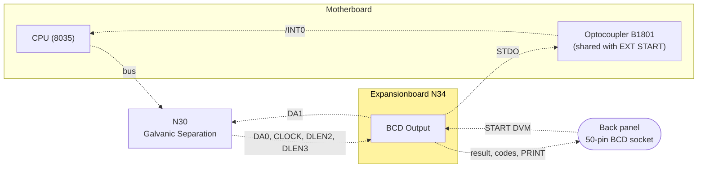

# BCD Output (Expansionboard N34)
N34 › **Overview** · [Operation](Operation.md) · [Schematics](Schematics.md) · [PCB](PCB.md)

This expansion board puts the complete reading on a 50-pin socket at the back of the PM2528, in parallel BCD: six digits, the range, the function and the polarity. After every reading it sends a PRINT pulse, so a printer or a data logger knows when to take the data. In return, that device can start a measurement with START DVM. Philips sold it as option PM9292, together with the galvanic separation N30.

## Functions
- Receiving the reading from the CPU over the serial bus (DA0, CLOCK, DLEN2 and DLEN3), in two 16-bit words
- Holding the digits and codes in two SAA1060 latches
- Building digit 10⁵, with overload coded as 1010
- Driving all outputs as open collector with 8k2 pull-ups to +5 V or an external +12…+15 V
- A PRINT pulse of about 900 µs after every reading
- START DVM: an external start command, passed to the CPU as an interrupt (STDO)

The board sits on the outguard side: its data, clock and supply come through the galvanic separation (N30), so the BCD output floats with the outguard ground, not with the input terminals.

## Signal flow
N34 receives the reading from the CPU through N30 and puts it on the back panel. The start command takes its own route back to the CPU.

## Connectors
N34 has no edge connector. It's connected by a 10-way flat cable (X3401), and the 50-pin BCD socket (X3402) is mounted on the board itself.

🟦 signal · 🟧 supply / zero · ⬛ not connected

### X3401: flat cable to the motherboard (X1901)
The flat cable goes to X1901 on the motherboard, which is wired to the option bus of the N30 socket. The IEC board N32 uses the same cable and pin numbering; the two boards are alternatives: PM9291 (IEC) or PM9292 (BCD).

| Pin | Name | I/O | Description | Connected to |
| -: | - | :-: | - | - |
| 1 | 🟦 **DA1** | O | Serial data to the CPU: low after a START DVM | N30 (via X1901) |
| 2 | 🟦 **DLEN3** | I | Selects D3401 (high digits and codes); its falling edge starts PRINT | N30 (via X1901) |
| 3 | 🟦 **DA0** | I | Serial data from the CPU | N30 (via X1901) |
| 4 | 🟦 **DLEN2** | I | Selects D3404 (low digits); also clears the START DVM latch | N30 (via X1901) |
| 5 | 🟦 **CLOCK** | I | Serial clock | N30 (via X1901) |
| 6 | ⬛ - |  | Not connected |  |
| 7 | ⬛ - |  | Not connected |  |
| 8 | 🟦 **STDO** | O | Start request: drives the LED of optocoupler B1801 | Mainboard: B1801 pin 1 (shared with EXT START) |
| 9 | 🟧 **0V** |  | Outguard zero (GNDOG) | Mainboard |
| 10 | 🟧 **+5V** |  | Outguard supply (+5VOG) | Mainboard |

### X3402: BCD socket (back panel)
50-way D-shell, two rows. The layout comes from the owner's manual (3.5, Fig. 9) and matches the schematic. "1" = high (positive BCD).

| Pins (bit 1, 2, 4, 8) | Name | I/O | Description |
| - | - | :-: | - |
| 1, 2, 26, 27 | 🟦 **10⁰** | O | Result, least significant digit |
| 3, 4, 28, 29 | 🟦 **10¹** | O | Result |
| 5, 6, 30, 31 | 🟦 **10²** | O | Result |
| 7, 8, 32, 33 | 🟦 **10³** | O | Result |
| 9, 10, 34, 35 | 🟦 **10⁴** | O | Result |
| 11, 12, 36, 37 | 🟦 **10⁵** | O | Result, most significant digit: 0, 1, 2, or 1010 for overload. Bit 4 (pin 36) is always 0 |
| 13, 14, 38, 39 | 🟦 **RANGE CODE** | O | 9 minus the range number |
| 15, 16, 40, 41 | 🟦 **POLARITY** | O | 1011 = +, 1101 = −, 1111 = none. Bits 1 and 8 are tied to +5 V |
| 17, 18, 42, 43 | 🟦 **FUNCTION CODE** | O | 0 to 7. Bit 8 (pin 43) is always 0 |
| 46 | 🟦 **START DVM** | I | Start a measurement: a low pulse of 15 µs to 100 ms |
| 48 | 🟦 **PRINT** | O | About 900 µs low after every reading |
| 49 | 🟧 **+12…+15V** | I | External supply for the output high level (jumper JP2) |
| 50 | 🟧 **0V** |  | Outguard zero |
| 19-25, 44, 45, 47 | ⬛ - |  | Not connected |

> [!NOTE]
> The owner's manual shows pin 49 as the only supply input; pin 23 is not connected.
> One Philips page shows STDO on X1901 pin 7 instead of 8; the N34 drawing and my motherboard sheet use pin 8. I still have to beep it.
> The Philips parts list calls the BCD socket X3401. On the component layout and on my schematic it's X3402, and X3401 is the flat cable connector.

## More about this board
- [Operation](Operation.md): a reading transfer step by step, all codes, PRINT and START DVM
- [Schematics](Schematics.md): the full schematic, internal signals and the sections
- [PCB](PCB.md): the board layout and 3D view

_N34 has no relays or analog switches._

---
N34 › **Overview** · [Operation](Operation.md) · [Schematics](Schematics.md) · [PCB](PCB.md)
