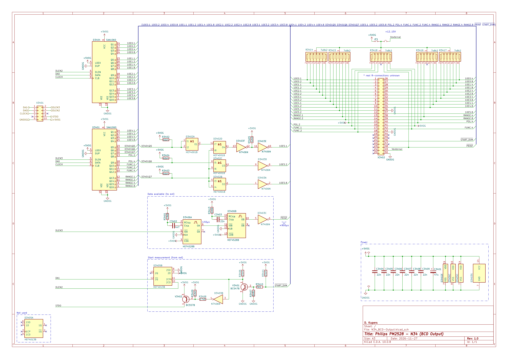
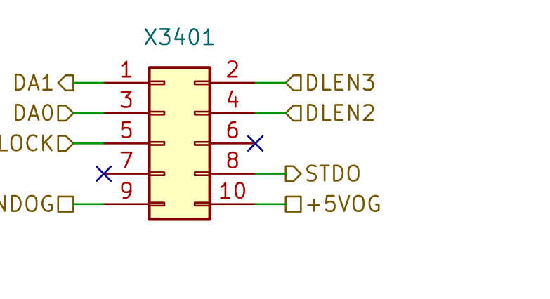
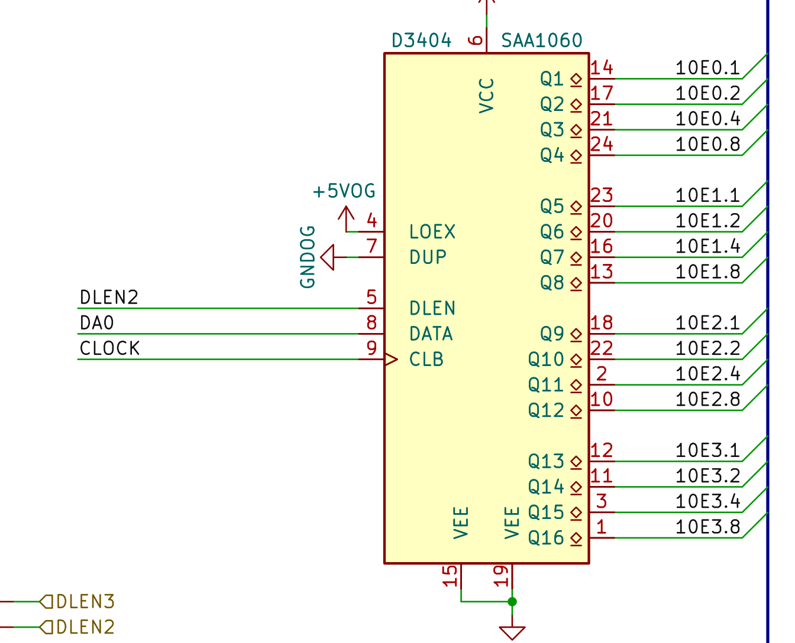
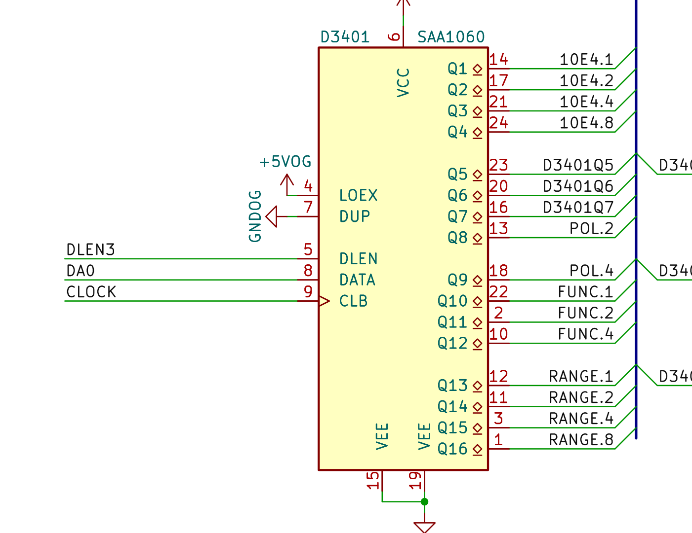
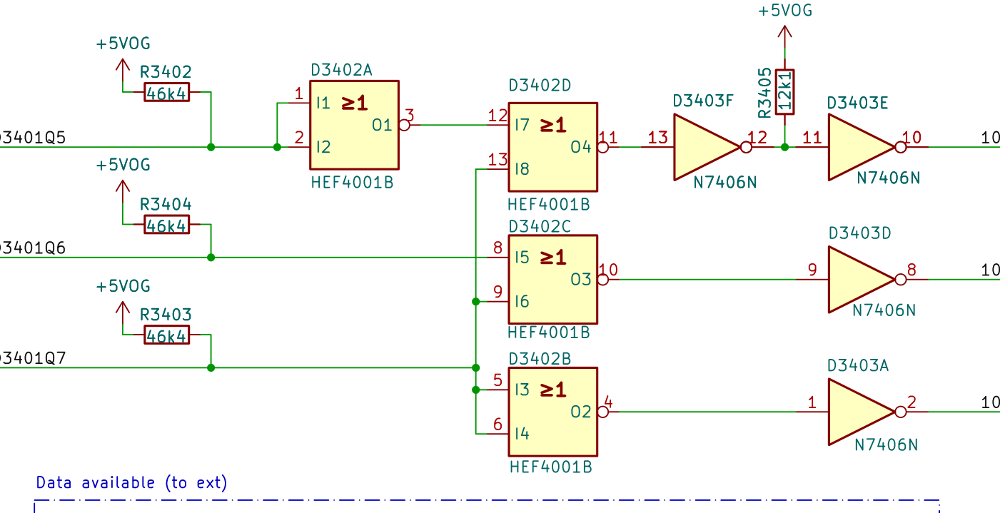
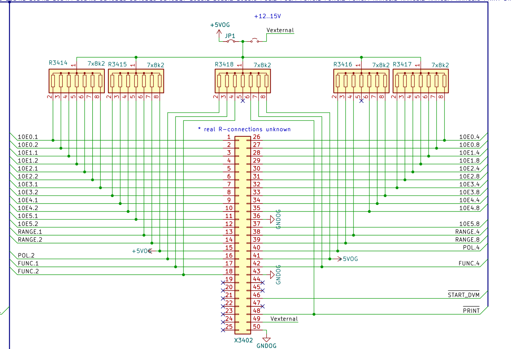
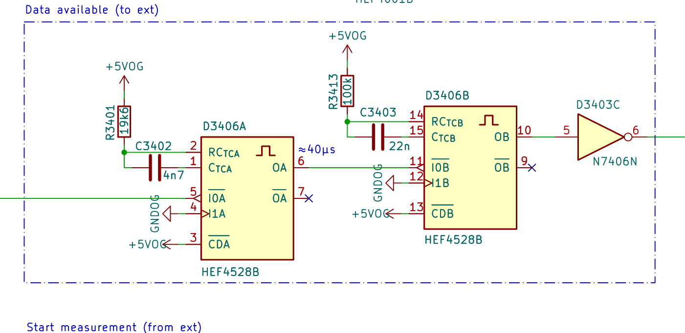
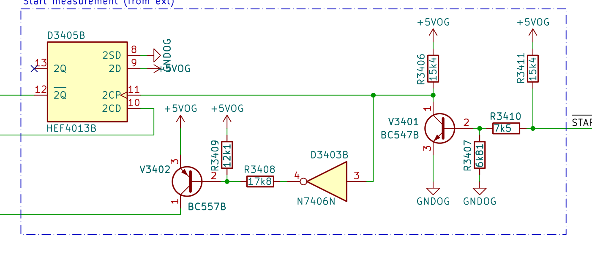
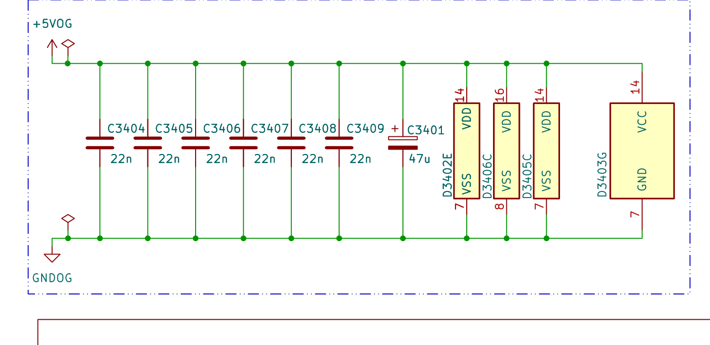

# BCD Output (Expansionboard N34) · Schematics
N34 › [Overview](README.md) · [Operation](Operation.md) · **Schematics** · [PCB](PCB.md)

I drew this schematic in KiCad from the low‑res Philips docs (Fig. 7.46, with the parts list 6.2.5). I don't have the board, so it follows the drawing; the few places where I had to guess are noted below. You’ll find the KiCad files in other parts of this repo.

## Full schematic

## Internal signals
The signals on the connectors are listed on the [overview page](README.md#connectors). These are the local ones.

| Name | Description |
| - | - |
| **10E0.1 … 10E5.8** | Result digits 10⁰ to 10⁵, bits 1, 2, 4, 8 |
| **POL.x, FUNC.x, RANGE.x** | Polarity, function code and range code bits |
| **D3401Q5-Q7** | D5 bit 0, D5 bit 1 and the overload flag, into the 10⁵ logic |
| **Vc** | High level of the outputs: +5 V (JP1) or the external supply on pin 49 (JP2) |
| **Vexternal** | External +12…+15 V from socket pin 49 |

## Sections
### Cable connector
X3401 is the flat cable to X1901 on the motherboard. It brings the serial bus from N30 (DA0, CLOCK, DLEN2, DLEN3), returns DA1, and passes STDO to the start optocoupler B1801. It also carries the outguard supply (+5VOG, GNDOG); the whole board runs on it.

### Low digits
D3404 (SAA1060) takes the DLEN2 word. DUP (pin 7) is tied low, which selects latch A, and LOEX (pin 4) high, which gives static outputs. Q1-Q16 hold digits 10⁰ to 10³, in groups of four.

### High digits and codes
D3401 (SAA1060) takes the DLEN3 word, wired the same way. Q1-Q4 are digit 10⁴, Q5-Q7 go to the 10⁵ logic, Q8 and Q9 are the polarity bits 2 and 4, Q10-Q12 the function code and Q13-Q16 the range code.

### Digit 10⁵
R3402-R3404 pull Q5-Q7 up for the CMOS gates. The NOR gates of D3402 (HEF4001B) combine D5 with the overload flag:
- D3402A inverts D5 bit 0, D3402D blocks it during overload, and the two inverters D3403F/E (with pull-up R3405 between them) make bit 1.
- D3402C and D3403D make bit 2 = D5 bit 1 OR overload.
- D3402B and D3403A make bit 8 = overload.

The result is 0, 1 or 2, and 1010 on overload. The 7406 inverters (open collector) also shift the level to Vc.

### Output stage
The five resistor networks R3414-R3418 (7 × 8k2, common pin to Vc) pull up the open-collector outputs. JP1 connects Vc to +5 V, JP2 to the external supply on pin 49. Polarity bits 1 and 8 go straight to +5 V, function bit 8 and 10⁵ bit 4 to zero.

> [!NOTE]
> Fig. 7.46 draws one "8k2 to Vc" per group and doesn't say which network pin goes to which output, so the network pins on my schematic are a guess. Also, the drawing shows no pull-up on 10⁵ bits 2 and 8 (pins 12 and 37), although they are open-collector outputs. These will be checked on a real board.

### PRINT
D3406 (HEF4528B) holds two monostables. The falling edge of DLEN3 at the end of the transfer triggers D3406A (R3401 19k6, C3402 4n7: about 40 µs). Its falling output triggers D3406B (R3413 100k, C3403 22n: about 900 µs). D3403C inverts that into the negative PRINT pulse on pin 48.

### START DVM
R3411, R3410 and R3407 feed the START DVM input to the base of V3401 (BC547B). A low input switches V3401 off; its collector (pulled up by R3406) then rises:
- it clocks D3405B (HEF4013B, D = 1), whose ~Q pulls DA1 low until DLEN2 clears it;
- through D3403B and R3408 it switches on V3402 (BC557B), which drives STDO into optocoupler B1801 on the motherboard.

The other half of D3405 (D3405A) isn't used.

### Power
C3401 (47 µF) and C3404-C3409 (22 nF) decouple the outguard +5 V at the ICs.

---
N34 › [Overview](README.md) · [Operation](Operation.md) · **Schematics** · [PCB](PCB.md)
